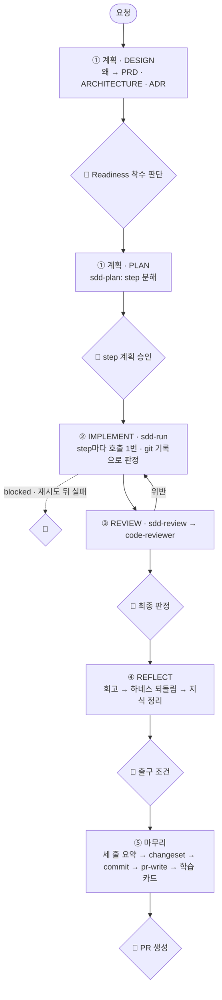

# claude-harness

레포에서 AI와 일하는 방식을 까는 Claude Code 플러그인이다. 기능 · 버그 작업을 계획 → 구현 → 리뷰 → 회고 → 마무리로 잇고, 정해 둔 곳에서만 사람에게 묻는다.

A Korean-language Claude Code plugin that sets up a spec-first workflow (plan → implement → review → reflect → ship) in your repo.

[](docs/changes/)
[](https://github.com/jtwjs/claude-harness/actions/workflows/ci.yml)
[](LICENSE)

```bash
/plugin marketplace add jtwjs/claude-harness
/plugin install claude-harness@jtwjs-plugins
/plugin install claude-md-management@claude-plugins-official   # 선택. REFLECT의 세션 학습 회수
```

대상 레포에서 `/harness-init`을 한 번 돌리고(새 프로젝트는 `/project-new`), 그다음부터는 "~기능 추가해줘"처럼 말하거나 `/sdd`로 시작한다.



`sdd`가 이 흐름을 이어 돌리고, 단계마다 정해 둔 🙋에서만 멈춘다. 🙋 자리의 정본은 [`skills/sdd/SKILL.md`](skills/sdd/SKILL.md) 「단계 → 스킬 · 체크포인트」 표다.

필요한 것: git · python3(없으면 훅 10개가 꺼진다 — 경고를 내는 건 `block-dangerous-bash` 하나뿐) · (선택) gh · (선택) claude-md-management.

## 왜 만들었나

| 문제 | 하네스가 하는 일 | 확인 장치 |
|---|---|---|
| AI가 빈칸을 추측으로 채운다 | 스펙(PRD · 수용 조건)을 먼저 세우고 step으로 쪼갠다 | 수용 조건이 실행 가능한 명령이다 |
| "됐다"는 말과 실제 동작이 다르다 | tdd를 켠 step은 테스트 먼저, 러너가 git 기록으로 확인한다 | 테스트 커밋이 먼저 · 그 시점에 실패 · 뒤에 테스트 파일 무변경 |
| 위험한 명령 · 짝 테스트 없는 구현이 섞인다 | 훅이 막거나 알린다 | 아래 훅 표 · `hooks/test.sh` · CI |

## 무엇이 들었나

스킬 25개(자동 입구 8 · 나머지는 `/이름` 또는 `sdd`가 경로로 읽음) · 에이전트 5개 · 훅 11개.

| 종류 | 이름 | 언제 | 부르는 법 |
|---|---|---|---|
| 자동 입구 | [`sdd`](skills/sdd/SKILL.md) | 기능을 만들거나 버그를 고칠 때(PRD 없는 막연한 과제 포함) | 자동 · `/sdd` |
| 자동 입구 | [`why`](skills/why/SKILL.md) | 이유가 흐리거나 주장 · 결정의 근거를 따질 때 | 자동 · `/why` |
| 자동 입구 | [`how`](skills/how/SKILL.md) | 코드가 어떻게 도는지 · 새 코드를 어느 레이어에 둘지 물을 때 | 자동 · `/how` |
| 자동 입구 | [`conductor`](skills/conductor/SKILL.md) | 병렬 트랙(worktree 세션 2개 이상)의 지휘를 맡길 때 | 자동 · `/conductor` |
| 자동 입구 | [`slack-writing`](skills/slack-writing/SKILL.md) | 슬랙 · DM 메시지를 쓰거나 다듬을 때 | 자동 · `/slack-writing` |
| 자동 입구 | [`notion-writing`](skills/notion-writing/SKILL.md) | 조직에 공유할 문서(제안 · 보고 · 기획)를 쓸 때 | 자동 · `/notion-writing` |
| 자동 입구 | [`commit`](skills/commit/SKILL.md) | 커밋을 시킬 때 | 자동 · `/commit` |
| 자동 입구 | [`pr-write`](skills/pr-write/SKILL.md) | PR을 올려 달라고 할 때 | 자동 · `/pr-write` |
| 단계 | [`sdd-plan`](skills/sdd-plan/SKILL.md) | 설계가 끝나 step 계획을 세울 때 | `sdd`가 경로로 · `/sdd-plan` |
| 단계 | [`sdd-run`](skills/sdd-run/SKILL.md) | step 계획을 구현할 때(사람이 없으면 헤드리스) | `sdd`가 경로로 · `/sdd-run` |
| 단계 | [`sdd-review`](skills/sdd-review/SKILL.md) | 구현 뒤 머지 · 커밋 전에 diff를 대조할 때 | `sdd`가 경로로 · `/sdd-review` |
| 단계 | [`design-brief`](skills/design-brief/SKILL.md) | 화면이 있는 기능에서 시안을 그리기 직전 | `sdd`가 경로로 · `/design-brief` |
| 단계 | [`design-critique`](skills/design-critique/SKILL.md) | 시안을 구현 전에 평가할 때 | `sdd`가 경로로 · `/design-critique` |
| 단계 | [`design-reconcile`](skills/design-reconcile/SKILL.md) | 구현 화면을 시안과 대조할 때 | `sdd`가 경로로 · `/design-reconcile` |
| 단계 | [`changeset`](skills/changeset/SKILL.md) | 릴리스 도구가 changesets이고 사용자 영향이 있을 때 | `sdd` · `commit`이 경로로 · `/changeset` |
| 단계 | [`harness-gaps`](skills/harness-gaps/SKILL.md) | 같은 지시 · 같은 교정이 반복될 때(3회부터 후보) | `sdd` REFLECT가 경로로 · `/harness-gaps` |
| 단계 | [`explain`](skills/explain/SKILL.md) | 변경 하나를 어떻게 · 왜로 풀어 설명받을 때 | `sdd` 마무리가 경로로 · `/explain` |
| 슬래시 입구 | [`harness-init`](skills/harness-init/SKILL.md) | 레포에 하네스를 처음 깔거나 업그레이드할 때 | `/harness-init` |
| 슬래시 입구 | [`project-new`](skills/project-new/SKILL.md) | stack-kits 보일러플레이트로 새 레포를 만들 때 | `/project-new` |
| 슬래시 입구 | [`harness-doctor`](skills/harness-doctor/SKILL.md) | 깔린 하네스가 썩었는지 점검할 때 | `/harness-doctor` |
| 슬래시 입구 | [`harness-score`](skills/harness-score/SKILL.md) | 레포가 AI와 일하기 좋은지 점수를 매길 때 | `/harness-score` |
| 슬래시 입구 | [`no-comments`](skills/no-comments/SKILL.md) | 주석을 걷고 구조 · 검사로 옮길 때 | `/no-comments` |
| 슬래시 입구 | [`statechart`](skills/statechart/SKILL.md) | 상태가 바뀌는 시스템을 TLA+로 검사하고 그림으로 볼 때 | `/statechart` |
| 슬래시 입구 | [`reframe`](skills/reframe/SKILL.md) | 만드는 것을 그 분야 전문가의 말로 다시 볼 때 | `/reframe` |
| 슬래시 입구 | [`sharpen`](skills/sharpen/SKILL.md) | 과제를 크게가 아니라 깊게 다시 쓸 때 | `/sharpen` |

| 에이전트 | 언제 |
|---|---|
| [`test-writer`](agents/test-writer.md) | 사람이 TDD를 엄격하게 할 때, 수용 조건을 실패하는 테스트로(러너는 안 부름) |
| [`feature-builder`](agents/feature-builder.md) | 실패하는 테스트를 통과시키거나 합의한 작은 수정을 할 때(러너는 안 부름) |
| [`code-reviewer`](agents/code-reviewer.md) | `sdd-review`가 넘기거나 체크리스트 밖 판단이 필요할 때 |
| [`root-cause-debugger`](agents/root-cause-debugger.md) | 원인 모를 버그 · 간헐적 실패의 근본 원인을 찾을 때 |
| [`comment-hunter`](agents/comment-hunter.md) | `/no-comments`가 범위 안 주석을 걷을 때만 |

SDD 러너는 [`skills/sdd-run/scripts/sdd_runner.py`](skills/sdd-run/scripts/sdd_runner.py)다(설계 [`docs/sdd-runner.md`](docs/sdd-runner.md)).

<details>
<summary>훅 11개 — 막는 것 / 알리기만</summary>

| 훅 | 언제 | 막는 것 / 알리기만 |
|---|---|---|
| [`block-dangerous-bash`](hooks/block-dangerous-bash.sh) | Bash 전 | 막는 것 — 사고 패턴([`deny-patterns.yaml`](hooks/deny-patterns.yaml)) · owner별 gh 쓰기 계정 · `gh pr merge`는 사람 확인 · 운영 DB 조회 밖 SQL(`guard.prodDb`를 적은 레포) |
| [`tdd-guard`](hooks/tdd-guard.sh) | Write/Edit 전 | 막는 것 — 짝 테스트 없는 구현 파일(`harness.json` `tdd.include` · `tdd.exclude`) |
| [`loop-lock`](hooks/loop-lock.sh) | Bash 뒤(성공 · 실패) | 막는 것 — 코드가 그대로인 채 같은 검증 명령을 거듭 돌리면 멈춤 신호 |
| [`todo-warn`](hooks/todo-warn.sh) | Bash 전(git commit) | 알리기만 — 새로 들어간 TODO · FIXME |
| [`auto-format`](hooks/auto-format.sh) | Write/Edit 뒤 | 알리기만 — 바뀐 파일 포맷(실패해도 막지 않음) |
| [`cadence-reminder`](hooks/cadence-reminder.sh) | 세션 시작 | 알리기만 — 회고 · 점검 주기 |
| [`weekly-readiness-check`](hooks/weekly-readiness-check.sh) | 세션 시작 | 알리기만 — AI-Readiness 점수가 떨어졌을 때 |
| [`prod-db-check`](hooks/prod-db-check.sh) | 세션 시작 | 알리기만 — `guard.prodDb`를 적었는데 운영 DB 주소를 못 읽을 때 |
| [`conductor-context`](hooks/conductor-context.sh) | 세션 시작 | 알리기만 — 지휘 자리에서 트랙 현황 · 열린 지휘 이슈 |
| [`hypothesis-gate`](hooks/hypothesis-gate.sh) | 프롬프트 제출 | 알리기만 — 판정 지시를 컨텍스트에 넣는다(프롬프트를 막지 않음) |
| [`validate-session-end`](hooks/validate-session-end.sh) | 응답 끝(Stop) | 알리기만 — `harness.json` `verify`를 읽기 전용으로 돌려 상태 보고 |

</details>

## 설치하면 생기는 것

`/harness-init`이 대상 레포에 남기는 것(템플릿은 [`templates/`](templates/)):

| 자리 | 담는 것 |
|---|---|
| `CLAUDE.md` | 항상 읽히는 짧은 지침 — 절대 금기 · 검증 명령 · 링크 |
| `.claude/harness.json` | 정본 설정 — 검증 명령 · TDD 범위 · 기준 브랜치 · 릴리스 도구 |
| `.claude/rules/` · `.claude/references/` | 경로에 걸릴 때 읽히는 판정 규칙 / 필요할 때 여는 고치는 법 |
| `.claude/README.md` · `.claude/observations.md` | 상황별로 무엇을 부를지 / 반복을 세는 계수기 |
| `.github/` | CI 워크플로 · PR 템플릿 · Dependabot(레포에 없을 때만) |
| `docs/{feature-YYYY-MM-DD}/` · `phases/{task}/` | 기능마다 PRD · ARCHITECTURE · ADR / step 계획과 기록 |

레포 밖 설정(있을 때만 읽는다):

| 파일 | 하는 일 |
|---|---|
| `~/.claude/gh-accounts.txt` | `owner 계정` 한 줄 — 그 owner 레포에 이슈 · PR · 릴리스를 쓰는 gh 명령은 그 계정일 때만 통과 |
| `~/.claude/conductor.json` | 지휘 자리 · 대상 레포 목록(`conductor`, `conductor-context`) |
| `~/.claude/hypothesis-gate.json` · `~/.claude/hypothesis-ledger.jsonl` | `hypothesis-gate`의 기준 횟수 / 판정 기록(추가만) |

모든 레포에서 도는 훅: `block-dangerous-bash`(운영 DB 가드만 `harness.json`이 있을 때) · `hypothesis-gate` · `conductor-context`(지휘 자리일 때만 출력).

`.claude/harness.json`이 있는 레포에서만 도는 훅: `tdd-guard` · `loop-lock` · `todo-warn` · `auto-format` · `cadence-reminder` · `weekly-readiness-check` · `prod-db-check` · `validate-session-end`.

개인 작업 방식을 기준으로 만든 하네스라 필요한 것만 골라 쓰길 권한다.

## 원칙

입구 스킬은 판단 전에 원칙 목차를 읽고, 쓰는 원칙은 원문을 읽는다 — 목록은 [`docs/principles/INDEX.md`](docs/principles/INDEX.md).

## 업데이트 · 끄기

```bash
claude plugin marketplace update jtwjs-plugins && claude plugin update claude-harness@jtwjs-plugins   # 업데이트 뒤 대상 레포에서 /harness-init(업그레이드 모드)
claude plugin disable claude-harness@jtwjs-plugins                                                        # 플러그인 전체 끄기
```

한 레포에서만 끄려면 그 레포의 `.claude/harness.json`을 치운다 — 위 「`.claude/harness.json`이 있는 레포에서만 도는 훅」이 멈춘다.

## 더 보기

- 변경 이력: [`docs/changes/`](docs/changes/) · 설계 근거: [`docs/design-notes.md`](docs/design-notes.md)
- 함께 쓰는 레포: [claude-dotfiles](https://github.com/jtwjs/claude-dotfiles)(맥의 `~/.claude` 설정 · 플러그인 자동 설치) · [stack-kits](https://github.com/jtwjs/stack-kits)(`/project-new`가 쓰는 코드 뼈대)
- 가져온 것: `how` · `no-comments`(+ `comment-hunter`) · `reframe` · `sharpen` · `statechart`는 PStack(MIT)을 고쳐 썼다. 저작권 표기는 각 SKILL.md 끝에 있다.

<details>
<summary>관리자용</summary>

```bash
bash hooks/test.sh             # 훅 회귀 + SDD 러너 단위 테스트(CI도 같은 명령)
scripts/release.sh --dry-run   # 할 일만 보여 준다
scripts/release.sh             # push → 마켓플레이스 · 플러그인 갱신 → 설치본 확인
```

사전 확인(main, 깨끗한 트리, plugin.json · marketplace.json 버전 일치, `hooks/test.sh` 통과)이 하나라도 어긋나면 아무것도 바꾸지 않고 멈춘다.

</details>
