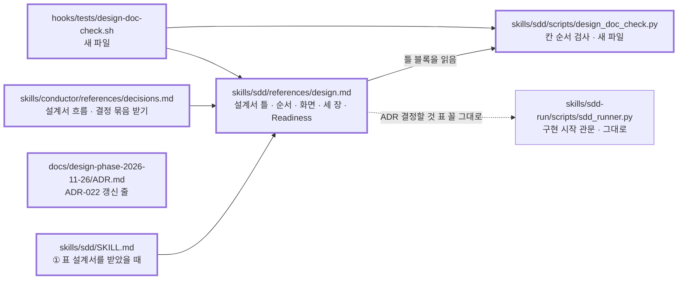
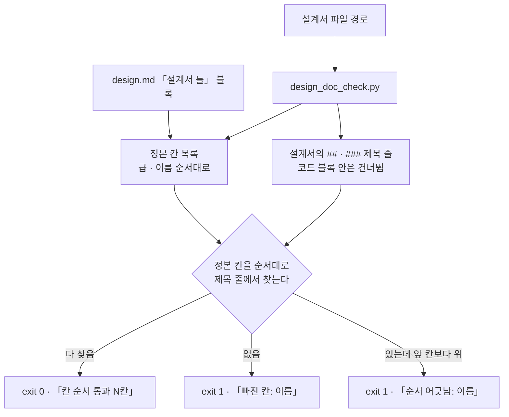

# ARCHITECTURE — design-doc-format

> PRD: [PRD.md](PRD.md). ADR: 새 ADR 없음(아래 「ADR 판정」), ADR-022에 갱신 줄. 줄 번호는 4426325 기준이다.
> 이 문서도 새 규칙을 미리 써 본다. 줄 끝 `(← 칸 이름)`은 설계 문서 칸, `(← 검증 세션)`은 설계서에 없어 이 세션이 코드 사실로 쓴 줄이다.

## 바뀌는 층

스킬 문서(규칙)와 작은 검사 스크립트 하나, 그 테스트만 바뀐다. 러너(`skills/sdd-run/**`)는 바뀌지 않는다 (← 검증 세션)



| 자리 | 지금 | 바뀜 |
|---|---|---|
| 설계서 틀(`design.md:88-100`) | 8칸(핵심 요구사항 한 줄 요약 · 결정할 것 / 결정한 것 · 사용자 흐름 · 기능 · 비기능 · 제약 · 가정 · 수용 기준) | 간단히(1~5 + 우리 칸) · 자세히(6~9) · 아주 자세히(10~12), 칸마다 한 줄 안내. 칸 순서 검사가 이 블록을 정본으로 읽는다(결정 D2) (← 목표와 비목표) |
| 설계서 순서 그림 · 3 보강 · 4 재검토(`design.md:51-69`) | 3 「구조 · 기술 결정은 여기서 묻지 않는다」 · 결정 묶음 답 → 「결정한 것」 칸 | 3: 큰 방향(구조 상자 · 큰 선택)은 「열린 질문과 누가 정하나」에 올려 묻고, 코드 근거가 필요한 선택은 결정 묶음으로. 답 → 「고른 안과 버린 안」. ARCHITECTURE · ADR 뒤 지휘가 아주 자세히 3칸을 다시 써서 붙인다 (← 상황별 동작) |
| 화면(`design.md:71-81`) | 열기 규칙만 | 열기 전에 칸 순서 검사를 돌린다. 실패면 열지 않고 고친다. 질문 블록 자리는 「열린 질문과 누가 정하나」 (← 상황별 동작) |
| 설계서와 세 장(`design.md:83-86`) | PRD = 설계서 원문 + 에이전트 칸 | PRD를 일곱 칸(한 줄 요약 · 문제 · 목표와 비목표 · 상황별 동작 · 제약 · 가정 · 사람이 볼 것)에서 뽑는다. 세 장 줄마다 출처 칸(결정 D4). 설계서에 없는 말은 결정 묶음 (← 상황별 동작) |
| 끝 · 설계문서 3장 · Readiness(`design.md:111-160`) | PRD 정의 「설계서 원문 + 에이전트 칸」 · ADR 「설계서 결정 번호」 · Readiness 9 · 10 옛 칸 이름 | PRD 정의는 「설계서와 세 장」을 가리킨다. ARCHITECTURE 정의에 불변 규칙 · 코드 지도 · 요청 하나 따라가기 · 배포와 롤백. ADR 정의의 「설계서 결정 번호」 → 설계 문서 「고른 안과 버린 안」 행 링크. Readiness 9 · 10을 새 칸 이름 · 출처 칸으로 (← 목표와 비목표) |
| ① 표 PRD 줄(`SKILL.md:43`) | PRD(설계서 원문 + 에이전트 칸 …) | PRD(설계서 칸에서 뽑고 줄마다 출처 칸, `design.md` 「설계서와 세 장」) (← 목표와 비목표) |
| 지휘 설계서 흐름(`decisions.md:12,14`) | 답 → 설계서 「결정한 것」 칸 | 답 → 「고른 안과 버린 안」. 아주 자세히 3칸은 ARCHITECTURE · ADR 뒤 지휘가 채운다(한 구절, 순서 정본은 `design.md`) (← 상황별 동작) |
| ADR-022 「대체 · 갱신」 아래(`ADR.md:10-14`) | — | 「갱신 (2026-11-28, #87)」 줄: D2 설계서 틀 · 순서 3 · 「설계서와 세 장」 (← 목표와 비목표) |

안 바뀌는 곳: `templates/.claude/references/track-brief.md`(옛 칸 이름을 가리키는 줄 0, `git grep` 확인함) · `skills/conductor/references/seat.md` · `dispatch.md`(설계서 칸 이름 없음) · 날짜 폴더 문서 · `phases/design-flow/**`(그 시점의 기록) · `skills/sdd-run/scripts/test_sdd_runner.py:1177`(러너 테스트 입력의 옛 제목, #91 트랙 범위) (← 검증 세션)

## 데이터 흐름 — 요청 하나 따라가기 (칸 순서 검사)



- 명령: `python3 ${CLAUDE_PLUGIN_ROOT}/skills/sdd/scripts/design_doc_check.py <설계서.md>` (← 상황별 동작)
- 정본 칸 목록은 `design.md` 「설계서 틀」 코드 블록의 `##` · `###` 제목 줄이다. 스크립트는 자기 위치 기준 `../references/design.md`를 읽는다. 블록은 「**설계서 틀**」 줄 다음 첫 ```` ```markdown ```` 블록이다(결정 D2) (← 검증 세션)
- 칸 맞춤: 제목 급이 같고, 번호(`1.`)를 뗀 제목이 정본 이름으로 시작하면 맞는다. `### 우리 칸 (원본 포맷에 없고 …)`처럼 뒤에 덧붙인 말은 괜찮다. 정본에 없는 제목(예: `## 들은 것 · 빈칸`, 상세 설계 아래 `####`)은 건너뛴다(결정 D3) (← 검증 세션)
- 설계서 파일을 못 읽거나 틀 블록을 못 찾으면 exit 2로 끝난다. 빠짐 · 순서(exit 1)와 가른다 (← 검증 세션)
- 내용은 보지 않는다. 아주 자세히 3칸은 제목만 있어도 통과한다 (← 상황별 동작)
- 오류 출력은 칸 이름을 그대로 쓴다. 사람이 무엇을 고칠지 바로 안다 (← 검증 세션)

## 결정할 것

구조 · 기술 결정. 설계서가 검증 세션에 맡긴 자리(검사 자리 · 출처 칸 꼴)와 설계서 사이 틈이다. 열린 것 0(2026-11-28 지휘 결정 묶음 1회차 회신: D1~D5 모두 A). D2에 따라 지휘가 설계서 5 트레이드오프를 「잃는 것: 틀 코드 블록 꼴이 검사의 계약이 된다」로 바꾼다. D5에 따라 지휘가 지휘 자리 설계서에 아주 자세히 3칸 제목을 더한다 (← 검증 세션)

| # | 정할 것 | 선택지 | 추천 | 주체 |
|---|---|---|---|---|
| D1 | 칸 순서 검사를 어디에 · 무엇으로 두나 | A `skills/sdd/scripts/design_doc_check.py`(python3 표준 라이브러리) + `hooks/tests/design-doc-check.sh` / B 셸 스크립트 `hooks/lib/` / C `skills/conductor/scripts/` | A || 지휘 판정(사용자 반려 가능, 2026-11-28) |
| D2 | 정본 칸 목록을 어디서 읽나 | A `design.md` 「설계서 틀」 블록을 스크립트가 읽는다(정본 하나) / B 스크립트에 목록을 박고, 테스트가 틀 블록과 같은지 대조한다 | A || 지휘 판정(사용자 반려 가능, 2026-11-28) |
| D3 | 칸 맞춤 규칙 | A 급 + 번호 뗀 제목이 정본 이름으로 시작 · 정본 밖 제목은 건너뜀 / B 제목 전체가 정본과 똑같고 다른 제목이 끼면 실패 | A || 지휘 판정(사용자 반려 가능, 2026-11-28) |
| D4 | 세 장 줄마다 출처 칸 꼴 | A 줄 끝 `(← 칸 이름)`, `👤`가 있으면 그 앞 / B 마크다운 링크(앵커) / C 절 머리에 한 번만 | A || 지휘 판정(사용자 반려 가능, 2026-11-28) |
| R1 | ADR 「설계 문서 링크」 칸 · Readiness 10이 비공개 설계서로 가는 행 링크를 요구한다(REVIEW 1회차 code-reviewer 🟡2) | A 「고른 안과 버린 안」 행의 주제 이름으로 가리킨다 / B 링크 그대로 | A | 지휘 판정(사용자 반려 가능, 2026-11-28) |
| R2 | PRD 뽑는 7칸에 사용자 흐름 · 비기능 출처가 없다(REVIEW 1회차 code-reviewer 🟡4) | A 우리 칸에 비기능 수치 · PRD 출처 칸 8칸(전체 구조 추가, 사용자 흐름은 전체 구조 · 상황별 동작에서) / B 공통 관심사를 PRD 출처에 / C 그대로 | A | 사용자(AI 추천 수용, 2026-11-28) |
| D5 | 지금 승인된 설계서는 아주 자세히 3칸 제목이 없다(`## 아주 자세히` 아래 설명 한 줄뿐). 칸 순서 검사가 실패한다 | A 틀 그대로 — 3칸 제목은 있어야 한다. 그 설계서는 지휘가 제목 세 줄을 더하면 통과 / B `## 아주 자세히`만 있으면 3칸 제목이 없어도 통과 | A || 지휘 판정(사용자 반려 가능, 2026-11-28) |

## 지키는 것 — 불변 규칙

- ADR 「결정할 것」 표 머리 · 주체 칸 꼴과 PRD 「→ 결정:」 · 「막지 않음:」 꼴을 바꾸지 않는다. 러너 `open_decisions`(`sdd_runner.py:168-215`)가 읽는다. 러너 단위 테스트로 확인한다 (← 검증 세션, 트랙 지시문)
- 출처 칸 꼴 `(← …)`은 러너가 읽는 표시(「→ 결정:」)와 겹치지 않는다. 화살표 방향이 반대다 (← 검증 세션)
- `design.md` 「설계서 틀」 블록은 칸 순서 검사가 읽는 계약이다. 블록 앞 「**설계서 틀**」 줄과 ```` ```markdown ```` 울타리를 바꾸면 검사가 크게 실패한다(exit 2 · 「틀 블록을 못 찾음」). 정본 칸이 0개로 읽혀 아무 설계서나 통과하는 일이 없게 테스트가 지킨다(지휘 회신 D2) (← 검증 세션)
- 공개 레포라 틀 예시는 일반화한다. 사람 · 회사 이름 · 개인 경로 · 개인 기록 문구를 넣지 않는다 (← 제약)
- 칸을 옮길 때 그 칸에만 있던 안내 줄(예: 👤 기준)이 같이 옮겨졌는지 대조한다. 옛 틀 「수용 기준」(위험 큰 기능만 Given · When · Then)은 새 틀 「상황별 동작」 안내로, 「비기능」(숫자로)은 「공통 관심사」 · 「가정」 안내로 간다 (← 검증 세션, 넘기는 사실)

## 코드 지도

| 파일 | 이번에 하는 일 |
|---|---|
| `skills/sdd/references/design.md` | 규칙 정본. 틀 · 순서 · 화면 · 세 장 · 끝 · Readiness · 3장 정의 |
| `skills/sdd/scripts/design_doc_check.py` | 새 파일. 칸 순서 검사 |
| `hooks/tests/design-doc-check.sh` | 새 파일. 검사 동작(통과 · 빠짐 · 순서 · 제목만) + 문서 문구 대조 |
| `skills/sdd/SKILL.md` | ① 표 한 칸 |
| `skills/conductor/references/decisions.md` | 설계서 흐름 · 결정 묶음 받기 두 줄 |
| `docs/design-phase-2026-11-26/ADR.md` | ADR-022 갱신 줄 |

## 테스트 전략

- 검사 동작: `hooks/tests/design-doc-check.sh`가 `$TMP`에 설계서를 만들어 스크립트를 돌린다. 통과(새 틀 전부) · 칸 하나 뺌 · 두 칸 순서 바꿈 · 아주 자세히 3칸 제목만 · 정본 밖 제목 끼움 · 틀 블록을 못 찾음(exit 2) → exit 코드와 출력의 칸 이름을 단언한다(AC-10~13 · AC-19) (← 검증 세션)
- 문서 문구: 같은 파일이 `design.md` · `SKILL.md` · `decisions.md` · ADR-022를 grep한다(AC-1~9 · 14 · 15). 끝 기준 grep은 정본 문장 안 낱말을 피해 옛 문구 0건으로 잡는다 (← 검증 세션, 넘기는 사실)
- 러너 꼴 불변: 기존 `hooks/tests/sdd-runner-unit.sh` 통과(AC-16) (← 검증 세션)
- 실제 실행 출력(완료 조건): 통과 = 지휘 설계서 사본(스크래치, D5 결과 반영) · 실패 = 그 사본에서 칸 하나 뺀 것 / 순서 바꾼 것. 끝 기준 = 새 맥락 서브에이전트 2회(유료 eval 0회) (← 검증 세션, 트랙 지시문)

## 새 규칙 적용 범위

칸 순서 검사는 새 규칙이다. 레포 안 기존 설계 문서 `docs/*/DESIGN-DOC.md`는 0개다(`ls` 확인함 2026-11-28). 기존 위반 목록 = 0건이라 걸 대상이 없다. 진행 중인 #71 · #91 설계서는 지휘 자리 비공개 파일이고 옛 틀 그대로 둔다(PRD 제약) (← 검증 세션, 제약)

## 배포와 롤백

- 배포: 이 PR 머지 → 지휘가 릴리스 → 설치본이 올라간 뒤 쓰는 설계서부터 새 틀 (← 제약)
- 롤백: PR 되돌리기 한 번. 스크립트 · 테스트는 새 파일이라 지우면 되고, 문서는 이전 문구로 돌아간다. 이미 새 틀로 쓴 설계서는 옛 규칙에서도 사람이 읽을 수 있다(칸 이름만 다르다) (← 검증 세션)

## ADR 판정

새 ADR(ADR-025) 없음. 세 조건 중 「되돌리기 비싸다」가 아니다. 바뀌는 것은 스킬 문서와 새 파일 둘이라 PR 하나로 되돌린다. 큰 방향(원본 하나 + 세 장 · 채우는 시점 두 번 · 칸 순서 검사)은 설계서 「고른 안과 버린 안」에서 사용자가 이미 정했고, ADR-022 D2를 바꾸는 것이라 ADR-022에 갱신 줄로 남긴다. D1~D5는 이 문서 「결정할 것」에 주체와 함께 남긴다 (← 검증 세션)
