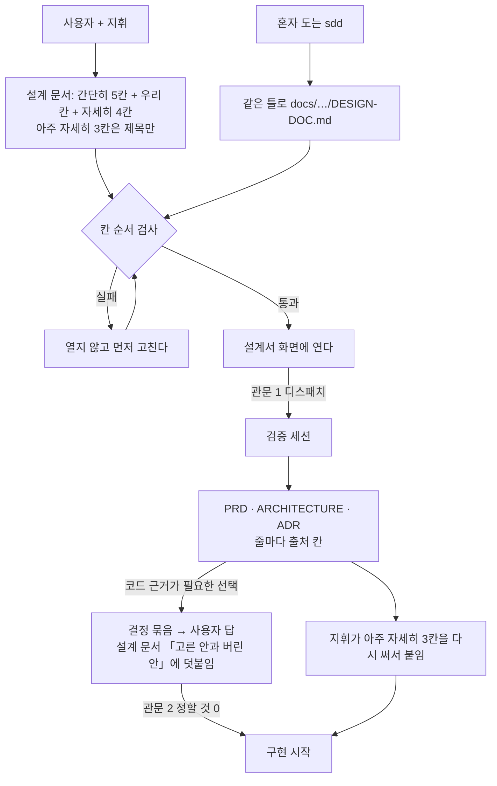

# PRD — design-doc-format

> 원문: 지휘 자리 설계서 최종본(사용자 승인, 2026-11-28, 비공개 경로라 링크하지 않음) · 이슈 https://github.com/jtwjs/claude-harness/issues/87 본문과 결정 댓글 · 상위 결정 ADR-022(`docs/design-phase-2026-11-26/ADR.md`, 설계 결정은 지휘 한 곳에서, 사람은 설계서 하나를 읽고 고친다).
> 이 PRD는 이번 트랙이 바꾸는 새 규칙을 미리 써 본다. 설계서 칸에서 뽑고, 줄마다 끝에 `(← 칸 이름)`으로 출처 칸을 단다. 설계서에 없는 말은 `(← 검증 세션)`이고, 그 안의 결정은 ARCHITECTURE 「결정할 것」으로 올린다.

## 무엇을

- 지휘 설계서 틀을 설계 문서 포맷(간단히 5칸 → 자세히 4칸 → 아주 자세히 3칸)과 우리 칸으로 바꾼다 (← 한 줄 요약)
- 레포 세 장(PRD · ARCHITECTURE · ADR)은 설계 문서의 칸에서 뽑고, 줄마다 출처 칸을 단다 (← 한 줄 요약)

## 왜

- 한 설계서 안에서 두 칸이 서로 다른 말을 했는데, 검증 세션이 코드를 읽기 전까지 아무도 몰랐다. 흐름 그림은 「되돌리고 판정 계속」, 기능 요구사항은 「테스트 먼저 단계와 같게(실패 → 재시도)」였다(#91 설계서) (← 문제)
- 지금 틀에는 「이럴 때 · 이렇게」를 한 줄씩 정하는 칸이 없다. 버린 안은 결정 표 이유 칸 끝에 묻힌다 (← 문제)
- 「구조 · 기술 결정은 설계서에서 묻지 않는다」라서 큰 구조 그림이 설계서에 없다. 사용자는 구조와 선택을 한 장에서 같이 보고 싶어 한다 (← 문제)
- 성공지표 1: 설계서 칸 순서를 기계로 확인하는 장치. 비포 0개(확인함 2026-11-28: `skills/sdd/` · `hooks/` 아래 설계서 칸 검사 없음). 애프터: 칸 순서 검사 1개 + 통과 · 실패 실행 출력 (← 검증 세션)
- 성공지표 2: 같은 설계 문서를 두 번 요청했을 때 같은 칸 순서. 비포: `미측정: 옛 틀로 같은 요청을 서브에이전트에 2회 / 재지 않음 — 옛 틀에는 칸 순서 검사가 없어 같은 잣대로 비교할 수 없다`. 애프터: 새 맥락 서브에이전트 2회 결과에 칸 순서 검사 2회 통과 (← 목표와 비목표)
- 성공지표 3: 설계서와 PRD가 갈리는지 보는 장치. 비포: Readiness 9번 대조 글 하나(`design.md` Readiness 표). 애프터: 세 장 줄마다 출처 칸 + Readiness가 출처 칸으로 대조 (← 검증 세션)

## 키워드

| 용어 | 이 기능에서의 뜻 |
|---|---|
| 설계 문서 · 설계서 | 사람이 읽고 고치는 원본 한 장. 이 PRD에서 두 말은 같은 것이다. 지휘 경로는 지휘 자리 비공개 파일, 혼자 도는 sdd는 `docs/{feature-YYYY-MM-DD}/DESIGN-DOC.md` |
| 칸 | 설계 문서의 제목 하나와 그 아래 내용. 간단히 5칸(한 줄 요약 · 문제 · 전체 구조 · 고른 안과 버린 안 · 트레이드오프) + 우리 칸 · 자세히 4칸(목표와 비목표 · 대안 비교 · 상황별 동작 · 열린 질문과 누가 정하나) · 아주 자세히 3칸(상세 설계 · 공통 관심사 · 배포와 롤백) |
| 우리 칸 | 원본 포맷에 없고 이 하네스가 유지하는 칸. 제약 · 가정 · 사람이 볼 것 |
| 세 장 | 검증 세션이 설계서를 읽고 쓰는 에이전트 문서 PRD · ARCHITECTURE · ADR |
| 출처 칸 | 세 장의 한 줄이 설계 문서의 어느 칸에서 왔는지. 줄 끝에 칸 이름으로 적는다 |
| 칸 순서 검사 | 설계 문서의 칸 제목이 정해진 순서대로 다 있는지 확인하는 작은 스크립트 |
| 결정 묶음 | 세 장을 쓰다 나온 코드 근거가 필요한 선택을 지휘에 올리는 꼴(`design.md` 「결정 묶음 꼴」) |
| 관문 둘 | 디스패치(정할 것 0 · 설계서 최종본) · 구현 시작(구조 · 기술 정할 것 0). 바뀌지 않는다 |

## 사용자 흐름

## 범위

포함 (← 목표와 비목표)

- `sdd` 설계서 틀을 간단히 5칸 · 자세히 4칸 · 아주 자세히 3칸 · 우리 칸으로 바꾼다
- 「설계서와 세 장」을 바꾼다: 검증 세션이 한 줄 요약 · 문제 · 목표와 비목표 · 상황별 동작 · 제약 · 가정 · 사람이 볼 것에서 PRD를 뽑고, 세 장의 줄마다 출처 칸을 단다
- 설계서 순서 3을 바꾼다: 큰 방향(구조 상자 · 큰 선택)은 설계서에서 묻고, 코드 근거가 필요한 선택은 결정 묶음으로 넘긴다. ADR-022에 갱신 줄을 단다
- ARCHITECTURE 틀에 「불변 규칙」 · 「코드 지도」 · 「요청 하나 따라가기」 · 「배포와 롤백」을 더한다
- ADR 틀에 설계 문서 「고른 안과 버린 안」 행으로 가는 링크를 더한다
- 칸 순서 검사와 그 테스트를 더한다. 지휘(혼자 도는 sdd면 그 세션)가 설계서를 화면에 열기 전에 돌린다

하지 않을 것 (← 목표와 비목표)

- 원본 포맷 12개(논문 · 영상 · 스레드 등) 전부 들이기: 세컨드브레인 쪽 일이다
- 진행 중인 #71 · #91 설계서를 새 틀로 옮기기: 바뀐 틀은 릴리스 뒤 설치본부터 적용된다(← 제약)
- 세컨드브레인 쪽 문서 포맷
- 「같이 볼 것」 3개(PR 본문 「전 → 후」 · how 「안 읽은 곳」 · 외부 스킬 「설치 판단」 틀): 후속 이슈 #98 · #99 · #100
- 칸 내용 검사: 칸 순서 검사는 제목만 본다. 아주 자세히 3칸은 디스패치 전에 제목만 있어도 통과한다(← 상황별 동작)

## 비기능

- 칸 순서 검사는 의존성 없이 돈다(python3 표준 라이브러리만). 설치본 · 사용자 레포 어디서든 같은 명령으로 돈다 (← 검증 세션)

## 제약

- 관문 둘은 그대로다(디스패치: 정할 것 0 · 설계서 최종본 / 구현: 구조 · 기술 정할 것 0) (← 제약)
- 혼자 도는 sdd의 설계 문서(`docs/{feature}/DESIGN-DOC.md`)는 레포에 커밋된다. 사람 이름 · 개인 기록 원문은 빼고 일반화한다 (← 제약)
- 바뀐 틀은 릴리스 뒤 설치본부터 적용된다. 진행 중인 #71 · #91 설계서는 옛 틀 그대로 둔다 (← 제약)
- ADR 「결정할 것」 표의 머리 · 주체 칸 꼴과 PRD 「→ 결정:」 · 「막지 않음:」 표시 꼴을 바꾸지 않는다. 러너 구현 시작 관문이 읽는다(`skills/sdd-run/scripts/sdd_runner.py` `open_decisions`) (← 검증 세션, 트랙 지시문)

## 가정

- 원본 포맷 칸 전사가 정확하다. 확인함: 공개 영상 화면 전사가 세 단계 화면을 모두 확인함으로 표시 (← 가정)
- 검증 세션이 세 장 줄마다 설계 문서의 칸 이름으로 출처를 달 수 있다. 확인 방법: 이 PRD · ARCHITECTURE가 첫 적용이다. 어색한 점은 회고에 남긴다 (← 가정)

## 결정

제품 · 도메인 결정은 설계 문서 「고른 안과 버린 안」 그대로다. 여기 다시 적지 않는다(같은 결정을 두 곳에 쓰면 한쪽이 낡는다). 기술 결정은 [ARCHITECTURE.md](ARCHITECTURE.md) 「결정할 것」.

| 주제 | 결정 | 주체 | 출처 |
|---|---|---|---|
| design-doc-source | 사람용 원본 하나 + 에이전트 문서 셋 | 사용자 | (← 고른 안과 버린 안) |
| design-doc-fill-twice | 채우는 시점 두 번(디스패치 전 5 + 4칸, 구현 전 아주 자세히 3칸) | 사용자(AI 추천 수용) | (← 고른 안과 버린 안) |
| design-doc-scope | #87은 설계 문서와 세 장만, 「같이 볼 것」은 #98 · #99 · #100 | 사용자(AI 추천 수용, 2026-11-28) | (← 고른 안과 버린 안) |
| design-doc-check | 틀 + 칸 순서 검사, 화면에 열기 전에 돌린다 | 사용자(AI 추천 수용, 2026-11-28) | (← 고른 안과 버린 안) |
| deep-cells-title-only | 디스패치 전 검사에서 아주 자세히 3칸은 제목만 있어도 통과 | 지휘 판정(사용자 반려 가능) | (← 상황별 동작) |

## 수용 조건

맡는 쪽: 층이 하나(하네스 스킬 문서 · 스크립트)라 생략한다. 검증 세션이 테스트를 쓰고 구현 세션이 통과시킨다.

- [ ] AC-1 `design.md` 설계서 틀이 간단히(한 줄 요약 · 문제 · 전체 구조 · 고른 안과 버린 안 · 트레이드오프 · 우리 칸) → 자세히(목표와 비목표 · 대안 비교 · 상황별 동작 · 열린 질문과 누가 정하나) → 아주 자세히(상세 설계 · 공통 관심사 · 배포와 롤백) 순서이고, 칸마다 한 줄 안내가 있다 (← 목표와 비목표) 👤 구조 · 고른 안 · 버린 안이 한 장에서 보인다
- [ ] AC-2 새 기능 설계를 시작하면 지휘가 간단히 5칸 + 자세히 4칸 + 우리 칸으로 초안을 쓴다고 `design.md` 「설계서」 절이 말한다 (← 상황별 동작)
- [ ] AC-3 큰 구조 상자 · 큰 선택이 갈리면 설계서 「열린 질문과 누가 정하나」에 올려 사용자에게 묻는다. 설계서 순서 3의 「구조 · 기술 결정은 여기서 묻지 않는다」 문장이 없다 (← 상황별 동작)
- [ ] AC-4 코드 근거가 필요한 선택은 결정 묶음으로 넘기고, 답은 같은 설계 문서 「고른 안과 버린 안」에 덧붙인다. `design.md` · `skills/conductor/references/*.md`에서 옛 칸 이름(「결정한 것」 칸 · 설계서 「결정」 칸)을 가리키는 줄이 0이다 (← 상황별 동작)
- [ ] AC-5 「설계서와 세 장」: 검증 세션이 한 줄 요약 · 문제 · 목표와 비목표 · 상황별 동작 · 제약 · 가정 · 사람이 볼 것에서 PRD를 뽑고, 세 장 줄마다 출처 칸을 단다. 설계서에 없는 말은 결정 묶음으로 올린다. 「PRD는 설계서 원문에 에이전트 칸만 더한다」 문장이 `design.md` · `skills/sdd/SKILL.md`에 없다 (← 상황별 동작)
- [ ] AC-6 ARCHITECTURE · ADR이 끝나면 지휘가 아주 자세히 3칸(상세 설계 · 공통 관심사 · 배포와 롤백)으로 다시 써서 붙인다고 `design.md` 설계서 순서와 `skills/conductor/references/decisions.md` 설계서 흐름이 말한다 (← 상황별 동작)
- [ ] AC-7 혼자 도는 sdd면 같은 틀을 `docs/{feature-YYYY-MM-DD}/DESIGN-DOC.md`에 쓴다 (← 상황별 동작)
- [ ] AC-8 ARCHITECTURE 틀(`design.md` 「설계문서 3장」)에 불변 규칙 · 코드 지도 · 요청 하나 따라가기 · 배포와 롤백 칸이 있다 (← 목표와 비목표)
- [ ] AC-9 ADR 틀에 설계 문서 「고른 안과 버린 안」 행을 주제 이름으로 가리키는 칸이 있다(지휘 회신 R1: 비공개 설계서라 링크 대신 이름). Readiness 9 · 10이 새 칸 이름 · 주제 이름으로 대조한다 (← 목표와 비목표)
- [ ] AC-10 Given 새 틀로 쓴 설계서 · When 칸 순서 검사 · Then exit 0 (← 상황별 동작)
- [ ] AC-11 Given 칸 하나를 뺀 사본 · When 칸 순서 검사 · Then exit 0이 아니고 빠진 칸 이름을 출력한다 (← 상황별 동작)
- [ ] AC-12 Given 두 칸의 순서를 바꾼 사본 · When 칸 순서 검사 · Then exit 0이 아니고 어긋난 칸 이름을 출력한다 (← 상황별 동작)
- [ ] AC-13 Given 아주 자세히 3칸이 제목만 있고 내용이 없는 설계서 · When 칸 순서 검사 · Then exit 0 (← 상황별 동작)
- [ ] AC-14 `design.md` 「화면」 절이 설계서를 화면에 열기 전에 칸 순서 검사를 돌리고, 실패면 열지 않고 먼저 고친다고 말한다. 검사 명령이 거기 있다 (← 상황별 동작)
- [ ] AC-15 ADR-022에 이번 변경(설계서 틀 · 순서 3 · 「설계서와 세 장」) 갱신 줄이 있다 (← 목표와 비목표)
- [ ] AC-16 러너가 읽는 꼴이 그대로다: 러너 단위 테스트(`hooks/tests/sdd-runner-unit.sh`)가 통과한다 (← 검증 세션, 트랙 지시문)
- [ ] AC-17 새 동작은 훅 테스트로 덮고 `bash hooks/test.sh`가 통과한다 (← 검증 세션)
- [ ] AC-19 Given `design.md` 「설계서 틀」 블록을 못 찾는 경우(울타리 · 머리 줄이 바뀜) · When 칸 순서 검사 · Then exit 2로 크게 실패하고 「틀 블록을 못 찾음」을 출력한다. 정본 칸 0개로 아무 설계서나 통과하지 않는다 (← 검증 세션, 지휘 회신 D2)
- [ ] AC-18 끝 기준: 새 맥락 서브에이전트에 같은 예시 요청으로 설계 문서를 2번 쓰게 하면 두 결과 모두 칸 순서 검사를 통과한다(유료 eval 0회) (← 목표와 비목표)

## 남은 ⚠️

- 없음 (기술 결정은 ARCHITECTURE 「결정할 것」에서 지휘 회신을 받는다)
