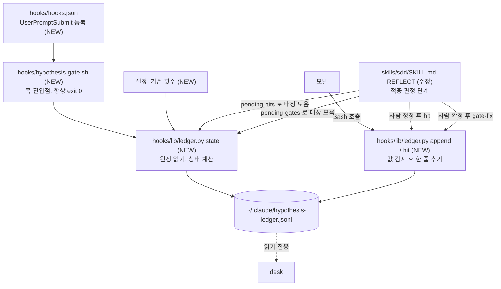
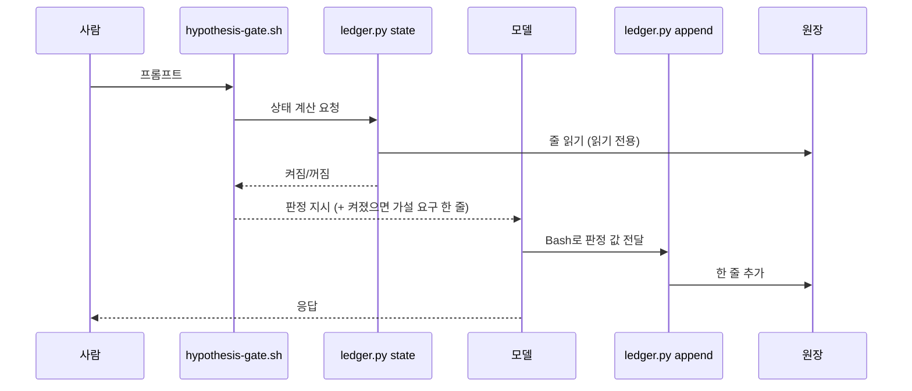

# ARCHITECTURE — 가설 게이트 원장 (plugin 쪽)

> 상태: 초안 (구현 전). PRD와 같은 폴더의 `SDD-SIDE.md`가 줄 형식·판정 기준·계산 규칙의 정본이고, 여기는 어느 파일이 무엇을 맡는지만 적는다.

## 키워드

| 용어 | 이 문서에서의 뜻 |
|---|---|
| 맡김 줄 | 프롬프트 한 번에 원장에 붙는 한 줄(`ts repo task gate area hyp rec acc why rebut skip`) |
| 적중 줄 | 맡김 줄의 `hyp`가 참인 건에 나중에 붙는 `{ref, hit, by}` 줄 |
| 원장 | 두 종류의 줄이 쌓이는 추가 전용 JSONL 한 파일(`~/.claude/hypothesis-ledger.jsonl`) |
| 연속 값 | 같은 (repo, task) 안에서 `rec·acc` 참, `why` 거짓인 맡김 줄이 이어진 횟수 |
| 재요구 상태 | 연속 값이 기준 횟수에 닿으면 켜지고 `hyp`+`rebut`이 모이면 꺼지는 상태. 저장하지 않고 매번 계산 |
| 기준 횟수 | 재요구를 켜는 연속 값. 코드에 박지 않고 설정에서 읽음 |

## 개요

기존 구조는 그대로 두고 훅 하나(`UserPromptSubmit`)와 파이썬 도우미 하나를 더한다. 훅은 원장을 읽기만 하고 주입 문구만 낸다. 원장에 줄을 붙이는 건 모델이 도우미를 불러서 한다. desk는 원장을 읽기만 한다.

## 계층 배치

바뀌는 칸은 `NEW`로 표시한다.

| 파일 | 책임 | 하지 않는 것 |
|---|---|---|
| `hooks/hooks.json` | `UserPromptSubmit` 이벤트에 훅 연결 | 다른 이벤트 변경 |
| `hooks/hypothesis-gate.sh` | `ledger.py state` 호출, 결과를 주입 문구로 출력, 어떤 실패에도 exit 0 | 프롬프트 차단, 원장 쓰기 |
| `hooks/lib/ledger.py state` | 원장 훑기, 연속 값·재요구 상태 계산, 설정 읽기 | 원장 쓰기, 상태 파일 만들기 |
| `hooks/lib/ledger.py append` | 칸·값 검사 후 맡김 줄 한 개 추가 | 기존 줄 수정, 허용 밖 칸 저장 |
| `hooks/lib/ledger.py hit` | `hyp` 참인 줄을 `ref`로 가리키는 적중 줄 추가 | 다른 줄을 가리키는 `ref` 허용 |
| `hooks/lib/ledger.py pending-hits` | (repo, task)에서 `hyp` 참이고 유효한 적중 줄이 없는 줄의 `ts` 출력 | 원장 쓰기 |
| `hooks/lib/ledger.py gate-fix` | 보정 줄 `{ref, gate, by:finn}` 한 줄 추가, `ref`·`gate` 검사 | 기존 줄 수정 |
| `hooks/lib/ledger.py pending-gates` | (repo, task)에서 유효한 `gate`가 null인 줄의 `ts` 출력 | 원장 쓰기 |
| `skills/sdd/SKILL.md` REFLECT | 두 단계: 적중 판정(대상 모음 → 모델 제안 → 사람 정정 → `hit`, `by`는 정정하면 `finn` 아니면 `model`) / 게이트 보정(대상 모음 → diff 대조 후보 → 사람 확정 → `gate-fix`) | sdd 밖(`task=null`) 작업 처리 |
| `hooks/test.sh` | 위 동작의 케이스 | 사용자의 실제 원장 건드리기 |

## 데이터 흐름

## 경계·의존 방향

- 훅 → `ledger.py state` → 원장(읽기). 쓰기 경로는 모델 → `ledger.py append|hit` → 원장 하나뿐이다.
- 훅은 프롬프트를 막지 않는다. 원장이 없거나 깨졌거나 설정이 없으면 판정 지시만 내고 끝낸다.
- 원장 경로는 환경 변수로 덮어쓸 수 있다(테스트용). 기본은 `~/.claude/hypothesis-ledger.jsonl`.
- 네트워크 호출 없음. 이름·원문·코드는 어떤 칸에도 들어가지 않는다(허용 칸 목록 밖은 `append`가 거부).
- desk는 원장 파일만 읽는다. 이 레포는 desk 코드에 의존하지 않는다.

## 상태 관리 규약

- 상태 파일이 없다. 재요구 상태는 매번 원장 줄 순서로 다시 계산한다(규칙은 `SDD-SIDE.md` 「계산 규칙」).
- 원장은 추가 전용이다. 줄을 고치거나 지우지 않고, 잘라내거나 회전하지 않는다(상태가 사라진다).
- 같은 `ref`의 적중 줄이 여럿이면 마지막 줄이 유효하다. 보정 줄도 같다(유효한 `gate` = 마지막 보정 줄의 값, 없으면 원 줄 값). 상태 계산은 매번 보정을 적용해 과거를 다시 센다.
- 기준 횟수는 실행할 때마다 설정에서 읽는다. 값을 바꾸면 과거 상태도 새 기준으로 다시 계산된다.

## 테스트 전략

- `hooks/test.sh`에 케이스를 추가한다(이 레포의 유일한 테스트). 임시 원장을 환경 변수로 지정해서 돌린다.
- 케이스: 원장 없음·빈 파일·깨진 줄(AC2), 연속 값 계산과 리셋·건너뜀(AC3), 켜짐 유지(AC4), 꺼짐 조건(AC5), 설정 없음(AC6), 주입 문구 유무(AC7), `append` 거부 규칙(AC8·AC10), 적중 줄 규칙(AC9).
- macOS 기본 bash 3.2에서 돈다. 변수 뒤에 한글이 오면 `${}`로 감싼다(0.35.0 수정 사례). 계산은 파이썬에 두어 bash 문법 위험을 줄인다.
- 동작 확인은 별도다. 테스트 통과가 "훅이 실제로 모델에 한 줄을 넣는다"를 뜻하지 않으므로 구현 첫 단계에서 실제 세션으로 확인한다(PRD 남은 ⚠️).
