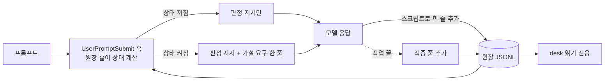

# PRD — 가설 게이트 원장 (plugin 쪽)

> claude-harness 이슈 #1 (desk-hypothesis-gate)의 plugin 쪽. 세부 설계와 desk와 맞춘 내용은 `SDD-SIDE.md`. desk 쪽 문서는 desk 레포에서만 고친다.

## 날것

> 이유 없는 수락이 이어지는 걸 잡아서 가설 입력 제안을 넣고 싶다. 어떤 입력이든 내가 이해한 바탕으로 내 언어로 요청해야 지휘할 수 있다고 생각한다. 실무에서 계속 문제였고 이 도구 안에 녹여서 개선해 나가고 싶다. 하네스는 필요한 일을 다 하는 선에서 최대한 가볍게 간다. 먼저 "모델이 놓치는 게 없을 것"이라는 가설을 세우고, 써 보면서 데이터를 쌓는다.

## 무엇을

AI에게 맡길 때마다(프롬프트 한 번) 원장에 한 줄을 남기고, 이유 없는 수락이 기준 횟수만큼 이어지면 가설을 먼저 달라고 다시 요구하는 장치를 plugin(sdd)에 넣는다. desk는 원장을 읽기만 한다.

## 왜

- 진짜 문제: AI 추천을 이해하지 못한 채 이어가면 이해 부채가 쌓이고, 내 말로 지휘하지 못하게 된다. 사후 측정으로는 이미 지나간 뒤다.
- 한 줄 정의: 우리는 (AI 추천을 이해 못 한 채 이어가다 이해 부채가 쌓여 내 말로 지휘하지 못하게 되는 문제) 때문에 (이해한 상태로 지휘를 유지)하기 위해 (맡기는 순간 가설을 먼저 받고, 이유 없는 수락이 이어지면 다시 요구)한다.
- 참고: 개인 결정 기록 2026-11-11(가설 먼저). 요지: 사후 감지만으로는 착각이 일어난 순간에 개입하지 못한다. 해소 판정은 영역별 입력 빈도와 가설 적중률을 같이 보고, 기준값은 첫 2~4주 기록을 본 뒤 정한다. 같은 요지의 논증 노트에 AI 추천대로 진행하다 내 말로 못 옮긴 경험 사례 두 건이 있다.

### 성공지표

| 지표 | 비포 | 목표 |
|---|---|---|
| 맡김 한 건당 원장에 남는 줄 | 0 (확인함: `hooks/hooks.json`에 줄을 쓰는 코드 없음) | 줄 누락률은 미측정. 기준은 첫 2주 뒤 사람이 정함 |
| 판정(`hyp rec acc why rebut`)이 맞는 비율 | 미측정: 쌓인 줄 중 샘플 20건을 사람이 대조 / 첫 2주 안 | 기준은 대조 뒤 사람이 정함 |
| 연속 기준 횟수 | 없음 | 첫 2~4주 기록을 보고 사람이 정해 config에 넣음 |
| 원장 한 줄을 남기는 데 드는 토큰 | 미측정: 프롬프트 몇 건에 판정을 돌려 토큰 로그로 재기 / 구현 첫 단계 | 미정 |

## 사용자 시나리오

1. 평소 맡김: 프롬프트를 보낸다 → 훅이 판정 지시를 넣는다 → 모델이 응답하며 판정 줄 한 개를 원장에 추가한다.
2. 이유 없는 수락이 기준 횟수 이어짐: 다음 프롬프트에서 훅이 "가설을 먼저 받아라" 한 줄을 더 넣는다 → 모델이 가설을 묻는다.
3. 가설을 냄: 모델이 반박을 낸다(`rebut`) → 같은 작업 안에서 `hyp`와 `rebut`이 모이면 재요구가 꺼진다.
4. 가설 없이 넘어감: 막지 않고 `skip=true`로 남긴다.
5. 작업이 끝날 때: 모델이 적중 줄을 추가하고, 사람이 정정할 수 있다(`by`로 구분).
6. desk가 원장을 읽어 영역별 입력 빈도와 적중률을 보여 준다.

## 사용자 흐름

- 진입 경로: 모든 레포의 모든 프롬프트(훅이 하네스 유무를 보지 않음)
- 동선: 프롬프트 → 훅(상태 계산, 주입) → 모델(응답 + 줄 추가) → 원장 → desk(읽기)

개인화: 이 기능 자체가 사람의 맡김 기록을 따라 달라지는 장치다(상태는 개인 원장에서만 계산).

## 범위

포함
- `UserPromptSubmit` 훅 추가(`hooks/hooks.json`): 원장을 훑어 재요구 상태를 계산하고 지시를 주입
- 원장 줄 쓰기 스크립트(허용된 칸과 값만 받아 한 줄 추가)
- 상태 계산(줄 순서만으로, 별도 상태 파일 없음), 기준 횟수는 config에서 읽음
- 적중 줄 쓰기: sdd REFLECT(회고 직전)에서 그 작업의 `hyp=true` 줄을 모아 모델이 판정하고 사람이 정정한다
- 작업 후 diff로 놓친 게이트 보정: sdd REFLECT에서 그 작업의 `gate=null` 줄과 diff를 대조해 후보를 보이고 사람이 확정하며, 원장에는 보정 줄로 남긴다(맨 마지막 step)

하지 않을 것
- 난이도 칸으로 재요구를 켜거나 끄기, 사람 정정 단계: `diff`는 참고용으로만 쌓는다. 첫 2~4주 뒤 분포 쏠림과 적중 대조에서 쓸모가 보이면 REFLECT에 정정 단계를 더한다(결정: 사람, 2026-11-13)
- 가설 요구를 강제로 막기: 막지 않고 `skip`으로 남긴다
- 줄 누락을 막는 `Stop` 훅 확인: 가볍게 가기 위해. 누락률은 측정으로만 본다
- sdd 밖(`task=null`) 맡김을 연속 값에 세기: 큰 작업은 sdd를 거쳐 `task`가 붙는다. 비율은 측정한다
- 연속 기준 횟수 기본값: 못 정한다. config에 값이 없으면 재요구는 꺼진 채 줄만 쌓는다
- 원장 회전·잘라내기·상태 스냅샷: 전체 보존이 전제
- 줄 쓰기 실패를 응답에서 알리기: 가볍게 가기 위해 오류 한 줄만 낸다. 실패가 쌓여 문제가 되면 그때 알림을 넣는다(결정: 사람, 2026-11-13)
- sdd 밖(`task=null`) 작업의 게이트 보정: REFLECT가 sdd 안에서만 돌기 때문(결정: 사람, 2026-11-13)
- sdd 밖(`task=null`) 작업의 적중 기록: REFLECT가 sdd 안에서만 돌기 때문. 적중률은 sdd 작업만 쌓인다(결정: 사람, 2026-11-13)
- 사람 이름·원문·코드를 원장에 적기
- 원장 화면: desk가 한다

## 결정

### hypothesis-ledger
- 목적·이유·배경: 이해 부채는 지나간 뒤 재면 이미 늦다. 맡기는 순간 개입하려면 맡김마다의 기록과 그 기록으로 켜지는 재요구가 필요하다.
- 결정: 맡김 한 건은 프롬프트 한 번이고 줄 한 개다. 같은 (repo, task) 안에서 `rec`·`acc`가 참이고 `why`가 거짓인 줄이 기준 횟수만큼 이어지면 재요구가 켜지고, 같은 (repo, task) 안에서 `hyp` 줄과 `rebut` 줄이 순서 무관으로 모이면 꺼진다.
- 결정 주체: 사람(연속·끄는 규칙의 범위, 설계가 아닌 맡김 제외, 막지 않기, 판정 기준, 난이도 칸은 참고용으로 두고 정정 단계는 데이터를 본 뒤) / AI 추천 수용(맡김 한 건 단위, 작업 식별, 끄는 규칙의 순서 무관)
- 버린 방법: 사후 감지만(개입 시점이 늦다) / 가설 입력을 막는 게이트(마찰이 커서 오래 못 간다)
- 참고: 개인 결정 기록 2026-11-11

### 판정 기준
- 정본은 `SDD-SIDE.md` 「판정 기준」 표(`hyp rec acc why rebut skip`). 모델이 프롬프트 시점에 선언한다.
- 결정 주체: 사람이 확인하고 수락. 판정 칸을 누가 채우는지는 사람이 고름(모델 선언).

## 수용 조건

- [ ] AC1 `hooks/hooks.json`에 `UserPromptSubmit` 이벤트가 있고 훅이 프롬프트마다 돈다
- [ ] AC2 원장 파일이 없거나 비었거나 깨진 줄이 섞여 있어도 훅은 프롬프트를 막지 않고(exit 0) 깨진 줄은 건너뛴다
- [ ] AC3 연속 값은 같은 (repo, task) 안에서 `rec`·`acc`가 참이고 `why`가 거짓인 맡김 줄이 이어진 횟수다. `why`가 참인 줄과 (repo, task) 변경에서 0이 된다. `gate=null`과 `task=null` 줄은 세지도 끊지도 않는다. 적중 줄은 건너뛴다
- [ ] AC4 연속 값이 config의 기준 횟수에 닿으면 재요구가 켜지고, 연속 값이 0이 되어도 켜진 채 유지된다
- [ ] AC5 켜진 뒤 같은 (repo, task) 안에서 `hyp=true` 줄과 `rebut=true` 줄이 순서 무관으로 모두 나오면 그 둘째 줄에서 꺼진다. (repo, task)가 바뀌면 모은 것을 버린다
- [ ] AC6 config에 기준 횟수가 없으면 재요구는 켜지지 않고 판정 지시만 주입된다
- [ ] AC7 상태가 꺼져 있으면 주입에 가설 요구 문구가 없고, 켜져 있으면 가설 요구 한 줄이 들어간다
- [ ] AC8 줄 쓰기 스크립트는 정해진 칸과 값(`gate`, `area` 목록 등)만 받고, 그 밖의 칸이나 값은 거부하며, 기존 줄을 고치지 않고 끝에만 한 줄 붙인다
- [ ] AC9 적중 줄은 `{"ref","hit","by"}` 형식이고, 같은 `ref`가 여러 번이면 마지막 줄이 유효하며, `hyp=true`가 아닌 줄을 `ref`로 가리키면 거부한다
- [ ] AC10 원장 파일은 `~/.claude/hypothesis-ledger.jsonl` 한 곳이고 사람 이름·프롬프트 원문·코드는 어떤 칸에도 들어가지 않는다
- [ ] AC11 `bash hooks/test.sh`가 통과하고 AC2~AC9, AC12, AC13, AC15, AC16 케이스가 포함된다
- [ ] AC12 `ledger.py append`나 `hit`가 쓰지 못하면(권한·디스크) 0이 아닌 종료 코드와 오류 한 줄(stderr)만 낸다. 재시도·응답에서의 알림·원장 복구는 하지 않는다
- [ ] AC13 `ledger.py pending-hits <repo> <task>`는 그 (repo, task)에서 `hyp=true`이면서 유효한 적중 줄이 없는 맡김 줄의 `ts`를 한 줄에 하나씩 출력한다. 없으면 빈 출력(exit 0)
- [ ] AC14 `skills/sdd/SKILL.md`의 REFLECT에 적중 판정 단계가 있다. 그 단계는 `pending-hits`로 대상을 모으고, 모델이 `right|partial|wrong`을 제안하고, 사람이 정정하면 `by=finn`으로, 그대로 두면 `by=model`로 `hit`를 쓴다. 대상이 없으면 한 줄 보고하고 넘어간다
- [ ] AC15 `ledger.py gate-fix <ref> <gate>`는 `{"ref","gate","by":"finn"}` 보정 줄을 끝에 추가한다. `ref`가 맡김 줄의 `ts`가 아니거나 `gate` 값이 허용 목록(`schema|api|error|delete|security|null`) 밖이면 거부한다. 기존 줄은 고치지 않는다
- [ ] AC16 연속 값 계산은 보정 줄이 있으면 마지막 보정 줄의 `gate`를 그 줄의 `gate`로 쓴다. `null`이던 줄이 값으로 바뀌면 연속에 들어가고, 값이던 줄이 `null`로 바뀌면 빠진다
- [ ] AC17 `ledger.py pending-gates <repo> <task>`는 그 (repo, task)에서 유효한 `gate`가 `null`인 맡김 줄의 `ts`를 한 줄에 하나씩 출력한다. `skills/sdd/SKILL.md`의 REFLECT에 게이트 보정 단계가 있고, `pending-gates`로 대상을 모으고, 모델이 diff와 대조해 후보를 보이고, 사람이 확정한 것만 `gate-fix`로 쓴다. 대상이 없으면 한 줄 보고하고 넘어간다

## 남은 ⚠️

- ⚠️ 프롬프트 시점 훅이 이 환경에서 모델 컨텍스트에 한 줄을 실제로 넣는지(추정: 가능). `미측정: 훅 하나 만들어 확인 / 구현 첫 단계`. 안 되면 주입 방식 설계를 다시 한다
- ⚠️ 게이트 보정은 REFLECT 때 모델이 어느 줄이 어느 프롬프트였는지 알아야 한다. 원장에는 원문이 없어서 세션이 압축되면 못 맞출 수 있다. `미측정: 압축 뒤 REFLECT에서 확인 / 구현 마지막 단계`. 안 되면 보정이 일부만 되는 것으로 두고 `SDD-SIDE.md`에 한계로 적는다
- ⚠️ 줄 누락률, 판정 정확도, 토큰, 훅 시간, 동시 쓰기, `area` 정확도는 `SDD-SIDE.md` 「미확인」 절에 방법과 기한이 있다
- 검사 명령: 이 레포에는 `.claude/harness.json`이 없어서 verify는 `bash hooks/test.sh` 하나다(앞선 `single-conductor` phase와 같은 방식, 2026-11-13 PLAN에서 정함. 결정 주체: AI 추천 수용)
