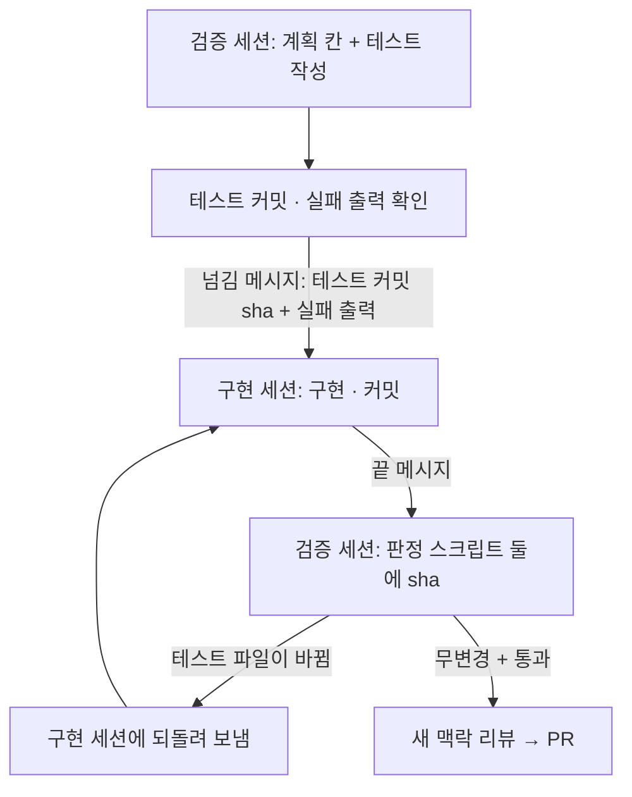

# ADR — harness-overhaul

> 번호는 지휘(`conductor`)가 발급한다(ADR-028, 2026-11-29). 결정 원문은 지휘가 사용자와 쓴 정비 설계서 최종본 「결정한 것」 · 「1회차 결정」이다(사용자 지시(채팅), 이슈 없음). 줄 번호는 91d8c11 기준이다.

## ADR-028 러너를 걷어내고 검증 세션과 작은 판정 스크립트가 판정을 맡는다 (하네스 정비)

- 상태: 결정 (2026-11-29). 주체는 아래 표 그대로. 열린 결정 0
- 맥락: 하네스가 너무 많이 짜여 일이 느리고 파일이 쌓인다. 11-28 하루 머지 21개 중 4개가 러너 버그 수정이었다(추가 1,805줄). 러너 코드 + 테스트는 4,504줄이고, 러너를 말하는 실행 파일이 32개다. 두 레포 253 step 기록에서 러너 판정이 실제로 잡은 것은 테스트 수정 되돌림 2건(그중 1건은 `tests/__pycache__/*.pyc` 오탐) · RED 순서 1건 · status 미갱신 1건 · 재판정 3건이다. 나머지 검사는 대부분 러너 자기 규약(index.json 상태 · BASE · 재시도 · 차례)을 지키려고 생겼다
- ADR 조건(`skills/sdd/references/design.md` 「끝」 3번): 되돌리기 비싸다(러너 · 칸 정의 · 실행 문서 32곳을 지운다) · 코드만 보면 왜 판정이 스크립트 둘뿐인지 모른다 · 버린 방법이 있다

### 결정할 것

| # | 정할 것 | 결정 | 주체 |
|---|---|---|---|
| O1 | 정비 범위 | ① 러너 걷어내기 ② 훅 리뷰 ③ 필요한 테스트만. 각각 리뷰를 받은 뒤 정한다 | 사용자(2026-11-29 채팅) |
| O2 | 러너 대신 무엇이 판정하나 | 검증 세션이 테스트를 쓰고 구현 결과를 직접 판정한다. 결정적으로 볼 수 있는 것은 스크립트로 둔다 | 사용자(2026-11-29 채팅) |
| O3 | 헤드리스 실행 | 사용자가 시킬 때만 | 사용자(2026-11-29) |
| O4 | CI 범위 | PR과 main 둘 다 바뀐 부분만. 전체 테스트는 손으로 돌릴 때만 | 사용자(2026-11-29 Inbox, 추천과 다르게 고름 · 이유 없음 — 다시 묻지 않음) |
| O5 | 설치 레이어 | A: 실행 파일(스킬 · 훅 · 에이전트 · 템플릿 · 실행 문서)만 하위 폴더로 옮겨 그 폴더만 설치. 개발 쪽(ADR · phase · 테스트 · CI · 스크립트 · evals)은 레포 루트에 남는다 | 사용자(AI 추천 수용, 2026-11-29 Inbox) |
| O6 | 정비 순서 | 지울 것을 먼저 지우고 레이어 이동은 마지막 | 사용자(AI 추천 수용, 2026-11-29 Inbox) |
| O7 | 이미 러너를 쓴 다른 레포 | 끝난 phase와 러너 키를 그대로 둔다. 다음 harness-init 업그레이드 때 정리. 다른 레포 PR을 만들지 않는다 | 지휘 판정(사용자 반려 가능) |
| O8 | 훅 기록 크기 | 상한을 넘으면 `.1` 하나로 돌려 쓴다 | 지휘 판정(ADR-018 B-4가 이미 「회전 · 상한 필요」로 정함) |
| O9 | 템플릿 확인받기 줄 `Bash(gh pr merge*)` | 삭제를 #129에 더한다 | 지휘 판정 |
| O10 | 하네스 레포 루트 CLAUDE.md | 짧게 둔다(검증 명령 + 진입점 · 의존 방향). 레이어 이동 PR에서 | 지휘 판정(규칙 파일이라 머지 때 사용자가 diff를 본다) |
| O11 | 지휘 자리 템플릿(#112, ADR-022 J7) 순서 | 정비에 넣지 않고 레이어 이동 머지 직후 첫 작업으로 한다. 설계 · 조사는 병렬로 해도 된다. J7의 「herdr 지휘 재설계와 같이」 조건은 푼다 | 사용자(AI 추천 수용, 2026-11-29 채팅) |
| O12 | 결정을 어디에 모으나 | 이 ADR 하나에 모은다 | 지휘 판정 |
| D1 | 러너 대신 남길 장치 | 판정 스크립트 2개(테스트 무변경 · 테스트 통과) + 구현 시작 관문 스크립트를 러너 밖으로 옮겨 유지. RED 실패 확인 · 재판정은 검증 세션 지시로. 세션 하나 모드는 새 맥락 리뷰만 | 사용자(AI 추천 수용, 2026-11-29 Inbox) |
| D2 | 엣지 5축 이름 대조(ADR-019 G6) | 검증 세션 지시로 옮긴다 | 사용자(AI 추천 수용, 2026-11-29 Inbox) |
| D3 | phases와 index.json | 계획 문서로만 둔다(러너 칸 정의 삭제). 이 레포의 끝난 phase 26개 삭제, ADR이 가리키던 step 링크는 커밋 참조로 | 사용자(AI 추천 수용, 2026-11-29 Inbox) |
| D4 | 러너 보존본(작업 폴더 · 로컬 브랜치) | 버린다. 지휘가 지운다 | 사용자(AI 추천 수용, 2026-11-29 Inbox) |
| D5 | 일하지 않는 훅 | loop-lock · todo-warn · validate-session-end 삭제. tdd-guard · auto-format · weekly-readiness-check는 2주 더 본다 | 사용자(AI 추천 수용, 2026-11-29 Inbox) |
| D6 | 판정 기록 훅(hypothesis-gate) | 지휘 자리에서만 켠다 | 사용자(AI 추천 수용, 2026-11-29 Inbox) |
| D7 | 「필요한 테스트」 기준 | 막는 훅의 판정 · 지난 사고 재발 · 사용자 레포에 쓰는 파일 중 하나를 지키면 남긴다. 문구 검사 73개 · statechart 반입 테스트 377파일 삭제, 기록 검사 92 → 약 11, 지휘 현황 · 스크립트 묶음 줄임 | 사용자(AI 추천 수용, 2026-11-29 Inbox) |
| D8 | 릴리스 스크립트의 전체 테스트 | main 머리에서 전체 테스트 잡(수동 발동)을 돌리고 결과를 기다린다 | 사용자(AI 추천 수용, 2026-11-29 Inbox) |

### O · D 버린 방법

| 결정 | 버린 방법 | 이유 |
|---|---|---|
| O5 | 설치본에 레포 전체 | 0.48.0 설치본 7.8MB 중 statechart 테스트 3.6MB · docs 1.0MB · phases 1.0MB는 실행 중 아무도 안 읽는다 |
| O6 | 레이어 이동 먼저 | 옮긴 뒤 지우면 같은 파일을 두 번 옮긴다 |
| O11 | 레이어 이동 PR에 같이 · herdr 재설계 때 | 이동 PR이 커지고 덜기에 추가가 섞인다 · 재설계는 기한이 없다 |
| D1 | 지시만(스크립트 없음) | diff 옵션 함정 둘(이름 바꾸기 숨김 · 비ASCII 따옴표)을 모델이 매번 기억해야 한다 |
| D1 | CI 잡 | 두 세션이 같은 브랜치에 커밋해서 CI는 경계를 커밋 내용으로만 가를 수 있다. 레포 규칙이 금지하는 방식이다 |
| D2 | 판정 스크립트 셋째 검사 | 계획 칸과 테스트를 같은 검증 세션이 쓴다 |
| D3 | 끝난 phase 유지 · phases 폐지 | 폐지는 index.json을 읽는 러너 밖 8곳을 다 고친다 |
| D5 | 여섯 다 · 그대로 | 셋은 전체 기록에서 수천 번 불려 일한 적 0. 나머지 셋은 기록 창이 짧아 판정 보류 |
| D6 | 남기고 거름 · 지움 | 사람 프롬프트는 지휘로 온다. 작업자 지시문 · 세션 간 알림이 섞이는 문제와 트랙의 턴마다 Bash 호출이 같이 사라진다 |
| D7 | 기준만(훅 삭제에 딸린 것만 지움) · 그대로 | 지키는 것이 없는 테스트가 CI 시간과 고칠 곳을 늘린다 |
| D8 | 지난 main CI 통과만 · 로컬 전체 | 「전체는 손으로 돌릴 때만」(O4)과 맞는다 |

### 바뀐 뒤 흐름 (나눔 모드)

### D1 판정 스크립트와 관문

세 스크립트는 `skills/sdd/scripts/`에 둔다. 모두 읽기만 하고 종료 코드로 답한다.

| 스크립트 | 하는 일 | 종료 코드 |
|---|---|---|
| `tests_unchanged.py <테스트 커밋 sha>` | 그 커밋 뒤(커밋 · 스테이징 · 작업 트리 · 추적 전 새 파일) 테스트 파일이 바뀌었나 | 0 무변경 · 1 바뀜(목록) · 2 인자 · 커밋 오류 |
| `tests_pass.py` | `.claude/harness.json` verify의 test 명령. `$step.test`가 있으면 `{since}`에 브랜치 시작점을 넣는다(ADR-025). 시작점을 못 찾으면 전체 | 0 통과 · 1 실패 · 2 설정 · 인자 오류 |
| `gate.py <docs 폴더>` | 구현 시작 관문. ADR 「결정할 것」 표의 주체 빈 행과 PRD 「남은 ⚠️」 항목을 센다(ADR-023 R1, 세는 규칙 그대로) | 0 열린 것 없음 · 2 열린 것 있음 |

- 무변경 판정의 교훈 둘을 스크립트에 박는다. ① 바뀐 파일은 `git -c core.quotePath=false diff --no-renames --name-only -z <sha>`로 받는다(옮긴 · 지운 테스트와 한글 · 공백 경로가 빠지지 않게). ② `__pycache__/` · `.pyc`는 테스트 파일이 아니다
- 경계는 검증 세션이 넘긴 테스트 커밋 sha로 가른다. 커밋 제목으로 가르지 않는다
- 자동 되돌림은 없다. 테스트 파일이 바뀌었으면 검증 세션이 구현 세션에 되돌려 보낸다
- RED 실패 확인(테스트 커밋 직전 실패 출력을 넘김 메시지에 붙인다) · 재판정(무변경 검사 → 테스트 고침 → 새 sha 넘김) · 엣지 5축 이름 대조(D2)는 검증 세션 지시 문장이다. 스크립트로 두면 RED 확인이 그 커밋으로 트리를 옮겨야 해서, 구현 중인 트리를 치는 위험(ADR-019 E12가 막던 것)이 돌아온다
- 세션 하나 모드는 판정 스크립트 없이 머지 전 새 맥락 `code-reviewer` 1회(ADR-019 F2)만 받는다

### 대체하는 것

- ADR-019(세션 나눔): 부분 대체. 세션 나눔 자체(E1~E11 · B · D)는 그대로다. 러너 칸만 이 ADR이 대체한다: A4(judge 두 번) · A5의 러너 step 갈래 · C1(러너가 빈 의도 칸을 막음) · C2(러너 effort 상수) · C3(러너 지시문 멈춤 규칙) · C7a · C7b(1회 모드 · 헤드리스 effort) · E12(index.json 차례) · F1의 상태 통로(index.json 정본) · G1(러너 개선 후보) · G6의 판정 자리(칸은 남고 대조는 검증 세션이)
- ADR-023(구현 시작 관문 · 재판정): R1은 그대로. R2는 위치만 바뀐다(러너 `gate` 하위 명령 → `skills/sdd/scripts/gate.py`, `sdd-plan` §0이 부른다). R3(`rejudge`)은 폐기한다. 재판정은 검증 세션 지시 문장이다
- ADR-024(`tdd: false` step도 테스트 수정을 되돌림): 대체. 목적(구현은 테스트를 못 고친다)은 `tests_unchanged.py`가 잇는다. 예외 칸(`test_edits`)은 없다. 테스트를 고칠 일은 검증 세션이 직접 한다
