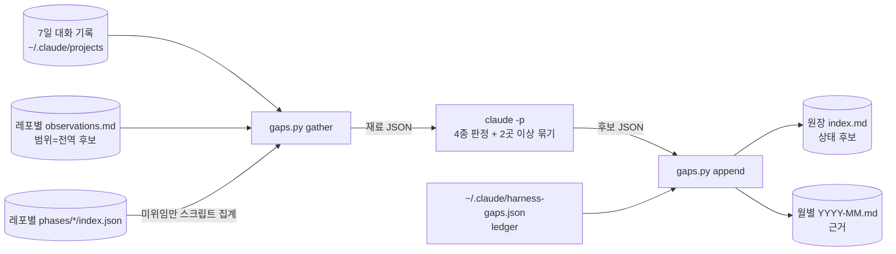

# PRD — harness-gaps 전역 후보를 개인 원장에 후보로 적재 (주 1회 헤드리스)

> 결정 원문: jtwjs/claude-harness 이슈 #35 (설계는 지휘에서 끝남, 「정할 것」 0). 설계 인터뷰 원본은 hanress-work 세션(2026-11-23). 원장 쪽 짝은 개인 볼트 friction 스킬 「harness-gaps 후보 적재」(이미 반영, 읽기만).

## 무엇을

harness-gaps가 찾은 **전역 후보**(여러 레포에 걸친 에이전트 반복)를 개인 불편 원장에 상태 `후보`로 직접 적재한다. 주 1회 헤드리스(`claude -p`)가 레포를 가로질러 모은다.

## 왜

- 한 줄 정의: 우리는 (에이전트 반복이 레포마다 흩어져 아무도 세지 않는 문제 — 기록 0건) 때문에 (여러 레포에 걸친 반복을 한곳에서 보고 고치기) 위해 (harness-gaps가 범위를 표시하고, 주 1회 레포를 가로질러 후보를 모아, 사람 확인 뒤 원장으로 넘긴다).
- `후보`로만 쓰는 이유: 모델이 잘못 묶은 행이 확인 없이 `열림`으로 들어오면 3회가 가짜로 차고, 버림 행이 분모에 영구히 남는다(#35 결정 2).

### 성공지표

| 지표 | 비포 | 목표 |
|---|---|---|
| harness-gaps 기록 | 0건 (확인함: `~/orca` · 개인 볼트 어디에도 `observations.md` 없음, 2026-11-23, #35 「측정」) | 주 1회 실행이 원장에 후보를 쓰거나 "후보 없음"을 남긴다. 건수 목표는 없음(데이터가 쌓인 뒤 사람이 정함) |
| 헤드리스 1회 소요 시간 | 미측정: 첫 수동 실행의 시작 · 끝 시각 / IMPLEMENT 검증 | 50분 이하(넘으면 실행 시각을 당김, #35) |

## 사용자 시나리오

1. REFLECT(레포 안, 사람 있음): harness-gaps가 반복을 `.claude/observations.md`에 셀 때 **범위 칸**을 `레포 고유 | 전역 후보`로 내용 판정한다. 원장에는 쓰지 않는다.
2. 일요일 17:30 헤드리스(레포 밖, 사람 없음): 스크립트가 지난 7일 재료를 추리고 → `claude -p`가 4종을 판정하고 레포 2곳 이상인 것만 묶고 → 스크립트가 원장에 `후보` 행 · 월별 파일에 근거를 붙인다.
3. 사람이 볼트 `/friction review`에서 `후보 → 열림`(이때부터 셈) 또는 `버림`으로 고른다(볼트 쪽, 이 PR 밖).
4. 개인 설정이 없으면(공개 사용자): 헤드리스는 아무것도 쓰지 않고 "원장 설정 없음" 한 줄로 끝난다. harness-gaps는 지금처럼 레포 `observations.md`만.

## 범위

포함
- `skills/harness-gaps/SKILL.md`: 범위 칸 · 재지시/재교정 경계 · 전역 후보 → 헤드리스 길 · 개인 설정
- `skills/harness-gaps/scripts/gaps.py`: `gather` · `append` (표준 라이브러리만)
- `skills/harness-gaps/scripts/weekly.sh`: gather → `claude -p` → append, `--dry-run`, 소요 시간 출력
- `skills/harness-gaps/references/weekly-prompt.md`: 헤드리스 판정 지시문
- 테스트 `hooks/tests/harness-gaps.sh`
- 버전 올림 0.39.0 → 0.40.0

제외 (레포 밖 — PR 본문 「남은 일」)
- launchd plist · install 등록(`~/.claude/automation/`) — 병합 뒤 사용자 확인을 받아 따로
- weekly 브리핑이 후보 수를 알리는 한 줄(개인 볼트)
- 원장 `후보 → 열림` 판정(볼트 `/friction review`, 이미 반영)

## 수용 조건

- AC1 설정 없음: `~/.claude/harness-gaps.json`이 없거나 `ledger` 칸이 없으면 `append`·`weekly.sh`는 원장을 만들지도 쓰지도 않고 exit 0, "원장 설정 없음" 한 줄.
- AC2 레포 목록: `gather`는 지난 N일(기본 7) 대화 기록 줄의 `cwd`에서 레포를 뽑는다. git 레포가 아닌 cwd는 뺀다. 같은 레포의 worktree는 한 레포로 합친다.
- AC3 미위임: 각 레포 `phases/*/index.json`에서 `status: blocked` 또는 `retries ≥ 3`인 step만 스크립트로 센다. 0이면 재료에 사유를 붙이지 않고, 0이 아니면 레포 · phase · step · 사유를 붙인다.
- AC4 전역 후보 행: 각 레포 `.claude/observations.md` 「열린 것」 표에서 범위 칸이 `전역 후보`이고 `마지막`이 창 안인 행만 재료에 넣는다. 범위 칸이 없는 옛 표도 깨지지 않는다(그 행은 건너뜀).
- AC5 재료 크기: 사람 말 · Bash 명령은 한 줄당 · 레포당 상한으로 자른다(값은 ARCHITECTURE). 재료에 대화 원문 전체가 들어가지 않는다.
- AC6 후보 검증: `append`는 후보마다 유형 ∈ {재지시, 재교정, 불발, 미위임, 반복 절차}, 레포 2곳 이상(서로 다른 이름 · 재료에 있던 레포 이름만), 패턴 한 줄 · 비어 있지 않음, 방향 ∈ {direct, investigate, plan}을 확인하고, 어긋난 후보는 그 후보만 건너뛰고 stderr 한 줄.
- AC7 ID: 원장 표의 `F-NNN` 최댓값 + 1부터 순서대로. 원장에 행이 없으면 `F-001`.
- AC8 원장 행: 11칸(`ID | 패턴 | 유형 | 대상 | 프로젝트 | 횟수 | 처음 | 마지막 | 방향 | 상태 | 연결`)으로 표 마지막 행 바로 뒤에 넣는다. 상태는 늘 `후보`. 기존 행 · 표 밖 문단은 바이트 그대로. 칸 안 `|`는 이스케이프.
- AC9 월별 파일: 원장과 같은 폴더의 `YYYY-MM.md`(실행 날짜 기준) 맨 아래에 후보마다 항목 하나를 붙인다 — 원문 인용 자리에 근거(레포 · 대화 날짜 · phases 폴더). 파일이 없으면 frontmatter와 함께 만든다.
- AC10 `--dry-run`: 원장 · 월별 파일을 쓰지 않고, 쓸 행과 항목을 stdout에 낸다.
- AC11 헤드리스 격리: `claude -p`는 도구 없이(`--tools ""`) · 세션 저장 없이(`--no-session-persistence`) 돈다. 다음 주 재료에 헤드리스 자신의 세션이 섞이지 않는다.
- AC12 헤드리스 실패: `claude -p` 실패 · 결과 JSON 파싱 실패면 원장을 쓰지 않고 exit 1, 사유 한 줄. 후보 0이면 "후보 없음"과 요약 줄 · exit 0.
- AC13 공개 레포: 코드 · 문서에 원장 경로 · 볼트 폴더 이름이 하드코딩되지 않는다(테스트가 grep으로 지킨다).

## 결정

| # | 결정 | 주체 | 출처 |
|---|---|---|---|
| 1 | 전역 판정 = REFLECT가 내용으로 범위 칸 표시, 원장은 레포 2곳 이상일 때만(헤드리스가 묶음) | 사람(나누는 위치는 AI 추천 수용) | #35 |
| 2 | 원장 쓰기 = 하네스가 직접 행 추가, 상태 `후보`. 월별 파일에도 근거, ID는 원장을 읽어 다음 번호 | 사람 | #35 |
| 3 | 주 1회 `claude -p` 백그라운드, 일요일 17:30 | 사람(시각은 AI 추천 수용) | #35 |
| 4 | 재지시 · 재교정 · 불발 · 반복 절차는 모델, 미위임은 스크립트로만 집계해 0이 아니면 사유를 모델 입력에 | 사람(AI 추천 수용) | #35 |
| 5 | 재지시/재교정 경계: 이미 한 결과를 고치면 재교정, 하기 전에 미리 말하면 재지시 | AI(사람 반려 없음) | #35 |
| 6 | 개인 설정 `~/.claude/harness-gaps.json`의 `ledger`. 없으면 레포 `observations.md`만 | AI(사람 반려 없음) | #35 |
| 7 | 훑을 레포 = 7일 대화 기록의 `cwd` | AI(사람 반려 없음) | #35 |
| 8 | 스킬 이름 `task-observer` → `harness-gaps`(목적 = 반복이 생긴 하네스 빈틈 찾기). 연쇄로 스크립트 `gaps.py` · 설정 `~/.claude/harness-gaps.json` · env `CLAUDE_HARNESS_GAPS_*`/`HARNESS_GAPS_*` · 테스트 `hooks/tests/harness-gaps-*.sh`. ADR-015 본문의 옛 이름은 이 행이 대체 | 사람(AI 추천 수용) | 2026-11-23 대화 · #35 코멘트 |

구현 가정(설계 결정 아님 — #35 결정을 코드로 옮기며 고른 기본값, ARCHITECTURE에 근거):
- 레포 = git 저장소(공통 git 디렉터리). worktree를 따로 세면 레포 하나가 「2곳」으로 가짜로 찬다.
- 원장 「연결」 칸 링크는 원장에서 위로 올라가 `.obsidian`이 있는 폴더 기준 경로로 만든다. 없으면 `[[YYYY-MM]]`. 볼트 경로를 코드에 쓰지 않기 위해서다.
- 「프로젝트」 칸은 `⚠️`(재료에서 허브를 알 수 없음 — friction 스킬 「모르는 칸은 ⚠️」), 「대상」 칸은 `레포(<a>, <b>)`.
