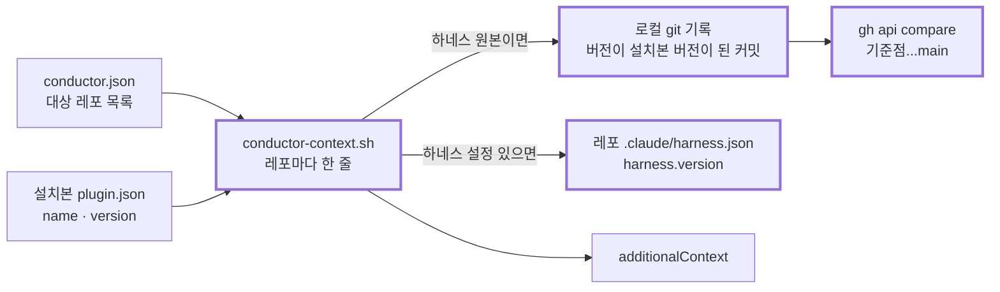

# ARCHITECTURE — release-alert

> PRD: [PRD.md](PRD.md). ADR 없음(아래 「ADR 판정」). 줄 번호는 a1743ed 기준이다.

## 바뀌는 층

지휘 현황 훅 한 파일(`hooks/conductor-context.sh`)과 그 테스트, 지휘 문서 한 줄(`skills/conductor/references/seat.md:11`, D4)만 바뀐다. 지휘 설정(`hooks/lib/conductor.py`) · 레포 세션 버전 알림(`hooks/cadence-reminder.sh`) · `hooks.json` 등록은 그대로다.



| 자리 | 지금 | 바뀜 |
|---|---|---|
| 레포 줄(`conductor-context.sh:58`) | `- {이름} — {트랙}` | 끝에 ` · 릴리스 안 된 머지 …` · ` · 템플릿 X → 설치본 Y` · ` · 릴리스 확인 실패`를 붙일 수 있다 |
| 설치본 버전 | 이 훅은 읽지 않는다. `cadence-reminder.sh:94`만 `$PLUGIN_ROOT/.claude-plugin/plugin.json`을 읽는다 | 같은 자리를 읽는다: `${CLAUDE_PLUGIN_ROOT:-<훅 폴더>/..}/.claude-plugin/plugin.json`의 `name` · `version` |
| 원격 조회 | 레포당 `gh issue list` 1회, 5초 제한(`:59-60`) | 하네스 원본 레포만 원격 조회 1회 더, 같은 5초 제한 · 같은 `run()` 마감(`:30-36`) |

## 데이터 흐름 (레포 하나)

```mermaid
flowchart TD
  R[대상 레포] --> T{하네스 원본인가<br/>D1}
  T -- 예 --> V{설치본 버전 읽힘?}
  V -- 아니오 --> F[ · 릴리스 확인 실패]
  V -- 예 --> B{기준점 찾음?<br/>D2}
  B -- 아니오 --> F
  B -- 예 --> G{원격 main 조회<br/>D3 · 5초}
  G -- 실패 --> F
  G -- n=0 --> N[붙이지 않음]
  G -- n≥1 --> L[ · 릴리스 안 된 머지 n건 #A … (설치본 X)]
  R --> H{.claude/harness.json<br/>harness.version 있음?}
  H -- 없음 · 빈 값 --> N2[붙이지 않음]
  H -- 같음 --> N2
  H -- 다름 --> U[ · 템플릿 X → 설치본 Y]
```

## 결정

구조 · 기술 결정. 열린 것 0(2026-11-27 지휘 결정 묶음 회신).

| # | 정할 것 | 결정 | 주체 |
|---|---|---|---|
| D1 | 대상 레포 중 하네스 원본을 가려내는 법 | A: 레포의 `.claude-plugin/plugin.json` `name`이 설치본 `name`과 같다. 버린 방법: origin slug 박기(포크 · 이름 변경에 놓침) · conductor.json 새 키(설정 스키마가 바뀜) | 지휘 판정(사용자 반려 가능) |
| D2 | 「설치본 버전」 기준점(태그 없음) | A: 하네스 원본 로컬 클론의 `origin/main` first-parent 기록에서 `.claude-plugin/plugin.json` `version`이 설치본 버전이 된 가장 최근 커밋(그 커밋의 첫 부모는 다른 버전이거나 파일이 없다). 못 찾으면 「릴리스 확인 실패」. 버전 올림 PR과 release.sh 사이 머지가 있으면 그만큼 더 센다(거짓 경보 쪽). 버린 방법: `~/.claude/plugins/installed_plugins.json` gitCommitSha(정확하지만 Claude Code 내부 파일 꼴에 기댐) · 둘 다 쓰기(길 둘 · 테스트 두 배) | AI 추천 수용(사용자) |
| D3 | 원격 main을 읽는 법 · 시간 제한 | A: `gh api repos/{slug}/compare/{기준점}...main` 1회, 5초 제한, 기존 `CLAUDE_CONDUCTOR_GH` 바꿔 끼우기(실측 0.56초). 버린 방법: git fetch 뒤 로컬 기록(2.26초 · 로컬 ref를 바꿈) · git ls-remote + 로컬 기록(2.05초 · 커밋이 로컬에 없으면 못 셈) | 지휘 판정(사용자 반려 가능) |
| D4 | 범위 밖 파일: `skills/conductor/references/seat.md:11` 훅 설명 한 줄 | A: 같은 PR에서 새 줄 두 종류를 한 구절 더한다. 버린 방법: 안 고침(지휘 문서가 실제 출력보다 좁게 남음) | 지휘 판정(사용자 반려 가능) |

아래는 되돌리기 쉬운 구현 세부라 AI가 정했다(주체: AI 판단, 지휘 이의 없음).

- 「머지」 한 건 = 원격 compare 결과 커밋 하나. 이 레포는 squash 머지만 쓴다(최근 first-parent 50건 중 merge 커밋 0). 건수 n은 compare `total_commits`(없으면 `commits` 길이)
- PR 번호는 커밋 제목 끝의 마지막 `(#N)`. 번호 없는 커밋도 n에는 센다. 번호는 머지 순서(오래된 것부터) 앞 5개를 보이고, 「외 m건」의 m = n − 보인 번호 수
- 줄 꼴: 레포 줄 끝에 ` · `로 잇는다. 예: `- claude-harness — 트랙 손댈 것 없음 · 릴리스 안 된 머지 7건 #93 · #94 · #95 · #96 · #97 외 2건 (설치본 0.43.0)`
- 「릴리스 확인 실패」 뒤에 짧은 사유 괄호를 붙여도 된다(예: `릴리스 확인 실패(원격)`). 그 줄에 「릴리스 안 된 머지」는 함께 나오지 않는다
- 템플릿 버전은 대상 레포 작업 트리의 `.claude/harness.json`을 읽는다(`cadence-reminder.sh:92-93`과 같은 읽기). 설치본 버전을 못 읽으면 템플릿 줄은 조용히 건너뛴다(레포 세션 알림과 같은 규칙). 하네스 원본 줄의 실패 표시는 위 릴리스 판정이 맡는다
- 설치본 `plugin.json`을 통째로 못 읽으면(이름을 모름) D1로 가려낼 수 없다. 그때는 `.claude-plugin/plugin.json`이 있는 대상 레포 줄마다 「릴리스 확인 실패」를 붙인다(조용히 0건처럼 보이지 않게, PRD AC-7). 이름은 읽히고 `version`만 비었으면 이름이 같은 레포 줄에 붙인다
- 기준점을 찾다가 git 읽기가 실패하면(시간 초과 · 오류) 「파일 없음」으로 보지 않고 「릴리스 확인 실패」로 둔다. 부모를 못 읽었다고 그 커밋을 기준점으로 쓰면 너무 최근 커밋을 잡아 적게 센다(REVIEW 1회차)
- 레포 작업 트리에 `.claude-plugin/plugin.json`이 있는데 못 읽으면(JSON 깨짐 · 충돌 표시) 「릴리스 확인 실패」(REVIEW 1회차)
- 두 꼬리가 한 줄에 다 붙으면 릴리스 꼬리가 먼저, 템플릿 꼬리가 뒤다
- gh 호출은 `--jq` 없이 JSON 전체를 받아 python에서 읽는다(테스트의 가짜 gh가 jq를 흉내 내지 않게)

## 지키는 것

- 원격 조회는 하네스 원본 한 레포만 한다. 다른 레포는 로컬 파일만 읽는다
- 각 조회는 기존 `run()`을 지나 5초 제한 · 전체 마감을 함께 쓴다. 한 레포의 실패는 그 줄에만 표시된다(PRD AC-10)
- 실패는 「붙이지 않음」(0건)과 다른 글로 보인다(PRD AC-7)
- 로컬 클론의 ref를 바꾸지 않는다(fetch 안 함). 원격은 읽기만 한다
- 레포 세션 알림(`cadence-reminder.sh`)은 바꾸지 않는다

## 테스트 전략

- 새 케이스 묶음 `hooks/tests/template-drift.sh`(step 1) · `hooks/tests/release-line.sh`(step 2 · 5)(러너가 테스트 파일로 알아보는 자리). `hooks/test.sh` 7-f 케이스는 고치지 않는다
- 바꿔 끼우기: 지휘 설정 `CLAUDE_CONDUCTOR_CONFIG`(기존) · gh `CLAUDE_CONDUCTOR_GH`(기존) · tracks_status `CLAUDE_CONDUCTOR_TS`(기존) · 설치본 `CLAUDE_PLUGIN_ROOT`(가짜 플러그인 폴더). 하네스 원본은 임시 git 레포(버전 올림 커밋 기록을 실제로 만든다)
- 가짜 gh는 `api …/compare/<기준점>...main` 호출을 기록하고 정해 둔 JSON을 낸다. 테스트는 넘긴 기준점이 맞는지 본다
- 실제 대상 레포 before/after는 사람이 볼 것(PRD AC-12)으로 PR에 싣는다

## ADR 판정

ADR 없음. 「되돌리기 비싸다」를 넘지 못한다: D1~D3 어느 것을 바꿔도 훅 한 파일의 함수 하나와 그 테스트만 고친다. 결정은 위 「결정」 표에 주체와 함께 남긴다.
