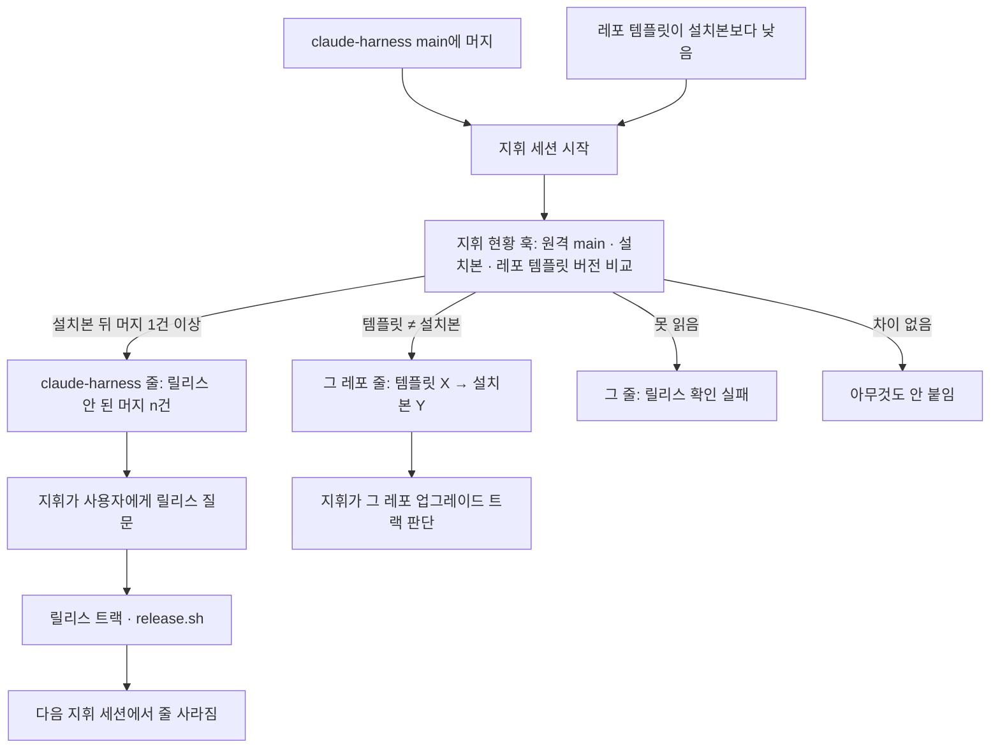

# PRD — release-alert

> 원문: 지휘 자리 설계서 최종본(사용자 승인, 2026-11-27, 비공개 경로라 링크하지 않음) · 이슈 https://github.com/jtwjs/claude-harness/issues/80 본문과 결정 댓글 2개. 아래는 설계서 원문의 뜻을 바꾸지 않고 옮긴 것이다. 대상 레포 이름은 일반화했다. 에이전트 칸(`AC-N` · 맡는 쪽 · `👤` · 키워드)만 더했다.

## 무엇을

claude-harness main에 설치본에 없는 머지가 있으면, 지휘 세션을 열 때 지휘 현황에 한 줄로 보인다. 같은 자리에 「레포 템플릿이 설치본보다 뒤처짐」도 보인다.

## 왜

- 진짜 문제: 기능 PR이 main에 머지돼도 버전을 올리고 `scripts/release.sh`를 돌리기 전까지는 설치본에 들어가지 않는다. 「머지됨 ≠ 설치됨」을 알려 주는 장치가 없다(#80)
- 있었던 일: 0.41.0 뒤 머지 10건이 버전 올림 없이 쌓여 하루 넘게 설치본에 없었다. 그 사이 #56(훅 기록 전체)을 「들어갔다」고 보고 집계 일정을 잡았다가 정정했다
- 성공지표: 「머지 ≠ 설치」 착각 건수. 비포 2건(#80 본문 0.41.0 사례 · #80 우선순위 댓글 #56 사례). 미측정(애프터): 방법 — 릴리스 질문이 지휘 현황 줄에서 시작된 건수와 착각 정정 건수 / 기한 — 다음 릴리스 3회

## 키워드

| 용어 | 이 기능에서의 뜻 |
|---|---|
| 지휘 현황 | 지휘 자리에서 세션이 시작할 때 `hooks/conductor-context.sh`가 넣는 대상 레포별 줄 |
| 설치본 | 지금 깔려 돌고 있는 플러그인 폴더. 그 `.claude-plugin/plugin.json` `version`이 설치본 버전이다 |
| 하네스 원본 | 대상 레포 중 claude-harness 자신(플러그인을 만드는 레포) |
| 릴리스 안 된 머지 | 설치본 버전 뒤 원격 main에 들어온 머지 전부 |
| 레포 템플릿 버전 | 대상 레포 `.claude/harness.json`의 `harness.version` |
| 하네스 설정 | 대상 레포의 `.claude/harness.json` |

## 사용자 흐름

## 범위

포함

- 지휘 세션이 시작하면, 지휘 현황의 claude-harness 줄에 「릴리스 안 된 머지 n건 #A · #B … (설치본 X)」을 붙인다. PR 번호는 최대 5개이고, 넘으면 「외 n건」으로 줄인다. n이 0이면 붙이지 않는다
- 문서만 바꾼 머지도 센다(설치본에 들어가고, skills가 실행 중에 docs를 읽는다)
- 세는 기준점은 설치본 버전이다. 버전 올림 머지도 센다. 그래서 「버전은 올렸는데 release.sh를 안 돌림」도 잡힌다
- 원격 main으로 센다. 로컬 클론이 뒤처져도 적게 세지 않는다
- 못 세면(원격을 못 읽음 · 설치본 버전을 못 읽음) 그 줄에 「릴리스 확인 실패」를 붙인다. 0건처럼 보이지 않는다
- 하네스 설정이 있는 대상 레포마다, 템플릿 버전 ≠ 설치본 버전이면 그 레포 줄에 「템플릿 X → 설치본 Y」를 붙인다. 같으면 붙이지 않는다. 하네스 설정이 없는 레포는 붙이지 않는다
- 레포 세션의 기존 버전 알림은 바꾸지 않는다
- 새 동작은 훅 테스트로 덮는다(#80 끝 조건)

하지 않을 것

- 작업 세션 · 레포 세션의 릴리스 알림: 그 자리에서는 릴리스를 안 해서 잡음이 된다
- 자동 릴리스 · 자동 업그레이드: 릴리스는 사용자가 승인하는 일이다
- 쌓인 날수 표시: 문턱이 1건이라 건수로 충분하다
- 글 규칙으로만 두기: #80 끝 조건이 막는다

## 비기능

- 지휘 현황 훅의 전체 마감(지금 25초) 안에서 끝난다
- 원격 조회는 레포당 기존 gh 호출과 같은 제한(5초)을 넘지 않는다고 가정한다. 늘어나는 시작 시간은 검증 세션이 바꾸기 전후로 잰다. 비포(2026-11-27, 이 브랜치 시작 커밋 a1743ed의 훅, 실제 대상 레포 3개, 3회): 1.98초 · 2.23초 · 2.42초. 애프터: 미측정 — 방법: 같은 자리 · 같은 대상 3회 / 기한: 구현 끝난 뒤 PR 전
- 한 레포의 조회 실패가 다른 레포 줄을 막지 않는다

## 제약

- 지휘 현황 훅 안에 넣는다. 지휘 자리에서만 돈다
- #80 끝 조건: 사람이 찾지 않아도 다음 세션 시작에서 한 줄로 보인다 · 테스트로 덮는다 · 글 규칙으로만 두지 않는다

## 가정

- 설치본은 레포 트리 사본이다. 확인함(2026-11-27): 설치본 폴더와 레포 최상위 목록이 같다(.git · 개인 학습 폴더 빼고)
- 지휘 현황이 대상 레포 중 하네스 원본(claude-harness)을 가려낼 수 있다. 확인 방법: 검증 세션이 방법을 정해 ARCHITECTURE에 쓴다
- 레포에 릴리스 태그가 없다(확인함, 0개). 그래서 기준점은 버전 파일 기록으로 찾아야 한다. 방법은 검증 세션이 정한다
- 첫 실행에서 하네스 설정이 있는 대상 레포 하나의 줄에 「템플릿 0.34.0 → 설치본 0.43.0」이 떠야 한다(확인함: 두 값)

## 결정

설계서 「결정한 것」 그대로(제품 · 도메인 결정). 기술 결정은 [ARCHITECTURE.md](ARCHITECTURE.md) 「결정」 절.

| 주제 | 결정 | 주체 | 이유 · 버린 방법 |
|---|---|---|---|
| alert-seat | 알림 자리는 지휘 현황 줄이다 | 사용자 | 릴리스를 정하는 곳이 지휘다. 버린 방법: 모든 세션 시작 훅(릴리스를 안 하는 작업 세션에는 잡음) · pr-write 머지 뒤 한 줄(머지한 세션 대화에만 남고 다음 세션은 모른다) |
| alert-threshold | 문턱은 1건부터다 | 사용자 | 0.41.0 뒤 머지 10건이 하루 넘게 쌓였다(#80 본문). 버린 방법: n건 · n일 문턱(그 사이 「머지 ≠ 설치」 착각이 다시 생긴다) |
| template-drift-on-seat | 기존 버전 알림(레포 템플릿 ≠ 설치본)을 지휘 현황에 같이 보인다 | 사용자 | 지휘 자리에는 하네스 설정이 없어서 기존 알림이 안 뜬다 |
| repo-session-notice | 레포 세션의 기존 버전 알림은 그대로 둔다 | AI 추천 수용 | 업그레이드는 그 레포에서 한다. 두 알림은 비교하는 짝이 달라서 겹치지 않는다 |
| count-basis | 세는 기준: 설치본 버전 뒤 main에 들어온 머지 전부(설치본과 main이 다르면 띄움) | AI 추천 수용 | 막으려는 실패는 놓침이다. 버린 방법: 동작에 닿는 폴더 목록을 바꾼 머지만 세기(새 폴더가 생기면 목록이 낡아 아무 말 없이 놓친다) |
| pr-numbers | 릴리스 줄에 건수 + PR 번호(최대 5개, 넘으면 「외 n건」)를 보인다 | AI 추천 수용 | 릴리스 질문 · 변경 이력을 쓸 때 다시 찾지 않는다. 버린 방법: 건수만(쌓인 머지를 손으로 찾게 된다) |

## 수용 조건

맡는 쪽: 층이 하나(훅)라 생략한다. 검증 세션이 테스트를 쓰고 구현 세션이 통과시킨다.

- [ ] AC-1 하네스 원본 줄: 설치본 버전 뒤 원격 main 머지가 1건 이상이면 「릴리스 안 된 머지 n건 #A · #B … (설치본 X)」을 붙인다
- [ ] AC-2 PR 번호는 최대 5개를 보이고, 넘으면 「외 n건」으로 줄인다
- [ ] AC-3 n이 0이면 하네스 원본 줄에 아무것도 붙이지 않는다
- [ ] AC-4 문서만 바꾼 머지도 센다
- [ ] AC-5 기준점은 설치본 버전이다. 버전 올림 머지도 센다(「버전은 올렸는데 release.sh를 안 돌림」이면 1건 이상으로 보인다)
- [ ] AC-6 원격 main으로 센다. 로컬 클론이 원격보다 뒤처져도 적게 세지 않는다
- [ ] AC-7 못 세면(원격을 못 읽음 · 설치본 버전을 못 읽음 · 기준점을 못 찾음) 그 줄에 「릴리스 확인 실패」를 붙인다. 0건처럼 보이지 않는다
- [ ] AC-8 하네스 설정이 있는 대상 레포마다 템플릿 버전 ≠ 설치본 버전이면 그 레포 줄에 「템플릿 X → 설치본 Y」를 붙인다. 같으면 붙이지 않는다. 하네스 설정이 없는 레포는 붙이지 않는다
- [ ] AC-9 레포 세션의 기존 버전 알림은 바뀌지 않는다(`hooks/cadence-reminder.sh` 변경 0 · 기존 version-drift 테스트 통과)
- [ ] AC-10 한 레포의 조회 실패가 다른 레포 줄을 막지 않는다. 원격 조회는 레포당 5초 제한 · 훅 전체 마감 안에서 끝난다
- [ ] AC-11 새 동작은 훅 테스트로 덮고 `bash hooks/test.sh`가 통과한다
- [ ] AC-12 실제 대상 레포로 돌린 지휘 현황 before/after 한 쌍. 첫 실행에서 하네스 설정이 있는 대상 레포 하나의 줄에 「템플릿 0.34.0 → 설치본 0.43.0」이 뜬다 👤 설치본 0.43.0 기준

## 남은 ⚠️

- 없음(구조 · 기술 결정은 ARCHITECTURE 「결정」 절이 지휘 결정 묶음으로 받는다)
