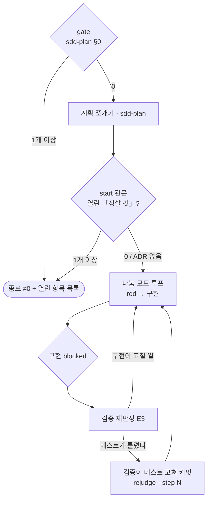

# ARCHITECTURE — runner-gate

> PRD: [PRD.md](PRD.md) · 결정: [ADR.md](ADR.md)(ADR-023, 열린 결정 0). 줄 번호는 6cafe20 기준이다.

## 바뀌는 층

러너 한 파일(`skills/sdd-run/scripts/sdd_runner.py`)과 그 테스트 · 문서, 그리고 부르는 곳 두 줄(`sdd-plan` §0 · `sdd-run` §2-b)만 바뀐다. 층 구조 · `phases/{task}/index.json`의 status 값 4개(`sdd_runner.py:71`) · 세션 하나 모드 흐름은 그대로다.

| 자리 | 지금 | 바뀜 |
|---|---|---|
| `start`(`sdd_runner.py:322-386`) | after · status · 트리 · verify.test · 브랜치를 본다 | 열린 「정할 것」을 세는 관문을 부작용 전에 돈다(R2). 같은 검사를 `gate <docs 폴더>` 하위 명령으로도 낸다 |
| 관문이 읽는 문서 | `index.json`의 `docs` 폴더를 지시문 가드레일로만 읽는다(`guardrails`, `:420-430`) | 같은 `docs` 폴더의 `ADR.md` · `PRD.md`를 관문이 센다(무엇을 세는지는 R1). `docs`가 없거나 파일이 없으면 관문은 막지 않는다(AC-2) |
| 재판정 뒤(나눔 모드) | blocked면 `prompt --role test`가 사유만 보이고 종료 2(`:893-895`). 구현 쪽 `judge`는 `red` 뒤 테스트 파일 변경을 되돌린다(판정 4, `:519-530`). `judge --red` 위반은 BASE로 reset(`discard_attempt`, `:683-691`) | `rejudge TASK --step N`(R3) · 구현 쪽 판정 5가 `rejudged` step이면 BASE 뒤 구현 변경을 본다 |
| `docs/sdd-runner.md` 나눔 모드 절(`:58`) | 「재판정이 테스트 고침이면 지금은 사람이 정리 — #77」 | 진입점 · 관문 설명, 장치로 못 막는 갈래 한 줄 + 이유 |
| `skills/sdd-run/SKILL.md` §2-b | 차례 표는 러너 문서를 가리킨다 | `rejudge` 진입점 안내 한 줄 |
| `skills/sdd-plan/SKILL.md` §0(지휘 경로 예외, 그 줄만) | 폴더 · task를 정한다 | 폴더를 정한 직후 `gate` 한 줄 |

## 흐름

## 지키는 것

- 관문은 레포 안 문서만 읽는다. 설계서(레포 밖 지휘 자리)는 읽지 않는다(PRD 하지 않을 것)
- 재판정 진입점은 검증 차례(그 step이 blocked)에만 움직이고, 차례가 아니면 지금처럼 종료 3 + 아무것도 안 바꾼다(ADR-019 E12)
- 구현 세션은 여전히 테스트 파일을 고치지 않는다(E3). 고친 테스트는 검증 세션 커밋으로만 들어온다
- 구현 커밋은 지우지 않는다. 기존 `sdd-discard/` 백업 규칙은 1회 모드 RED 위반에만 남는다
