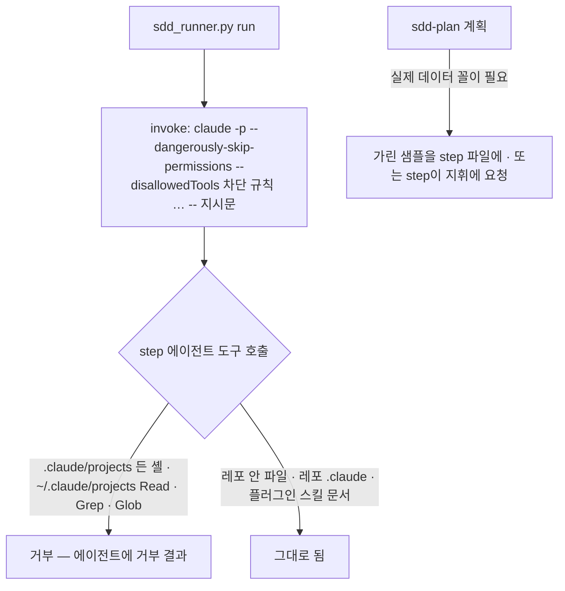

# PRD — runner-headless-block

> 원문: 이슈 #75 본문과 2026-11-28 「본문 고침」 댓글(https://github.com/jtwjs/claude-harness/issues/75). 설계서는 없다 — 이슈가 요구사항이고 결정은 사용자(AI 추천 수용)가 했다. 「원문」 절은 이슈를 뜻을 바꾸지 않고 옮긴 것이고, 「에이전트 칸」 절(AC 번호 · 키워드 · 남은 ⚠️)만 검증 세션이 더했다.

## 원문

### 핵심 요구사항 한 줄 요약

헤드리스 step 에이전트가 로컬 대화 기록(`~/.claude/projects`)을 읽지 못하게 러너가 기본으로 막고, 계획은 「실제 데이터에서 찾아라」 대신 가린 샘플을 넘기게 한다. (← #75 본문 첫 줄)

### 일어난 일

- #52 `verify-flow` step 1을 헤드리스로 돌렸더니, step 에이전트가 「거르기 표식」을 찾으려고 셸 명령(`cd ~/.claude/projects && grep -r …`)으로 이 컴퓨터의 대화 기록 전체를 훑었다 (← #75 일어난 일)
- 레포에 들어간 것은 가짜 값과 건수뿐이었다. 막혀서가 아니라 에이전트가 조심해서다 (← #75 일어난 일)
- 원인 셋 (← #75 일어난 일)
  1. step 파일이 「표식은 먼저 실제 훅 입력에서 확인」을 시키면서 샘플을 주지 않았다. 실제 훅 입력이 남은 곳은 대화 기록뿐이다
  2. 금지 문구가 「원장 실물(`~/.claude/…`)을 읽지 않는다」라 원장 파일만 금지로 읽혔다. 지시 두 개가 부딪쳐 에이전트가 앞쪽을 골랐다
  3. 헤드리스 실행은 `--dangerously-skip-permissions`라 막는 것이 지시문뿐이다
- 대화 기록에는 모든 레포 · 세션의 원문이 들어 있고, 하네스는 공개 레포다. 읽은 조각이 테스트 예시 · 진행 기록 · 커밋 메시지로 들어가 push되면 되돌릴 수 없다. 규칙 줄보다 장치로 막는다(ADR-021 Q1 A ①: 성공 조건이 한 줄이고 고치기 간단) (← #75 일어난 일)

### 성공지표

- 헤드리스 step이 대화 기록에 닿는 길 중 장치로 막힌 것(직접 경로 셸 · Read · Grep · Glob). 비포 0/4(지금 `invoke`는 `--dangerously-skip-permissions`만, 2026-11-28 코드 확인). 애프터 목표 4/4 — AC-2 헤드리스 시험 출력으로 잰다 (← 검증 세션)

### 사용자 흐름

### 결정 (제품 · 도메인)

| 주제 | 결정 | 주체 | 이유 · 버린 안 | 출처 |
|---|---|---|---|---|
| runner-headless-history-block | 헤드리스 호출에서 `.claude/projects`가 들어간 셸 명령과 그 경로의 Read · Grep · Glob을 `--disallowedTools`로 기본 차단한다 | 사용자(AI 추천 수용) | 규칙 줄보다 장치로 — 새면 되돌릴 수 없다 | #75 결정 · 바꾸는 곳 |
| runner-headless-only | 세션 안 모드는 대상이 아니다. 전역 플러그인 훅으로 걸지 않는다 | 사용자(AI 추천 수용) | 사람이 보는 세션은 요약 복구 · 조사로 대화 기록을 정당하게 읽는다 | #75 바꾸는 곳 |
| runner-headless-block-pattern | 셸 차단은 `.claude/projects`가 든 명령만. `.claude` 전체는 막지 않는다 | 지휘(AI 추천 수용, 사용자 반려 가능) | 넓히면 레포 안 `.claude/harness.json` 읽기 · 플러그인 스크립트까지 막아 정상 step이 깨진다(지시 충돌을 장치 쪽에서 다시 만듦). 나눠 쓰기 우회는 한계 줄로 | #75 결정 댓글 |
| runner-headless-block-const | 차단 규칙은 러너 코드 상수 한 곳. 설정 칸은 열지 않는다 | 지휘(AI 추천 수용, 사용자 반려 가능) | 쓰는 곳이 하나뿐이고 끄는 요구가 없다. 칸을 열면 끄는 길도 생긴다 | #75 결정 댓글 |
| runner-headless-block-tools | Read · Grep · Glob 규칙을 셋 다 명시 | 지휘(AI 추천 수용, 사용자 반려 가능) | 이슈 글자 그대로. 헤드리스 시험에서 셋 다 거부되는지 본다 | #75 결정 댓글 |
| history-ban-exceptions | 금지 문구에 예외 둘: 레포 안 `.claude/` · 스킬이 시키는 플러그인 스킬 문서(`~/.claude/plugins/`) | 지휘 확인 요청 + 검증 세션 확인 | 안 적으면 지시 두 개가 부딪쳐 원인 2를 다시 만든다(ARCHITECTURE 「금지 문구와 장치의 범위」) | #75 결정 댓글 |
| plan-masked-sample | step이 실제 데이터 꼴을 알아야 하면 계획이 가린 샘플을 step 파일에 넣거나, step이 지휘에 요청한다. 「실제 데이터에서 찾아라」는 쓰지 않는다 | 사용자(AI 추천 수용) | 원인 1 — 샘플이 없으면 에이전트가 원천을 찾아 나선다 | #75 바꾸는 곳 |

### 범위

포함
- `skills/sdd-run/scripts/sdd_runner.py` 헤드리스 호출(`invoke`, 지금은 `--dangerously-skip-permissions`만)에 차단 규칙 (← #75 바꾸는 곳 · 본문 고침)
- `skills/sdd-plan/SKILL.md` step 템플릿 · 계획 절차에 「샘플을 넘긴다」 규칙 (← #75 바꾸는 곳)
- step 템플릿 금지사항(`skills/sdd-plan/SKILL.md` 「금지사항」) · `skills/sdd-run/scripts/preamble.md` 금지 줄에 「`~/.claude` 아래(대화 기록 · 원장 · 설정) 읽지 않는다」 (← #75 바꾸는 곳 · 본문 고침)
- 한계를 문서에 한 줄: 경로를 나누거나 변수로 숨기는 우회까지는 못 막는다 (← #75 끝 조건 · 결정 댓글)

하지 않을 것
- 세션 안 모드 차단 · 전역 플러그인 훅 (← #75 바꾸는 곳)
- 경로를 나누거나 변수로 숨기는 우회까지 막기 · `.claude` 전체 차단 (← #75 끝 조건 · 결정 댓글)

### 제약

- 러너는 공용 경로라 머지 전 새 맥락 code-reviewer 1회 (← 트랙 지시문)
- 헤드리스 시험은 유료 `claude` 실행이라 몇 번 · 무엇을 돌릴지 지휘 답을 받은 뒤에만 돌린다 (← 트랙 지시문)
- 선행 #52: 충족 — PR #78로 닫혔다 (← #75 본문 고침)

## 에이전트 칸

### 키워드

| 용어 | 이 기능에서의 뜻 |
|---|---|
| 헤드리스 호출 | `sdd_runner.py run`이 step마다 띄우는 `claude -p --dangerously-skip-permissions …` 한 번(`invoke`) |
| 세션 안 모드 | `prompt` · `judge`로 사람이 보는 세션이 step을 도는 길. 러너가 `claude`를 띄우지 않는다 |
| 대화 기록 | `~/.claude/projects` 아래 파일. 모든 레포 · 세션의 원문 |
| 차단 규칙 | `claude --disallowedTools`에 넘기는 거부 규칙 묶음 |
| 가린 샘플 | 실제 데이터 꼴을 유지하되 값 · 이름 · 경로를 가짜로 바꾼 예시. 계획이 step 파일에 넣는다 |

### 수용 조건

- [ ] AC-1 헤드리스 호출 인자에 `--disallowedTools`와 차단 규칙(`.claude/projects`가 든 셸 명령 · `~/.claude/projects` 경로의 Read · Grep · Glob)이 들어가고, 지시문은 `--` 바로 뒤 마지막 인자 하나로 남아 차단 목록에 섞이지 않는다 — 러너 단위 테스트 (← #75 끝 조건)
- [ ] AC-2 헤드리스 시험: 그 인자로 띄운 `claude -p`에서 `grep -r x ~/.claude/projects`와 그 경로 Read가 거부된다. 레포 안 파일 읽기는 된다 — 출력으로 확인 (← #75 끝 조건)
- [ ] AC-3 `preamble.md` 금지 줄과 `sdd-plan` step 템플릿 「금지사항」에 「`~/.claude` 아래(대화 기록 · 원장 · 설정)를 읽지 않는다」와 예외 둘(레포 안 `.claude/` · 스킬이 시키는 플러그인 스킬 문서 `~/.claude/plugins/`)이 있고, `원장 실물(` 옛 문구는 0건이다 (← #75 끝 조건)
- [ ] AC-4 `sdd-plan` 계획 절차 · step 템플릿에 「step이 실제 데이터 꼴을 알아야 하면 가린 샘플을 step 파일에 넣거나 step이 지휘에 요청한다 — 「실제 데이터에서 찾아라」는 쓰지 않는다」 규칙이 있다 (← #75 끝 조건)
- [ ] AC-5 `docs/sdd-runner.md`에 헤드리스 차단과 한계 한 줄(경로를 나누거나 변수로 숨기는 우회까지는 못 막는다)이 있다 (← #75 끝 조건)

### 남은 ⚠️

- 없음 (결정 묶음 1회차로 닫힘 — 결정 표 4행)
