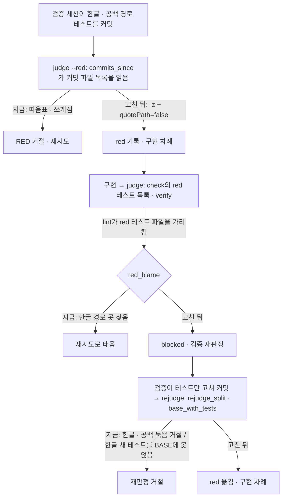

# PRD — runner-path-quote

> 원문: 이슈 #113 본문(https://github.com/jtwjs/claude-harness/issues/113). 설계서는 없다 — 이슈가 요구사항이고 고침 방식은 끝났다(#91 · #102와 같은 고침). 「원문」 절은 이슈를 뜻을 바꾸지 않고 옮긴 것이고, 「에이전트 칸」 절(AC 번호 · 키워드 · 재현 · 남은 ⚠️)만 검증 세션이 더했다.

## 원문

### 핵심 요구사항 한 줄 요약

한글 · 공백 테스트 경로를 쓰는 레포에서도 테스트 먼저 단계(red 기록 · 재판정)가 진행된다. (← #113 현상 · 할 것)

### 현상

- 러너의 `commits_since`와 `rejudge_split`은 `git diff-tree --name-only` 출력을 공백으로 쪼개 파일 목록을 만든다. 테스트 파일 경로에 한글이 있으면 git이 경로를 따옴표 · 8진 이스케이프로 내보내 이름이 맞지 않고, 공백이 있으면 경로가 쪼개진다. (← #113 현상)
- 한글 테스트 경로: `judge --red`가 red 기록을 거절한다 · 재판정이 거절된다. 공백 경로: 한 경로가 두 조각으로 쪼개진다. (← #113 현상)
- 이 틈은 막는 쪽으로 실패한다. 신호를 속이지는 않지만, 한글 · 공백 경로 테스트를 쓰는 레포에서는 테스트 먼저 단계가 진행되지 않는다. (← #113 현상)

### 성공지표

- 한글 · 공백 테스트 경로에서 테스트 먼저 단계가 잘못 거절 · 잘못 갈리는 꼴 수. 비포 6/6(2026-11-28 재현, 아래 「재현」 A~F). 애프터 목표 0/6 — AC 테스트 출력으로 잰다 (← 검증 세션)

### 사용자 흐름

### 결정 (제품 · 도메인)

| 주제 | 결정 | 주체 | 이유 · 버린 안 | 출처 |
|---|---|---|---|---|
| runner-path-quote-same-fix | 네 자리 파일 목록을 #91 · #102와 같은 방식(`-z` NUL 구분 + `core.quotePath=false`)으로 읽는다 | 사용자(AI 추천 수용, #102 결정 묶음 3번) | #91 · #102가 같은 틈을 이 고침으로 막았다 | #113 할 것 |
| runner-path-quote-red-list | `check`의 red 테스트 목록은 이름 바꾸기 감지 끄기 없이 `-z` + `core.quotePath=false`만 | 지휘(#102에서 넘어온 범위 더함) | 이 목록은 red_blame이 쓰는 이름 목록이라 이름 바꾸기 옛 경로가 필요 없다 | #113 범위 더함 |
| runner-path-quote-rejudge-renames | `base_with_tests`에는 `-z` + `core.quotePath=false`만 넣고 이름 바꾸기 감지 끄기는 넣지 않는다 | 지휘(AI 추천 수용, 사용자 반려 가능) | 재판정 이름 바꾸기는 결과가 안 바뀐다(#102 재현 E) — 테스트로 증명할 수 없는 줄을 늘리지 않는다. 버린 안: `--no-renames`까지 | #113 결정 댓글 |
| runner-path-quote-inline | 네 자리마다 판정 4 · 4'와 같은 꼴을 그대로 적는다(헬퍼로 묶지 않음) | 지휘(AI 추천 수용, 사용자 반려 가능) | 이슈는 네 자리 읽기만 말한다 — 이미 머지된 판정 4 · 4'를 다시 열지 않는다. 버린 안: 헬퍼 하나로 묶고 판정 4 · 4'도 옮김 | #113 결정 댓글 |

### 범위

포함
- 두 자리(`commits_since` · `rejudge_split`) 파일 목록을 `-z` + `core.quotePath=false`로 읽는다 (← #113 할 것)
- 재판정용 `base_with_tests`의 한글 경로 갈래도 같이 본다 (← #113 할 것)
- `check`의 red 테스트 목록도 같은 꼴로 (← #113 범위 더함)
- 테스트: 한글 · 공백 테스트 경로로 red 기록 · 재판정이 통과 (← #113 할 것)

하지 않을 것
- 판정 4 · 4'(이미 #91 · #102로 고침) (← #113 왜 #102에서 안 고치나)
- `hooks/**`의 경로 읽기(#127 몫) (← 트랙 지시문)

### 제약

- 러너 경로라 머지 전 새 맥락 code-reviewer 1회 (← #113 할 것)
- #102 머지 뒤(같은 러너 파일): 충족 (← #113 순서)

## 에이전트 칸

### 재현 (2026-11-28, 검증 세션 스크래치)

| # | 경우 | 지금 결과 |
|---|---|---|
| A | red 커밋 테스트가 `tests/한글.expect` | `judge --red` 종료 10 「RED: 테스트 커밋이 없다」 |
| B | red 커밋 테스트가 `tests/my q.expect` | 종료 10 「테스트 커밋이 구현보다 먼저가 아니다 (같이 커밋된 구현: q.expect)」 |
| C | 재판정 묶음에 `tests/한글.expect` | `rejudge` 종료 1 「blocked 뒤 커밋 … 테스트 · phases/ 밖 파일을 담았다」 |
| D | 재판정 묶음에 `tests/my q.expect` | C와 같음 |
| E | (A~D만 고친 복사본) 재판정 묶음이 옛 테스트를 지우고 한글 새 테스트만 둠 | 종료 1 「고친 테스트가 구현 전(BASE)에서도 통과」 — `base_with_tests`가 따옴표 경로를 못 찾아 BASE에 안 얹음. 공백은 `splitlines`라 통과 |
| F | (A~D만 고친 복사본) red 테스트 파일 `tests/한글_note.txt`가 lint에 걸림 | 종료 10(재시도) — `check`의 red 테스트 목록이 따옴표 경로라 red_blame이 못 찾음. 공백은 파일 이름 조각이 맞아 우연히 blocked |

### 키워드

| 용어 | 이 기능에서의 뜻 |
|---|---|
| 같은 고침 | `git -c core.quotePath=false <diff | diff-tree> … --name-only -z`로 받아 `\0`으로 나누고 빈 조각을 버리는 것 |
| red 테스트 목록 | 구현 쪽 판정에서 BASE ~ red 사이 테스트 파일 목록(`check`). verify 실패가 red 테스트 파일에서 나는지(red_blame) 찾는 데 쓴다 |
| `base_with_tests` | 재판정 확인 ③용 임시 커밋 — BASE 트리에 HEAD의 바뀐 테스트 파일을 얹는다 |

### 수용 조건

- [ ] AC-1 (재현 A) red 커밋의 테스트 파일이 한글 경로(`tests/한글.expect`)면 `judge --red`가 종료 0으로 red를 기록한다 (← #113 할 것)
- [ ] AC-2 (재현 B) red 커밋의 테스트 파일이 공백 경로(`tests/my q.expect`)면 `judge --red`가 종료 0으로 red를 기록한다 (← #113 할 것)
- [ ] AC-3 (재현 C) 재판정 묶음이 한글 경로 테스트를 담으면 `rejudge`가 종료 0으로 red를 묶음 끝으로 옮긴다 (← #113 할 것)
- [ ] AC-4 (재현 D) 재판정 묶음이 공백 경로 테스트를 담으면 `rejudge`가 종료 0으로 red를 옮긴다 (← #113 할 것)
- [ ] AC-5 (재현 E) 재판정 묶음이 옛 테스트를 지우고 한글 경로 새 테스트만 두면, `base_with_tests`가 그 파일을 BASE에 얹어 BASE에서 실패를 보고 `rejudge`가 종료 0이다 (← #113 할 것 「`base_with_tests`의 한글 경로 갈래」)
- [ ] AC-6 (재현 F) red 커밋의 한글 경로 테스트 파일을 test 밖 verify(lint)가 가리키면, 구현 쪽 판정이 재시도 대신 blocked(종료 2)로 검증 재판정에 넘기고 `blocked_reason`에 그 경로가 따옴표 · 8진 이스케이프 없이 보인다 (← #113 범위 더함)
- [ ] AC-7 `docs/sdd-runner.md` 검증 상태의 테스트 개수 줄이 실제 `Ran N`과 같다 (← 검증 세션)

### 남은 ⚠️

- 없음 (결정 묶음 1회차로 닫혔다)
