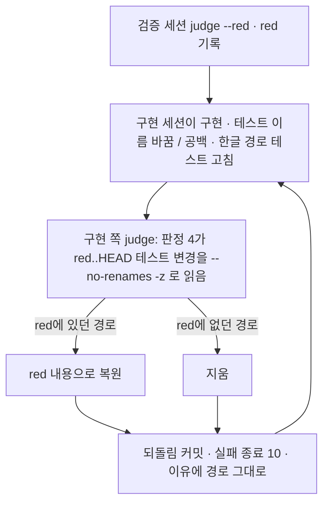

# PRD — runner-rename-guard

> 원문: 이슈 #102 본문(https://github.com/jtwjs/claude-harness/issues/102). 설계서는 없다 — 이슈가 요구사항이고 결정은 끝났다(#91과 같은 고침). 「원문」 절은 이슈를 뜻을 바꾸지 않고 옮긴 것이고, 「에이전트 칸」 절(AC 번호 · 키워드 · 남은 ⚠️)만 검증 세션이 더했다.

## 원문

### 핵심 요구사항 한 줄 요약

테스트 먼저 단계(tdd:true)에서 red 기록 뒤 구현 세션이 테스트 파일 이름을 바꾸거나 공백 · 한글 경로의 테스트 파일을 고쳐도, 러너가 판정 4에서 빠짐없이 되돌린다. (← #102 할 것)

### 현상

- 판정 4는 구현 구간(red 뒤)에서 바뀐 테스트 파일을 `git diff --name-only`로 찾는다. 이 명령은 기본으로 이름 바꾸기를 감지해 옛 경로를 보이지 않는다. (← #102 현상)
- 그래서 red 뒤 테스트 파일 이름을 바꾸면 새 경로는 지워지고 옛 경로는 복원되지 않는다. 테스트 파일이 둘 다 사라진 채 판정이 끝난다. (← #102 현상)
- #91 새 맥락 리뷰가 찾았고 검증 세션이 재현했다(재현 스크립트 rc 10, 두 파일 다 없음). (← #102 현상)

### 성공지표

- 판정 4가 놓치는 red 뒤 테스트 변경 꼴(이름 바꾸기 · 공백 경로 · 한글 경로) 수. 비포 3/3(2026-11-28 재현, ARCHITECTURE 「재현」 A · B). 애프터 목표 0/3 — AC-1~3 테스트 출력으로 잰다 (← 검증 세션)

### 사용자 흐름

### 결정 (제품 · 도메인)

| 주제 | 결정 | 주체 | 이유 · 버린 안 | 출처 |
|---|---|---|---|---|
| runner-rename-guard-same-fix | 판정 4의 테스트 파일 찾기에 #91과 같은 고침(`--no-renames -z` + `core.quotePath=false`)을 적용한다 | 사용자(AI 추천 수용, 트랙 지시문) | #91이 tdd:false 쪽(판정 4')에서 같은 틈을 이 고침으로 막았다 | #102 할 것 |
| runner-rename-guard-separate | #91에서 고치지 않고 따로 연다 | 사용자(AI 추천 수용, #91 결정) | #91 결정 「테스트 먼저 단계의 동작은 바꾸지 않는다」를 지키려고 | #102 왜 #91에서 안 고치나 |
| runner-rename-guard-rejudge-base | 재판정 `base_with_tests`(:839)는 이번에 고치지 않는다 | 지휘(AI 추천 수용, 사용자 반려 가능) | 이름 바꾸기는 결과가 안 바뀐다(ARCHITECTURE 재현 E). 한글 갈래는 #113으로 | #102 결정 댓글 |
| runner-rename-guard-red-list | red 테스트 목록(:663)은 이번에 고치지 않고 #113으로 | 지휘(AI 추천 수용, 사용자 반려 가능) | 지금 관찰되는 결함이 없어 테스트로 증명할 수 없다(공백 조각은 경로의 부분 문자열이라 red_blame이 여전히 찾음 · 한글은 red 확인이 먼저 거절). #113이 red 확인을 고치면 드러난다 | #102 정정 댓글 |
| runner-rename-guard-diff-tree | red 확인 · 재판정의 `diff-tree` 한글 · 공백 경로 문제는 후속 #113으로 | 지휘(AI 추천 수용, 사용자 반려 가능) | 시끄럽게 막는 쪽이라 신호를 속이지 않고, 고치면 판정 4 밖으로 번진다(ARCHITECTURE 재현 C · D) | #102 결정 댓글 |

### 범위

포함
- 판정 4의 테스트 파일 찾기에 #91과 같은 고침을 적용한다 (← #102 할 것)
- 테스트로 덮는다: red 뒤 테스트 이름 바꾸기 → 옛 경로 복원 · 새 경로 지움 / 공백 · 한글 경로 테스트 파일 수정 → 되돌림 (← #102 할 것)
- `docs/sdd-runner.md` `test_edits` 항목의 「다음 시도(새 BASE)부터」 문구를 실제 동작과 같게 고친다: step 도중 더한 칸은 남은 재시도에는 안 먹고, 멈춘 뒤 재개(새 BASE)부터 적용된다(`docs/changes/0.45.0.md` 업그레이드 영향 줄과 같게) (← #102 같이 고칠 것)

하지 않을 것
- 테스트 먼저 단계의 다른 판정(2 · 3 · 5 · 6) 동작 변경 (← 검증 세션)
- tdd:false 쪽 판정 4' 변경: #91에서 끝났다 (← #102 왜 #91에서 안 고치나)
- red 테스트 목록(:663) · 재판정 `base_with_tests`(:839) · red 확인과 재판정의 `diff-tree` 경로 읽기: #113 (← #102 결정 댓글)

### 제약

- 러너 · 훅 경로라 머지 전 새 맥락 code-reviewer 1회 (← #102 할 것)
- #91 머지 뒤(같은 러너 파일): 충족 — #91은 PR #104로 머지됐다 (← #102 순서)

## 에이전트 칸

### 키워드

| 용어 | 이 기능에서의 뜻 |
|---|---|
| 판정 4 | tdd:true step에서 red 뒤 구현 구간의 테스트 파일 변경을 되돌리고 실패로 보내는 판정(`sdd_runner.py` `check`) |
| 판정 4' | tdd:false step에서 BASE에 있던 테스트 파일의 수정 · 삭제를 되돌리는 판정(#91, ADR-024) |
| red | 나눔 모드 `judge --red`가 기록한 테스트 커밋 sha. 1회 모드는 판정 2가 찾은 테스트 커밋 |
| 같은 고침 | `git -c core.quotePath=false diff --no-renames --name-only -z`로 받아 `\0`으로 나누는 것 |

### 수용 조건

- [ ] AC-1 red 뒤 구현이 테스트 파일 이름을 바꾸면(`tests/a` → `tests/a2`), 판정 4가 옛 경로를 red 내용으로 복원하고 새 경로를 지운 뒤 실패(종료 10)로 보낸다. 실패 이유에 옛 경로가 보인다 (← #102 할 것)
- [ ] AC-2 red 뒤 구현이 공백이 든 경로의 테스트 파일을 고치면, 판정 4가 red 내용으로 되돌리고 실패 이유에 그 경로가 그대로 보인다 (← #102 할 것)
- [ ] AC-3 red 뒤 구현이 한글(비ASCII) 경로의 테스트 파일을 고치면, 판정 4가 red 내용으로 되돌리고 실패 이유에 그 경로가 따옴표 · 8진 escape 없이 보인다 (← #102 할 것)
- [ ] AC-4 `docs/sdd-runner.md` `test_edits` 항목이 「step 도중 더한 칸은 남은 재시도에는 안 먹고, 멈춘 뒤 재개(새 BASE)부터 적용된다」와 같은 뜻이고, 「다음 시도(새 BASE)부터」 문구는 0건이다 (← #102 같이 고칠 것)

### 남은 ⚠️

- 없음 (:663 · :839 · diff-tree는 결정 묶음 1회차 · 정정으로 닫혀 #113으로 갔다)
