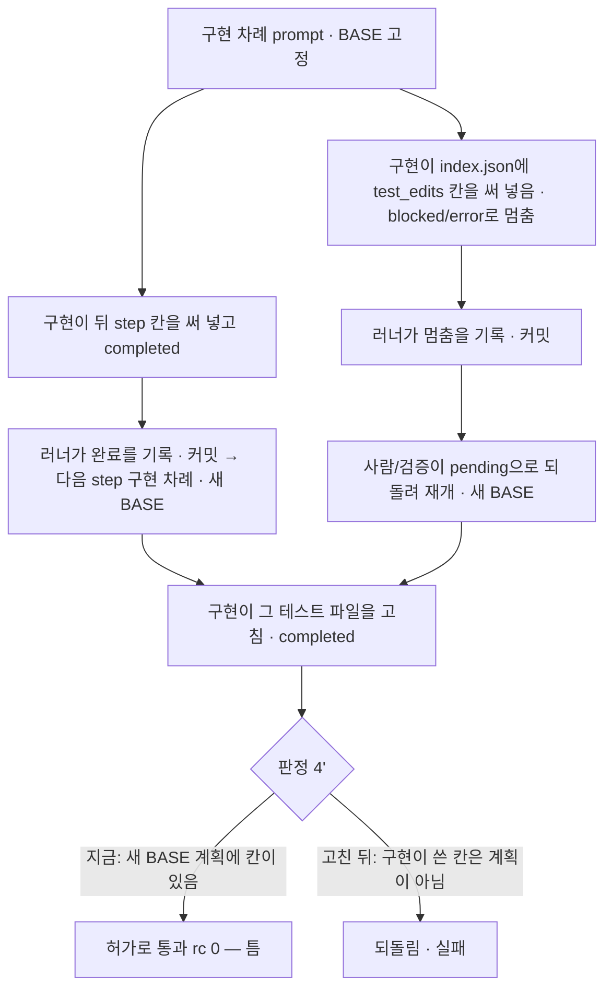

# PRD — runner-resume-test-edits

> 원문: 이슈 #116 본문(https://github.com/jtwjs/claude-harness/issues/116). 설계서는 없다 — 이슈가 요구사항이다. 「원문」 절은 이슈를 뜻을 바꾸지 않고 옮긴 것이고, 「에이전트 칸」 절(AC 번호 · 키워드 · 재현 · 남은 ⚠️)만 검증 세션이 더했다.

## 원문

### 핵심 요구사항 한 줄 요약

멈춘 step을 재개할 때, 구현이 `phases/<phase>/index.json`에 써 넣은 `test_edits`가 허가가 되지 않는다. 「테스트 통과」 신호가 구현이 테스트를 건드린 채로 나오지 않는다. (← #116 현상 · 할 것)

### 현상

- 러너 step이 `blocked` · `error`로 멈출 때, 구현이 `index.json`에 써 넣은 `test_edits`(테스트 파일 수정 허가 칸)가 그대로 커밋된다. (← #116 현상)
- 그 step을 `pending`으로 되돌려 재개하면 새 BASE가 그 칸을 담은 채로 잡혀, 구현이 스스로 써 넣은 칸이 허가가 된다. 구현이 테스트를 고친 시도가 판정을 통과한다. (← #116 현상)
- PR #115(#102) 새 맥락 code-reviewer가 재현했다: 멈춘 직후 판정 rc 2 → 재개 뒤 rc 0. (← #116 현상)
- `test_edits` 칸이 생긴 때(ADR-024 T6)부터 있던 문제다. #102와 같은 부류다. (← #116 현상)

### 성공지표

- 구현이 써 넣은 `test_edits`가 다음 BASE의 허가로 넘어가는 꼴 수. 비포 2/2(2026-11-28 재현, 아래 「재현」 A · B). 애프터 목표 0/2 — AC 테스트 출력으로 잰다 (← 검증 세션)

### 사용자 흐름

### 결정 (제품 · 도메인)

| 주제 | 결정 | 주체 | 이유 · 버린 안 | 출처 |
|---|---|---|---|---|
| runner-resume-test-edits-direction | (a) 러너가 멈춤을 기록할 때 `test_edits`를 BASE 계획 값으로 되돌린 뒤 커밋한다 | 지휘(AI 추천 수용, 사용자 반려 가능) | 지금 있는 BASE 계획 읽기를 한 자리 더 쓸 뿐이라 새 칸 · 새 절차가 없다. 버린 안 (b) 재개 때 알리고 멈춤: 옛 BASE sha를 구현이 쓰는 index.json에 따로 둬야 해 막는 힘이 더 크지 않고, 정당한 추가도 매번 멈춘다 | #116 방향 · #116 결정 댓글 |
| runner-resume-test-edits-scope | 멈춤(blocked · error)과 완료 기록 모두에서, 모든 step의 `test_edits`를 그 판정 BASE의 계획 값으로 맞춘다(재현 B 포함) | 지휘(AI 추천 수용, 사용자 반려 가능) | 재현 B는 같은 틈의 다른 입구라 한쪽만 막으면 신호가 여전히 구현 손을 탄다. 버린 안: 멈추는 그 step만 + 후속 이슈 | #116 결정 댓글 |
| runner-resume-test-edits-no-plan | BASE 커밋에 계획(`index.json`)이 없으면 계획 없음으로 보고 모든 칸을 빼고 한 줄씩 낸다 | 지휘(AI 추천 수용, 사용자 반려 가능) | 판정 4'가 이미 이 경우를 「계획 없음」으로 봐서 두 자리가 같은 답을 낸다(정정: 현재 step에만 맞는다 — 뒤 step은 자기 BASE를 읽는다. REVIEW 1회차 🟡로 아래 commit-guard가 받는다). 버린 안: 맞추기를 건너뜀(이 경우만 틈이 조용히 열림) | #116 결정 댓글 2회차 |
| runner-resume-test-edits-commit-guard | `start`가 부작용 전에 작업 트리 index.json의 step별 `test_edits`를 HEAD에 커밋된 값과 대조해, 다르면(HEAD에 index.json이 없는데 칸이 있는 것 포함) 「index.json을 커밋한 뒤 실행」으로 종료 1 | 지휘(AI 추천 수용, 사용자 반려 가능) | 맞추기가 커밋 안 된 정당한 계획 칸을 지우기 전에, 사람이 있는 자리에서 멈춘다. 버린 안: 문서만(조용히 지워지는 길이 남음) · BASE에 계획 없으면 맞추기 건너뜀(틈이 다시 열림) | #116 결정 댓글 3회차 |
| runner-resume-test-edits-name-match | 맞추기는 계획 step의 번호와 `name`이 둘 다 같을 때만 계획 값을 넣고, 어긋나면 칸을 뺀다 | 지휘(AI 추천 수용, 사용자 반려 가능) | `start`를 거치지 않는 재개에서도 칸이 다른 step으로 옮겨 붙지 않게(막는 쪽 실패). 버린 안: 문서만 | #116 결정 댓글 3회차 |
| runner-resume-test-edits-notice | 맞추는 함수가 값을 실제로 바꿨으면 「step N test_edits 되돌림: <전> → <계획 값>」 한 줄을 출력한다 | 지휘 | 다른 세션이 뒤 step 칸을 고쳐 커밋한 경우가 조용히 사라지지 않게. 되돌림은 막는 쪽 실패라 허가가 새지 않는다 | #116 결정 댓글 |

### 범위

포함
- 방향 결정 (← #116 할 것)
- 테스트: 멈춤 → 구현이 `test_edits` 추가 → 재개 시나리오가 허가로 통과하지 않음 (← #116 할 것)
- 재현 B(완료 기록에 실린 뒤 step 칸)도 같이 막는다 (← #116 결정 댓글)
- 값을 되돌렸으면 출력에 한 줄 (← #116 결정 댓글)
- `docs/sdd-runner.md` `test_edits` 항목의 「step 도중 더한 칸은 … 멈춘 뒤 재개(새 BASE)부터 적용된다」 문구를 고친 동작과 같게 고치고, 막지 못하는 한계를 적는다 (← 검증 세션, 동작이 바뀌는 문구)

하지 않을 것
- `tdd: true` step 판정(판정 4 · red 기준 되돌림): `test_edits`를 쓰지 않는다(`start`가 거른다) (← 검증 세션)
- 한글 · 공백 경로 `diff-tree` 쪼개기: #113 (← 트랙 지시문 순서)
- 검증 세션이 쓰는 기록(`judge --red` · `rejudge`)의 index 커밋에서 맞추기: 그 차례에는 구현이 index.json을 쓰지 않는다 (← 검증 세션)
- 구현 세션이 판정 뒤 · 다음 BASE 고정 전에 index.json을 직접 커밋하는 경우: 러너는 그 커밋을 사람 커밋과 가를 수 없다. 한계로 문서에 적는다 (← #116 결정 댓글)

### 제약

- 러너 경로라 머지 전 새 맥락 code-reviewer 1회 (← #116 할 것)
- #75 뒤(같은 러너 파일): 충족 — 머지됐다 (← #116 순서)

## 에이전트 칸

### 키워드

| 용어 | 이 기능에서의 뜻 |
|---|---|
| `test_edits` | `tdd: false` step의 계획 칸 `{"<경로>": "<이유>"}`. 적힌 기존 테스트 파일만 판정 4'에서 되돌리지 않는다(ADR-024) |
| BASE 계획 | BASE 커밋의 `index.json`에 적힌 그 step의 `test_edits`(`planned_edits`, ADR-024 T6) |
| 멈춤 | step이 `blocked`(구현 보고 · 계획 칸) 또는 `error`(재시도 다 씀)로 기록되는 것. 둘 다 `index.json`을 커밋하고, red가 없으면 BASE를 지운다 |
| 재개 | 멈춘 step을 `pending`으로 되돌려 다시 돌리는 것. 다음 구현 차례가 그때 HEAD를 새 BASE로 고정한다 |

### 재현 (2026-11-28, 검증 세션, 고치기 전 코드)

- A(#116 그대로): 나눔 모드 tdd:false step → 구현이 `test_edits: {tests/q.expect}`를 써 넣고 blocked → judge rc 2, 멈춤 커밋의 `index.json`에 칸이 들어감 → pending으로 되돌려 구현 prompt(새 BASE) → 구현이 `tests/q.expect`를 고치고 completed → judge rc 0, 파일은 고친 내용 그대로. (확인함)
- B(같은 부류, 이슈 밖): step 1 구현이 step 2의 `test_edits`를 써 넣고 completed → judge rc 0으로 `index.json` 커밋 → step 2 구현 prompt(새 BASE) → 구현이 `tests/q.expect`를 고침 → judge rc 0. (확인함)

### 수용 조건

- [ ] AC-1 (재현 A · blocked) tdd:false step에서 구현이 자기 step의 `test_edits`를 써 넣고 blocked로 멈추면, 멈춤 커밋의 `index.json`에는 그 칸이 BASE 계획 값(계획에 없으면 칸 없음)으로 들어가고, judge 출력에 「step 1 test_edits 되돌림」 줄이 보인다. 재개 뒤 구현이 그 테스트 파일을 고쳐 completed를 보고하면 judge가 종료 10으로 되돌린다(고치기 전 코드는 종료 0) (← #116 할 것)
- [ ] AC-2 (재현 A · error) 같은 칸을 써 넣은 채 재시도를 다 써 error로 멈추면, 멈춤 커밋의 `index.json`에 그 칸이 계획 값으로 들어간다 (← #116 현상 「blocked · error」)
- [ ] AC-3 (재현 B · 완료) step 1 구현이 step 2의 `test_edits`를 써 넣고 completed로 통과하면, 완료 커밋의 `index.json`에서 step 2 칸이 계획 값으로 들어가고 출력에 「step 2 test_edits 되돌림」 줄이 보인다. 이어 step 2 구현이 그 테스트 파일을 고치면 judge가 종료 10으로 되돌린다(고치기 전 코드는 종료 0) (← #116 결정 댓글)
- [ ] AC-4 BASE 계획에 있던 칸(자기 step · 뒤 step)은 그대로 남고, 바뀐 것이 없으면 되돌림 줄이 없다. 계획에 있던 칸의 이유 글을 구현이 바꿨으면 계획 글로 돌아간다 (← 검증 세션, 회귀 막기)
- [ ] AC-5 BASE 커밋에 그 phase의 `index.json`이 없거나 읽을 수 없으면 계획 없음으로 보고 모든 step의 `test_edits` 칸을 빼고, 뺀 step마다 되돌림 한 줄(전 값 포함)을 출력한다 (← #116 결정 댓글 2회차)
- [ ] AC-6 `docs/sdd-runner.md` `test_edits` 항목이 새 동작(러너가 멈춤 · 완료 기록 때 모든 step 칸을 BASE 계획 값으로 맞추고 한 줄을 낸다 · 재개 때 칸을 더하려면 index.json을 커밋한다)과 한계를 적고, 「멈춘 뒤 재개(새 BASE)부터 적용된다」 문구는 0건이다 (← 검증 세션)

- [ ] AC-7 (결정 2에서 감수한 경우) 구현 BASE 뒤에 다른 커밋이 뒤 step의 `test_edits`를 고쳐 넣고 지금 step이 completed로 통과하면, 완료 커밋의 그 칸은 BASE 계획 값으로 돌아가고 출력에 「step N test_edits 되돌림」 줄이 보인다(막는 쪽 실패) (← #116 계획 확인 댓글)
- [ ] AC-8 `skills/sdd-run/SKILL.md` §4 재개 절차에 「`test_edits` 칸을 더하려면 index.json을 커밋한 뒤 재개한다」 한 구절이 있다 (← #116 계획 확인 댓글, 바꿀 파일 목록 밖 예외 승인)
- [ ] AC-9 작업 트리 index.json의 어떤 step `test_edits`가 HEAD에 커밋된 값과 다르면(HEAD에 index.json이 없는데 칸이 있는 첫 실행 · 멈춘 뒤 커밋 없이 칸을 더한 재개 포함) `start`가 「step N test_edits 가 커밋된 계획과 다르다 — index.json 을 커밋한 뒤 실행」 꼴로 종료 1을 내고, 브랜치 · index.json을 바꾸지 않는다 (← #116 결정 댓글 3회차)
- [ ] AC-10 진행 중 index.json에서 step 번호가 BASE 계획과 같아도 `name`이 다르면 그 step은 계획 칸을 받지 않는다 — 번호를 바꾼 step에 옛 step의 칸이 옮겨 붙어 커밋되지 않는다 (← #116 결정 댓글 3회차)
- [ ] AC-11 `test_edits`가 `null`로 적힌 step은 계획에도 칸이 없으면 되돌림 줄을 내지 않는다 (← REVIEW 1회차 🟢)

### 남은 ⚠️

- 없음 (AC-5는 결정 묶음 2회차로 닫혔다)
