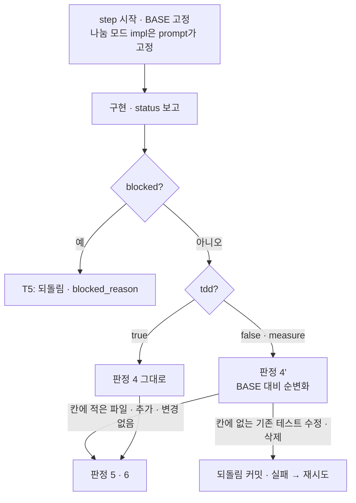

# ARCHITECTURE — runner-tdd-guard

> PRD: [PRD.md](PRD.md) · 결정: [ADR.md](ADR.md)(ADR-024). 줄 번호는 a1743ed 기준이다.

## 가정 확인 (PRD 「가정」)

| 가정 | 코드 사실 | 결론 |
|---|---|---|
| 「테스트 파일」 판별은 테스트 먼저 단계의 되돌리기가 쓰는 기준 | 판정 4가 `TEST_FILE` 정규식(`sdd_runner.py:80`)에 걸리고 `phases/`로 시작하지 않는 경로를 테스트 파일로 본다(`:630-631`). `docs/sdd-runner.md` 「테스트 파일 판별」 줄에는 `test.sh`가 빠져 있다(코드는 잡는다) | 맞다. 같은 정규식 · 같은 `phases/` 제외를 쓴다. 문서 줄에 `test.sh`를 더한다 |
| 「시작 커밋」은 그 step을 시작할 때 러너가 기록한 커밋 | BASE는 `prompt --base`를 줄 때만 `pin_base`가 고정한다(`:1144`, `:407-415`). 헤드리스 `run`은 HEAD를 고정한다(`:1069`). 나눔 모드 tdd:false step은 구현 차례라(`turn`, `:328-338`) 검증의 `prompt --role test --base`를 거치지 않고, 구현 지시는 `prompt --role impl`에 `--base`가 없다(`skills/sdd-run/SKILL.md:55`). 그래서 `judge`가 「BASE 필요」로 거절한다(`:1152-1154`) | 1회 모드 · 헤드리스는 맞다. 나눔 모드 tdd:false는 지금 틀리고 ADR-024 T3로 맞춘다 |

## 바뀌는 층

러너 한 파일(`skills/sdd-run/scripts/sdd_runner.py`)과 그 테스트 · 문서, 부르는 곳 두 자리(`sdd-run` §2-b 한 줄 · `sdd-plan` index.json 칸 설명과 이동 리팩터 줄)만 바뀐다. 층 구조 · status 값 4개 · tdd step 판정 4는 그대로다.

| 자리 | 지금 | 바뀜 |
|---|---|---|
| `check`(`:606-671`) | 테스트 파일 검사는 `if step.get("tdd")` 안에만 있다(`:624-639`). tdd:false는 판정 5 · 6만 돈다 | tdd가 아닌 step(측정 포함)에 판정 4'(ADR-024 T1 · T2): BASE ~ HEAD 순변화에서 BASE에 있던 테스트 파일 중 `test_edits`에 없는 것을 BASE 내용으로 되돌림 커밋 → 실패(재시도). 추가는 남긴다 |
| `check` blocked 갈래(`:609-610`) | 판정 없이 돌려준다 | 판정 4'의 되돌림을 돌리고 `blocked_reason`에 붙인다 |
| `start`(`:456-463` 검사 자리) | measure + tdd 등을 거른다 | `test_edits` 꼴 검사(T4): tdd:true step에 있음 · 이유 빈칸 · 테스트 파일 아닌 경로면 종료 1 |
| `prompt`(`:1144`) · tdd:false 지시문(`:569-572`) | `--base`가 있을 때만 BASE 고정. 「테스트 단계가 없다」 한 줄 | `--role impl`이고 BASE가 없으면 HEAD 고정(T3). 지시문에 「기존 테스트 파일은 고치지 않는다(`test_edits`에 적힌 것만 예외) · 새 테스트 파일은 된다」 |
| `docs/sdd-runner.md` 판정 표 · 나눔 모드 절 | 판정 4는 `tdd: true`만 | 판정 4' 줄 · 테스트 파일 판별 줄 `test.sh` · 차례 표 tdd:false 행 BASE |
| `skills/sdd-run/SKILL.md:55` | 「BASE는 검증 쪽이 고정한 값」 | tdd:false는 `prompt --role impl`이 고정한다(지휘 허락) |
| `skills/sdd-plan/SKILL.md:39` · index.json 칸 설명(`:66-75`) | 이동 step은 tdd:false라 테스트 파일을 바꿀 수 있다고 전제 | 이동 step은 바뀌는 기존 테스트 파일을 `test_edits`에 이유와 함께 적는다 · 칸 설명 한 줄(지휘 허락) |

## 흐름

## 지키는 것

- 순변화(`git diff BASE HEAD`)를 본다. 한 step 안에서 고쳤다가 되돌린 파일은 변경이 아니다. 재시도에서 되돌림 커밋이 BASE 뒤에 있어도 순변화가 0이라 다시 걸리지 않는다
- 이름 바꾸기는 git이 「옛 경로 지움 + 새 경로 추가」로 본다(`--name-only`, `-M` 없음). 칸에 옛 경로가 없으면 옛 파일은 복원되고 새 파일은 남는다
- 나눔 모드 blocked(red 없음)는 BASE를 지운다(`:960-961`). 검증이 그사이 테스트를 고쳐 커밋하고 pending으로 되돌리면, 다음 구현 차례는 `prompt --role impl`이 새 BASE(그 커밋 뒤)를 잡아 검증의 수정이 되돌려지지 않는다(T3)
- 판정 4'는 테스트 명령을 돌리지 않는다(git diff · checkout만). 판정 시간이 느는 곳은 되돌림이 있을 때의 커밋 하나다

## 테스트 전략

`test_sdd_runner.py`의 임시 레포 + 가짜 claude로 세션 `judge`(1회 모드)와 나눔 모드(`prompt --role impl` → `judge`)를 돈다. 브랜치 이름은 박지 않고 호출 앞뒤 값을 대조한다(`.claude/rules/non-obvious-patterns.md`). 사례: AC-1 수정 → 되돌림 + 이름 · AC-2 삭제 → 복원 · AC-3 추가 → 통과 · 변경 없음(테스트 밖 변경만) → 통과 · `test_edits` 파일 수정 → 통과 · 나눔 모드 tdd:false가 `--base` 없이 판정까지 간다 · T4 칸 꼴 검사 · T5 blocked 보고 때 되돌림
