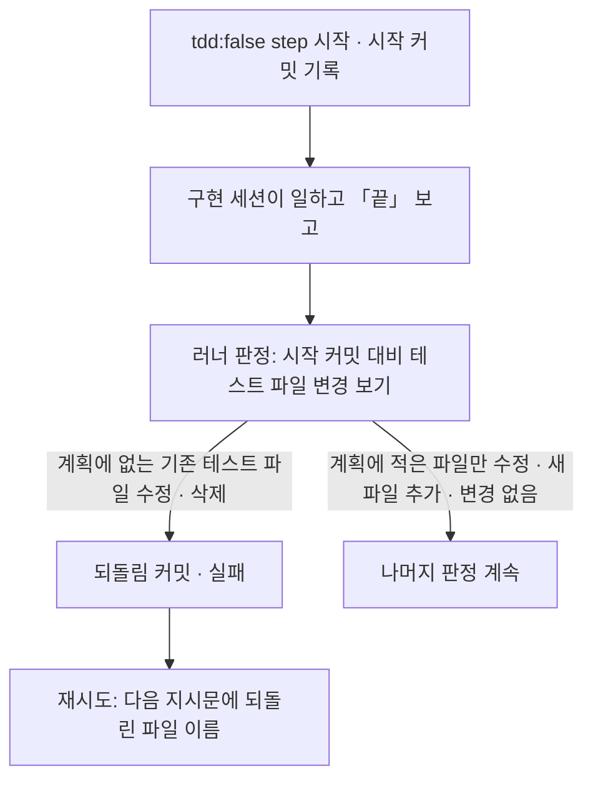

# PRD — runner-tdd-guard

> 원문: 지휘가 사용자와 쓴 설계서 최종본(2026-11-27 승인, 2026-11-28 결정 묶음 1회차 반영). 결정 기록은 https://github.com/jtwjs/claude-harness/issues/91 본문 · 결정 댓글. 아래 「원문」 절은 설계서를 뜻을 바꾸지 않고 옮긴 것이고, 「에이전트 칸」 절(AC 번호 · 맡는 쪽 · 키워드 · 남은 ⚠️)만 검증 세션이 더했다.

## 원문

### 핵심 요구사항 한 줄 요약

테스트를 먼저 쓰지 않는 단계(tdd:false)에서도, 구현 세션이 원래 있던 테스트 파일을 고치거나 지우면 러너가 되돌린다. 새 테스트 파일을 더하는 것은 허용한다.

### 결정 (제품 · 도메인)

| 주제 | 결정 | 주체 | 이유 · 버린 안 |
|---|---|---|---|
| runner-test-edit-principle | 「구현 세션은 테스트 케이스를 함부로 고치면 안 된다. 테스트 케이스 수정은 막는다」 | 사용자 원칙(2026-11-27) | tdd:false 단계는 이 원칙과 부딪히는 유일한 자리다(#86 검증 세션이 코드 · 테스트로 확인) |
| runner-tdd-guard-scope | 이 장치는 #86 「러너 관문 리뷰 반영」 밖, #91에서 한다 | 사용자(AI 추천 수용) | #86 범위를 늘리지 않으려고 |
| runner-tdd-step-unchanged | 테스트 먼저 단계(tdd)에서 구현이 테스트를 더하는 것도 지금처럼 막는다. 코드는 안 바꾼다 | 사용자(AI 추천 수용) | 지금 동작이 원칙과 맞다 |
| runner-tdd-false-guard | tdd:false 단계: 원래 있던 테스트 파일의 수정 · 삭제는 되돌리고, 새 테스트 파일 추가는 허용한다 | 사용자 원칙 + #91 「할 것」 | 새 파일은 기존 케이스를 바꾸지 않는다 |
| runner-tdd-guard-parallel | #80 「릴리스 필요 알림」 트랙과 병렬로 띄운다 | 사용자(AI 추천 수용) | 바꾸는 파일이 겹치지 않는다(러너 · 러너 테스트 · 러너 문서 vs 지휘 현황 훅) |

기술 결정 다섯(시작 커밋 기록 · 정당한 예외 범위 · 되돌린 뒤 흐름 · 칸의 꼴 · 막힘 보고 때 되돌림)은 설계서 「결정한 것」에 있고 [ADR.md](ADR.md) ADR-024 T1~T5로 옮겼다. 설계서 「결정할 것」: 없음(2026-11-28 결정 묶음 1회차로 닫힘).

### 사용자 흐름

### 범위

포함
- tdd:false 단계 판정에서, 시작 커밋에 있던 테스트 파일이 수정되거나 삭제됐으면 되돌린다
- 새 테스트 파일 추가는 허용한다
- 계획(단계 기록)의 「고쳐도 되는 기존 테스트 파일」 칸에 이유와 함께 적힌 파일은 수정 · 삭제를 허용한다
- 되돌렸으면 테스트 먼저 단계의 되돌리기와 같게 실패로 보고 재시도하고, 다음 지시문에 되돌린 파일 이름을 붙인다(조용히 되돌리지 않는다)
- 테스트로 덮는다: 수정 → 되돌림 · 삭제 → 복원 · 추가 → 통과 · 변경 없음 → 통과 · 계획에 적은 파일 수정 → 통과

하지 않을 것
- 테스트 먼저 단계(tdd)의 동작 변경: 결정한 대로 안 바꾼다
- 러너 밖(훅 · 전역 설정)으로 막기: 러너가 판정하는 자리에서만 한다

### 비기능

- 판정 시간이 눈에 띄게 늘지 않는다. 비포(2026-11-28, 검증 세션 측정): `python3 -m unittest skills/sdd-run/scripts/test_sdd_runner.py` — 145개, unittest 보고 95.0초, CPU user 41.9초 + sys 34.7초. 벽시계 367초는 검사 자리 대기(다른 세션 3개)가 섞여 비교에 쓰지 않는다. 애프터는 같은 명령으로 REVIEW 때 잰다

### 제약

- 러너는 공용 경로라서 머지 전에 새 맥락 code-reviewer를 한 번 거친다(러너 경로 규칙)
- #80 트랙과 같은 시간에 돈다. 검사는 머신 전체에서 동시에 2개까지라 트랙을 더 늘리지 않는다

### 가정 (확인 방법: 검증 세션이 코드로 확인해 ARCHITECTURE에 쓴다)

- 「테스트 파일」 판별은 테스트 먼저 단계의 되돌리기가 쓰는 기준을 그대로 쓴다 → 확인함(ARCHITECTURE 「가정 확인」)
- 「시작 커밋」은 그 step을 시작할 때 러너가 기록한 커밋이다 → 지금 코드는 나눔 모드 tdd:false step에서 기록하지 않는다. ADR-024 T3로 참이 된다(ARCHITECTURE 「가정 확인」)

### 수용 기준

- AC-1 Given tdd:false step에서 구현 세션이 원래 있던 테스트 파일 한 줄을 고침 · When 러너가 「끝」을 판정 · Then 그 파일이 시작 커밋 내용으로 돌아가고, 되돌린 파일 이름이 판정 결과에 보인다
- AC-2 Given 같은 step에서 원래 있던 테스트 파일을 지움 · When 판정 · Then 파일이 복원된다
- AC-3 Given 같은 step에서 새 테스트 파일만 더함 · When 판정 · Then 통과하고 새 파일이 남는다

## 에이전트 칸

- **맡는 쪽**: 층이 하나(러너)라 생략. 전부 검증 세션이 테스트로 쓰고 구현 세션이 통과시킨다
- **범위 「테스트로 덮는다」 중 AC 밖 둘**: 「변경 없음 → 통과」 · 「계획에 적은 파일 수정 → 통과」는 AC-3 · ADR-024 T1 step 테스트에 같이 둔다
- **사람이 볼 것**: 없음(러너 내부 판정)
- **완료 조건**: AC-1~3 · `python3 -m unittest skills/sdd-run/scripts/test_sdd_runner.py` · `bash hooks/test.sh` 통과 출력
- **성공지표**: 미측정 — 방법: 다음 나눔 모드 트랙들의 tdd:false step에서 「테스트 파일 수정 되돌림」 건수와 그중 정당했던 건수 / 기한: 다음 나눔 모드 트랙 3개

### 키워드

| 용어 | 이 기능에서의 뜻 |
|---|---|
| tdd:false step | `phases/{task}/index.json` step의 `tdd`가 false인 step. `kind: measure` 포함 |
| 시작 커밋(BASE) | 그 step의 `base` 칸에 러너가 고정한 커밋. 판정은 BASE ~ HEAD 순변화를 본다 |
| 테스트 파일 | 러너의 `TEST_FILE` 정규식에 걸리고 `phases/` 밖인 경로 |
| 고쳐도 되는 기존 테스트 파일 칸 | step의 `test_edits` 선택 칸(꼴은 ADR-024 T4) |
| 되돌림 | BASE에 있던 테스트 파일을 BASE 내용으로 되돌리는 커밋 |
| 판정 4 · 4' | 4는 tdd step의 「RED 뒤 테스트 파일 무변경」(그대로), 4'는 이번에 더하는 tdd:false step 검사 |

### 남은 ⚠️

- ⚠️ 정당한 예외 범위 → 결정: ADR-024 T1
- ⚠️ 되돌린 뒤 흐름 → 결정: ADR-024 T2
- ⚠️ 나눔 모드 tdd:false step의 시작 커밋 기록 → 결정: ADR-024 T3
