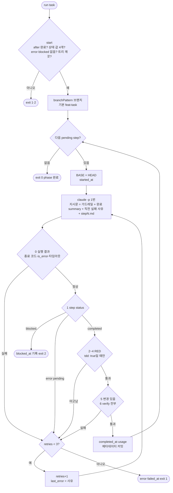

# SDD 러너 — step당 호출 1번 + git 기록 판정

> 2026-10-13, 0.18.0 · 0.18.1(리뷰 반영). 코드 정본은 `skills/harness-run/scripts/sdd_runner.py`, 테스트는 같은 폴더 `test_sdd_runner.py`.
> 이 문서는 왜 이렇게 생겼는지(강의 하네스와 섞은 근거)와 판정 규칙을 적는다.

## 한 줄

`harness`가 만든 `phases/{task}/` 의 step을 하나씩 **호출 1번**으로 구현하고(테스트 먼저 → 구현), 끝나면 **러너가 git 기록을 직접 보고** 통과·재시도·멈춤을 정한다. 세션 안(`harness-run` 스킬)과 헤드리스(터미널에 걸어 두고 떠남)가 같은 스크립트·같은 규칙을 쓴다.

```bash
python3 "${CLAUDE_PLUGIN_ROOT}/skills/harness-run/scripts/sdd_runner.py" run <task>   # 헤드리스, 끝까지
# 세션 안: start → [prompt(stderr ▶ step N) → 서브에이전트 1번 → judge --step N --base <SHA>] 반복 (harness-run §2)
```
종료 코드: 0 완료 · 1 실패로 멈춤 · 2 blocked(사람 필요) · 10 재시도(`judge`만)

## 루프



## 판정 표 — 위에서부터, 첫 실패에서 멈춤

| # | 검사 | 실패 사유(다음 지시문 머리에 붙는다) |
|---|---|---|
| 0 | (헤드리스만) 종료 코드 · JSON `is_error` · 타임아웃 1800초 | "실행 실패: …" |
| 1 | index.json 그 step의 status | error → 에이전트 사유 · pending → "status 를 갱신하지 않음" · blocked → 멈춤 |
| 2 | (`tdd: true`) 테스트 파일만 담긴 커밋이 구현 커밋보다 먼저 | "RED: 테스트 커밋이 없다 / 먼저가 아니다" — 이번 시도 버림 |
| 3 | (`tdd: true`) 그 커밋 시점으로 옮겨 `verify.test`(앱별이면 테스트가 든 앱만) → **실패해야** 함 | "RED: 테스트가 아무것도 잡지 않음" — 이번 시도 버림 |
| 4 | (`tdd: true`) 그 뒤 테스트 파일 무변경 — 바뀌었으면 되돌림 커밋 후 실패 | "GREEN: 테스트 파일을 고쳤다(되돌림)" |
| 5 | 이 step에서 커밋된 변경이 있다 | "completed 보고인데 변경 없음" |
| 6 | `verify` 전부(앱별이면 root마다) 통과 | "verify 실패: <이름>" |

- 재시도는 첫 시도 + 3회 = 최대 4회(`harness-run`·`sdd`와 같은 문장). 강의 execute.py는 **총 3회**(`range(1, MAX_RETRIES+1)`) — 우리 하네스가 원래 쓰던 "재시도 3"을 유지했다. `retries`는 승격 판단 계수기라 재개 때도 0으로 돌리지 않고, 한도는 재개(`resumed_at`) 뒤 실패 수로 센다
- 실패 사유는 `last_error`(다음 지시문용, 통과하면 지움)와 `attempts: [{at, error}]`(이력, 통과해도 남김 — REFLECT가 "어디서 헤맸나"를 본다, 강의 SDD §5 학습 루프)
- RED 위반(2·3)은 같은 BASE 위에서 고칠 수 없다(1회차의 잘못된 커밋이 계속 판정 대상) → 이번 시도 커밋을 `sdd-discard/{task}/stepN-tryK` 브랜치로 옮겨 두고 BASE로 되돌린다. 지우지 않는다
- 멈출 때(재시도 소진·blocked) 남은 코드는 `wip:` 커밋으로 남긴다(강의 `_commit_step`와 같음) — 재개 때 `start`가 더러운 트리로 거부하지 않게
- 테스트 파일 판별: `*.test.*` · `*.spec.*` · `__tests__/` · `tests/`·`test/` · `src/test/` · `*Test(s).kt|java` · `test_*.py` · `*_test.py|go`
- 3번은 **이 작업 트리 그대로** 커밋을 잠깐 옮겨 돌린다(새 worktree는 node_modules 같은 의존성이 없어 엉뚱한 이유로 실패한다). 진행 중인 index.json은 잠깐 stash 한다

## 강의 하네스와 섞은 것

강의 `jha0313/harness_framework`(`scripts/execute.py` 417줄 · `test_execute.py` 559줄)와 이 플러그인을 대조해 골랐다.

| 부분 | 강의 | 이 플러그인(이전) | 채택 |
|---|---|---|---|
| step 실행 단위 | `claude -p` 1번 | RED·GREEN 서브에이전트 2번 | **강의** — 호출 수, 단순함 |
| 테스트 먼저 | CLAUDE.md CRITICAL 한 줄 | `tdd-guard` 훅 + step `tdd` 칸 | **이 플러그인** 훅·칸 + 강의 문장은 지시문에 |
| 지시문 | CLAUDE.md + `docs/*.md` 전부 | `index.json.docs`의 PRD·ARCH·ADR만 | **이 플러그인** — 읽는 범위가 좁다 |
| 판정 | 에이전트가 적은 status만 | status + GREEN 게이트 | **이 플러그인 + 새 검사**(0·2·3·4) |
| 재시도 | 3회, 직전 에러를 머리에 | `retries` 계수기 | 둘 다 |
| 시간 기록·원문 로그·타임아웃 | 있음 | 없음 | **강의** — 무인이라 언제·왜 멈췄는지 필요 |
| phase 순서 | 상위 `phases/index.json`(쓰기만) | `after` + `phases_status.py` | **이 플러그인** — 상태를 두 곳에 적으면 어긋난다(실측: 한 레포 22개 중 7개 `done`) |
| 러너 테스트 | pytest, claude는 mock, **판정 루프 테스트 0** | 없음 | **새로** — 가짜 claude로 판정 루프 끝에서 끝까지(헤드리스·세션 경로 24개) |
| 실패 시 코드 커밋 · phase `created_at`·`completed_at` | 있음(`_commit_step`·`_finalize`) | — | 코드 커밋만 가져옴(0.18.1). phase 시각은 step 시각으로 충분해서 뺐다 |
| TDD 2단계 분리 | TDD 챕터에서 세션 2개(`cd tests/` → 루트), SDD 러너와 별개 | 러너 안에 2단계 | **강의** — 러너 밖 도구로 분리(`test-writer`·`feature-builder`) |

남는 약점: 테스트와 구현을 같은 머리가 써서 테스트가 구현 생각에 맞춰질 수 있다. 되돌리는 조건은 BACKLOG("러너 step을 1회 → 2회 호출로").

## 결정 (2026-10-13)

- 플러그인 안 · Python 표준 라이브러리 · 세션과 헤드리스 같은 규칙 · TDD와 러너 분리 — 사람(Finn)
- step당 1번 + 사후 git 검사 · 가짜 claude + unittest 테스트 — AI 추천을 사람이 수용
- 사전 확인(Finn 터미널, 2.1.296): `--dangerously-skip-permissions`에서도 PreToolUse 차단 훅이 돈다(`--no-verify` 커밋 차단) · 실패한 명령은 PostToolUseFailure만 돈다

## 검증 상태

- `python3 -m unittest skills/harness-run/scripts/test_sdd_runner.py` — 24개 통과. 헤드리스: 한 번에 통과 · 훅 기록 파일 안 섞음 · tdd false · pending→재시도 · 3회 실패 · blocked · blocked+실행 실패 · is_error · 타임아웃 · RED 없음 · RED가 안 잡음 · RED 위반 뒤 재시도로 회복 · 테스트 수정 되돌림 · 변경 없음 · verify 실패 · after 미완료 · 더러운 트리 · verify.test 없음 · summary 전달 · 실패 이력 · 멈춘 뒤 재개. 세션: judge가 지정 step 판정 · 마지막 step도 검사 · `--step` 필수. `release.sh`가 같이 돌린다
- **실가동 1회(2026-10-13, Finn 터미널, Claude Code 2.1.296)**: 임시 레포 phase 1개·step 2개(`tdd: true` 셸 스크립트 → `tdd: false` README), `tdd.enabled: false`
  - `exit 0`, 재시도 0. 커밋 순서 `test: (red)` → `feat:` → `chore:` → `feat:` → `chore:` — 테스트 파일만 담긴 RED 커밋이 먼저 왔고 RED 시점 실패 검사도 통과
  - started→completed 25초·21초, 턴 5·4, `summary`가 step 2 지시문에 넘어감. JSON `total_cost_usd` 0.30·0.26은 **클라이언트 추정치**다(공식 문서: 구독자에게는 청구와 무관)
  - 발견 1건: 그 레포에 `.gitignore`가 없어 훅 기록 파일(`.claude/.last-*`)이 step마다 `feat:` 커밋 하나로 더 묶였다 → 러너가 그 경로를 뺀다
- 과금: 헤드리스 `claude -p`는 환경에 `ANTHROPIC_API_KEY`가 있으면 **항상** 그 키로 API 과금된다(공식 문서 authentication) → `start`가 경고. GitBook SDD 노트의 "6/15부터 `claude -p`는 API 과금"은 공식 문서·changelog(2.1.288~296 범위)에서 **확인 못 함**(웹 검색 미실행) — 충돌로 남겨 둔다
- 미확인: 재시도·blocked·RED 되돌림을 실제 `claude`로 겪은 적 없음(가짜 claude로만). 세션 경로(`harness-run`)를 실제 서브에이전트로 돌린 적 없음. 앱별 verify 레포 미가동
