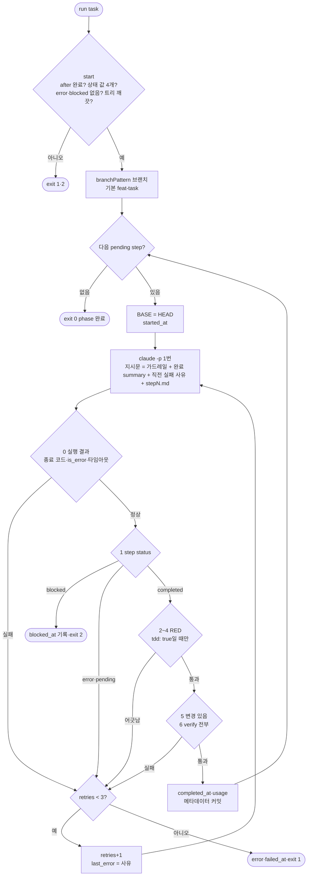

# SDD 러너 — step당 호출 1번 + git 기록 판정

> 2026-10-13, 0.18.0 · 0.18.1(리뷰 반영). 코드 정본은 `skills/sdd-run/scripts/sdd_runner.py`, 테스트는 같은 폴더 `test_sdd_runner.py`.
> 이 문서는 왜 이렇게 생겼는지(강의 하네스와 섞은 근거)와 판정 규칙을 적는다.

## 한 줄

`sdd-plan`이 만든 `phases/{task}/` 의 step을 하나씩 **호출 1번**으로 구현하고(테스트 먼저 → 구현), 끝나면 **러너가 git 기록을 직접 보고** 통과·재시도·멈춤을 정한다. 세션 안(`sdd-run` 스킬)과 헤드리스(터미널에 걸어 두고 떠남)가 같은 스크립트·같은 규칙을 쓴다.

```bash
python3 "${CLAUDE_PLUGIN_ROOT}/skills/sdd-run/scripts/sdd_runner.py" run <task>   # 헤드리스, 끝까지
# 세션 안: start → [prompt --base <HEAD>(stderr ▶ step N, BASE 를 index.json 에 고정) → 서브에이전트 1번 → judge --step N] 반복 (sdd-run §2)
```
종료 코드: 0 완료 · 1 실패로 멈춤 · 2 blocked(사람 필요) · 10 재시도(`judge`만) · 3 차례 아님(나눔 모드)

## 루프



## 판정 표 — 위에서부터, 첫 실패에서 멈춤

| # | 검사 | 실패 사유(다음 지시문 머리에 붙는다) |
|---|---|---|
| 0 | (헤드리스만) 종료 코드 · JSON `is_error` · 타임아웃 1800초 | "실행 실패: …" |
| 1 | index.json 그 step의 status | error → 에이전트 사유 · pending → "status 를 갱신하지 않음" · blocked → 멈춤 |
| 2 | (`tdd: true`) 테스트 파일만 담긴 커밋이 구현 커밋보다 먼저. 새 꼴 step이면 엣지 5축 칸의 테스트 이름이 그 커밋의 테스트 파일 내용에 글자 그대로 있다(ADR-019 G6) | "RED: 테스트 커밋이 없다 / 먼저가 아니다" · "엣지 5축: <축> 테스트 이름 <이름> 이 테스트 커밋에 없다" — 이번 시도 버림 |
| 3 | (`tdd: true`) 그 커밋 시점으로 옮겨 `verify.test`(앱별이면 테스트가 든 앱만, `$step.test`가 있으면 그것) → **실패해야** 함 | "RED: 테스트가 아무것도 잡지 않음" — 이번 시도 버림 |
| 4 | (`tdd: true`) 그 뒤 테스트 파일 무변경 — 바뀌었으면 되돌림 커밋 후 실패 | "GREEN: 테스트 파일을 고쳤다(되돌림)" |
| 5 | 이 step에서 커밋된 변경이 있다. `kind: measure`(측정 전용)면 변경 0 허용 + `summary`에 백틱 명령·결과 필수, 통과 시 6 생략(#8). 단 phase 마지막 step이면 6을 전체로 돈다(0.25.0) | "completed 보고인데 변경 없음" / "measure: summary 에 측정 명령(백틱)과 결과가 없다" |
| 6 | `verify` 통과. 앱별이면 바뀐 파일이 든 앱 + `verifyAffects`만(#5), `$step` 명령이 있으면 그것(0.25.0). 앱 밖 파일 · phase 마지막 step · 재개 step이면 전체 명령 전부. 마지막 step에서 전체가 깨지고 이 step 범위는 통과(또는 측정 step)면 **blocked**(0.25.0). (`tdd: true`) test 밖 verify 출력이 RED 테스트 파일을 가리키면 이번 시도 버림(#9, 0.26.0) | "verify 실패: <이름>" + 출력 끝 40줄(그 앞의 실패 테스트 이름 줄 최대 10줄을 먼저, 4,000자 넘으면 앞 생략, #12) / "… 앞 step 탓으로 보여 재시도하지 않는다" · "… 이 step 범위에서도 깨진다" · "… RED 테스트 파일에서 난다" — 이번 시도 버림 |

- **step 명령(`$step`, 0.25.0)**: 앱(단일 앱이면 `verify`)에 `"$step": {"test": "… {since} …"}`를 두면 판정 3·6, 서브에이전트 지시문의 「검증 명령」, 헤드리스 Stop 훅(env `SDD_RUNNER_SINCE`)이 전체 명령 대신 그것을 쓴다. `{since}`는 그 step 시작 커밋(BASE)이고, 명령이 `git diff {since}`·미추적 파일로 영향받은 테스트를 스스로 고른다(예: `vitest run --changed {since}`). `$` 키라 전체 명령으로는 모이지 않는다. 전체로 돌리는 때: 앱 밖 파일 · phase 마지막 step(측정 step 포함) · 재개 step(앞 시도 `wip:` 커밋이 BASE 앞에 있어 범위가 빈다). 근거: 앱 하나의 test 전체가 step마다 judge·RED·서브에이전트·Stop 훅에서 여러 번 돌아, 테스트 수에 비례해 step 비용이 커졌다(유통 대시보드 10-19: server 전체 52분 · web 5초 타임아웃 재실행)
- **마지막 step의 전체 실패 가리기(0.25.0)**: 전체 verify가 깨지면 같은 앱의 step 명령을 한 번 더 돌린다. 통과하면 이 step 범위 밖(앞 step) 탓이라 재시도(최대 4회 × 전체 test) 대신 blocked — 그 step 에이전트는 남의 실패를 고칠 수 없다. 측정 step(변경 없음)은 바로 blocked. step 명령이 없으면 못 가려 지금처럼 재시도
- **전체 미룸(`--defer-full-test`, #13)**: `judge`·`run` 실행 옵션. 켜면 phase 마지막 step(측정 step 포함) · 재개 step · 앱 밖 파일로 「전체」가 될 verify도 step 명령만 돈다(앱 밖 파일이면 모든 앱의 step 명령). `full_reason` 한 곳에서 걸어 지시문 검증 명령 · Stop 훅 환경 · 판정 6이 엇갈리지 않는다. `$step` 명령이 하나도 없으면 줄일 범위가 없어 그대로 전체. 줄인 step은 통과 때 러너가 `summary` 끝에 `전체 test 미룸 — 릴리스 전 한 번`을 붙인다 — 전체는 릴리스 전 사람이 한 번 돌린다. `harness.json` 키가 아닌 이유: 부하 판정은 그때그때 사람이 한다(`uptime` 같은 자동 판정은 두지 않는다)
- **BASE 고정(#11, 0.26.0)**: `prompt --base`가 그 step의 `base`를 index.json에 적고 재시도에서 덮지 않는다. `judge`는 그 값을 먼저 읽는다(없을 때만 `--base`). 헤드리스 `run`도 같은 자리를 쓴다. step이 완료·blocked·실패로 멈추면 지운다 — 재개는 새 BASE(앞 시도는 `wip:` 커밋). 세션 모드에서 모델이 BASE를 기억하다 재시도·컨텍스트 압축 때 HEAD로 다시 잡으면 이전 시도의 RED 커밋이 BASE 앞으로 밀려 엉뚱한 실패가 났을 경로를 막는다
- **RED 테스트 파일 탓 verify 실패(#9, 0.26.0)**: 판정 4가 RED 뒤 테스트 수정을 되돌리므로, RED 테스트 파일 자체가 lint·typecheck에 걸리면 재시도로는 고칠 수 없었다(고치면 되돌림 → 4회 소진). test 밖 verify 출력에 RED 테스트 파일 경로·이름이 나오면 RED 위반처럼 이번 시도를 버리고 BASE부터 테스트를 다시 쓰게 한다. `test` 출력은 늘 테스트 이름을 담으니 보지 않는다. 대가: 구현 시그니처가 테스트와 달라 typecheck가 테스트 파일에서 나는 경우도 이 시도를 버린다(구현만 고치면 됐을 경우에도 테스트부터 다시). 재시도 지시문에는 이전 시도의 테스트 커밋이 남아 있으면 "테스트는 다시 쓰거나 고치지 않는다"를 붙인다
- **나눔 모드(ADR-019 A4 · E2 · E12)**: 검증 세션(테스트 · 리뷰)과 구현 세션(구현만)이 같은 worktree · 같은 브랜치를 번갈아 쓴다. 옵션 없이 부르면 1회 모드 그대로(헤드리스 `run` · 세션 하나 작업). 차례는 끝나지 않은 첫 step 하나로 정하고 뒤 step으로 건너뛰지 않는다. 차례가 아닌 역할로 `prompt --role` · `judge --red`를 부르면 아무것도 바꾸지 않고 종료 3 + 「지금은 <역할> 차례」 — `judge --red`의 `checkout --detach` · `reset --hard`가 구현 중인 트리를 치지 않게 하는 장치가 이것뿐이다

  | 그 step 상태 | 차례 | 부르는 것 |
  |---|---|---|
  | `kind: measure` pending | 검증 | `prompt --role test`(지금 measure 지시문) → `judge --step N`(측정 규칙) |
  | `tdd: true` pending · `red` 없음 | 검증 | `prompt --role test`(테스트만 · `test: step N — 이름 (red)` 커밋 · 구현 파일 금지 · status는 pending 그대로) → `judge --red --step N` |
  | `tdd: true` pending · `red` 있음 / 그 밖의 `tdd: false` pending | 구현 | `prompt --role impl`(테스트는 이미 있다 · 테스트 파일 고치지 않음 · 막히면 blocked + 이유) → `judge --step N` |
  | blocked | 검증 재판정(E3) | `prompt --role test`가 사유만 보이고 종료 2 |
  | error | 사람 | 둘 다 거부 |

  - `judge --red`: 판정 2(BASE 뒤 커밋이 모두 테스트 파일만) · 3(그 마지막 커밋 시점에 `verify.test` 실패)만 돈다. 통과하면 그 커밋 sha를 step `red`에 적고 index를 커밋(종료 0, status는 pending). 실패는 1회 모드 RedFail과 같다 — 이번 시도 버림 · 종료 10. 커밋 안 된 변경이 있으면 판정 전에 종료 1(트리를 옮기지 않는다)
  - 구현 쪽 `judge --step N`(`red` 있음): 2·3을 다시 돌지 않는다. 판정 4는 `red` 뒤 테스트 파일 변경(되돌림), 5는 `red` 뒤 변경 유무, 6의 범위 · `{since}`는 BASE(테스트가 든 앱도 돈다). 재시도는 `red`를 지우지 않는다. 판정 6에서 test 밖 verify가 RED 테스트 파일을 가리키면(1회 모드는 시도를 버림) 테스트 커밋을 지우지 않고 **blocked**(검증 세션 재판정) — 지우면 `red`가 고아 커밋을 가리킨다
  - BASE는 `prompt --role test --base`가 고정한 값을 구현 쪽이 그대로 쓴다(`pin_base`는 덮지 않음). `red`가 있으면 blocked · 실패로 멈춰도 BASE를 지우지 않는다(`red`와 짝)
  - `red`는 index.json step의 선택 칸이다. `status` 값은 4개 그대로라 `phases_status.py --check`는 손대지 않았다
- **계획 칸(ADR-019 C1 · G6)**: step 파일에 `## 의도` 절이 있으면 새 꼴이다. 새 꼴은 의도 본문이 비면, `tdd: true` step(measure 제외)은 「Acceptance Criteria」의 `- 엣지 5축` 하위 줄 `  - <축>: <값>`(축 다섯 = `testing.md` §2 글자, 값 = 백틱 테스트 이름 하나 이상(` · ` 구분) 또는 `해당 없음…`)이 하나라도 비면 막는다 — 세션 `prompt`는 지시문 없이 종료 2 + 이유 한 줄, 헤드리스 `run`은 `claude`를 부르지 않고 step을 blocked(「… 계획을 고친 뒤 재개」)로 두고 종료 2. 에이전트가 고칠 수 없는 계획 칸이라 재시도 4회를 태우지 않는다. 의도 절이 없는 옛 꼴은 stderr 경고 한 줄만. 새 꼴 tdd 지시문에는 「엣지 5축 칸의 테스트 이름을 그대로 테스트 이름에 쓴다」가 붙고, 판정 2가 그 이름을 테스트 커밋(1회 모드는 판정 2가 찾은 커밋, 나눔 모드는 `judge --red`의 마지막 커밋)의 파일 내용에서 찾는다. 판정 4(테스트 무수정)는 그대로, 커버리지 숫자 게이트는 없다
- **effort(ADR-019 C2)**: step 칸이 아니라 역할이 정한다 — 검증 `high` · 구현 `medium`(E1). `prompt --role test` = 검증, `--role impl` · 옵션 없는 세션 `prompt` = 구현(C7a), 헤드리스 `run` = 검증(C7b). `prompt`는 stderr에 `▶ effort <값>`(세션 러너가 Agent effort로 넘긴다), `run`은 `claude -p --effort <값>`. `--effort`로 덮는다. 값 대응은 코드 상수 한 곳(`EFFORT` · `ONE_SHOT`)
- **멈춤 조건(ADR-019 C3 · E3)**: 지시문 6번 blocked = 사람만 할 수 있는 일 · 테스트가 수용 조건과 다르다 · 설계 문서에 없는 결정이 필요하다. 구현 역할 지시문에는 「테스트는 고치지 않는다 — 막히면 blocked + 이유, 검증 세션이 다시 판정한다」
- 재시도는 첫 시도 + 3회 = 최대 4회(`sdd-run`·`sdd`와 같은 문장). 강의 execute.py는 **총 3회**(`range(1, MAX_RETRIES+1)`) — 우리 하네스가 원래 쓰던 "재시도 3"을 유지했다. `retries`는 승격 판단 계수기라 재개 때도 0으로 돌리지 않고, 한도는 재개(`resumed_at`) 뒤 실패 수로 센다
- 실패 사유는 `last_error`(다음 지시문용, 통과하면 지움)와 `attempts: [{at, error}]`(이력, 통과해도 남김 — REFLECT가 "어디서 헤맸나"를 본다, 강의 SDD §5 학습 루프)
- RED 위반(2·3)은 같은 BASE 위에서 고칠 수 없다(1회차의 잘못된 커밋이 계속 판정 대상) → 이번 시도 커밋을 `sdd-discard/{task}/stepN-tryK` 브랜치로 옮겨 두고 BASE로 되돌린다. 지우지 않는다
- 멈출 때(재시도 소진·blocked) 남은 코드는 `wip:` 커밋으로 남긴다(강의 `_commit_step`와 같음) — 재개 때 `start`가 더러운 트리로 거부하지 않게
- 테스트 파일 판별: `*.test.*` · `*.spec.*` · `__tests__/` · `tests/`·`test/` · `src/test/` · `*Test(s).kt|java` · `test_*.py` · `*_test.py|go`
- 3번은 **이 작업 트리 그대로** 커밋을 잠깐 옮겨 돌린다(새 worktree는 node_modules 같은 의존성이 없어 엉뚱한 이유로 실패한다). 진행 중인 index.json은 내용을 읽어 두고(worktree 전용 git dir에 백업) HEAD 내용으로 돌렸다가 복귀 뒤 다시 써 넣는다 — stash 목록은 모든 worktree가 공유해 병렬 세션의 stash를 꺼낼 수 있어 쓰지 않는다

## 강의 하네스와 섞은 것

강의 `jha0313/harness_framework`(`scripts/execute.py` 417줄 · `test_execute.py` 559줄)와 이 플러그인을 대조해 골랐다.

| 부분 | 강의 | 이 플러그인(이전) | 채택 |
|---|---|---|---|
| step 실행 단위 | `claude -p` 1번 | RED·GREEN 서브에이전트 2번 | **강의** — 호출 수, 단순함 |
| 테스트 먼저 | CLAUDE.md CRITICAL 한 줄 | `tdd-guard` 훅 + step `tdd` 칸 | **이 플러그인** 훅·칸 + 강의 문장은 지시문에 |
| 지시문 | CLAUDE.md + `docs/*.md` 전부 | `index.json.docs`의 PRD·ARCH·ADR만 | **이 플러그인** — 읽는 범위가 좁다 |
| 판정 | 에이전트가 적은 status만 | status + GREEN 게이트 | **이 플러그인 + 새 검사**(0·2·3·4) |
| 재시도 | 3회, 직전 에러를 머리에 | `retries` 계수기 | 둘 다 |
| 시간 기록·원문 로그·타임아웃 | 있음 | 없음 | **강의** — 무인이라 언제·왜 멈췄는지 필요 |
| phase 순서 | 상위 `phases/index.json`(쓰기만) | `after` + `phases_status.py` | **이 플러그인** — 상태를 두 곳에 적으면 어긋난다(실측: 한 레포 22개 중 7개 `done`) |
| 러너 테스트 | pytest, claude는 mock, **판정 루프 테스트 0** | 없음 | **새로** — 가짜 claude로 판정 루프 끝에서 끝까지(헤드리스·세션 경로 24개) |
| 실패 시 코드 커밋 · phase `created_at`·`completed_at` | 있음(`_commit_step`·`_finalize`) | — | 코드 커밋만 가져옴(0.18.1). phase 시각은 step 시각으로 충분해서 뺐다 |
| TDD 2단계 분리 | TDD 챕터에서 세션 2개(`cd tests/` → 루트), SDD 러너와 별개 | 러너 안에 2단계 | **강의** — 러너 밖 도구로 분리(`test-writer`·`feature-builder`) |

남는 약점: 테스트와 구현을 같은 머리가 써서 테스트가 구현 생각에 맞춰질 수 있다. 되돌리는 조건은 BACKLOG("러너 step을 1회 → 2회 호출로").

## 결정 (2026-10-13)

- 플러그인 안 · Python 표준 라이브러리 · 세션과 헤드리스 같은 규칙 · TDD와 러너 분리 — 사람(사용자)
- step당 1번 + 사후 git 검사 · 가짜 claude + unittest 테스트 — AI 추천을 사람이 수용
- 사전 확인(사용자 터미널, 2.1.296): `--dangerously-skip-permissions`에서도 PreToolUse 차단 훅이 돈다(`--no-verify` 커밋 차단) · 실패한 명령은 PostToolUseFailure만 돈다

## 검증 상태

- `python3 -m unittest skills/sdd-run/scripts/test_sdd_runner.py` — 47개 통과(0.26.0 4개: 세션 BASE 재시도 고정·끝나면 지움 · BASE 없으면 judge 거부 · RED 테스트 파일이 lint 에 걸리면 버리고 다시 · 재시도 지시문 「테스트 커밋이 남아 있다」. 0.25.0 step 명령 9개: 중간 step은 step 명령 · 마지막은 전체 · 마지막 전체만 깨지면 blocked · 이 step 범위도 깨지면 재시도 · step 명령 없으면 재시도 · 앱 밖이면 전체 · 재개면 전체 · 측정 마지막 step도 전체(깨지면 blocked) · RED 확인도 step 명령 · 지시문·세션 `prompt --base`).  이하 0.18 기준 목록: 헤드리스: 한 번에 통과 · 훅 기록 파일 안 섞음 · tdd false · pending→재시도 · 3회 실패 · blocked · blocked+실행 실패 · is_error · 타임아웃 · RED 없음 · RED가 안 잡음 · RED 위반 뒤 재시도로 회복 · 테스트 수정 되돌림 · 변경 없음 · verify 실패 · after 미완료 · 더러운 트리 · verify.test 없음 · summary 전달 · 실패 이력 · 멈춘 뒤 재개. 세션: judge가 지정 step 판정 · 마지막 step도 검사 · `--step` 필수. `release.sh`가 같이 돌린다
- **실가동 1회(2026-10-13, 사용자 터미널, Claude Code 2.1.296)**: 임시 레포 phase 1개·step 2개(`tdd: true` 셸 스크립트 → `tdd: false` README), `tdd.enabled: false`
  - `exit 0`, 재시도 0. 커밋 순서 `test: (red)` → `feat:` → `chore:` → `feat:` → `chore:` — 테스트 파일만 담긴 RED 커밋이 먼저 왔고 RED 시점 실패 검사도 통과
  - started→completed 25초·21초, 턴 5·4, `summary`가 step 2 지시문에 넘어감. JSON `total_cost_usd` 0.30·0.26은 **클라이언트 추정치**다(공식 문서: 구독자에게는 청구와 무관)
  - 발견 1건: 그 레포에 `.gitignore`가 없어 훅 기록 파일(`.claude/.last-*`)이 step마다 `feat:` 커밋 하나로 더 묶였다 → 러너가 그 경로를 뺀다
- 과금: 헤드리스 `claude -p`는 환경에 `ANTHROPIC_API_KEY`가 있으면 **항상** 그 키로 API 과금된다(공식 문서 authentication) → `start`가 경고. GitBook SDD 노트의 "6/15부터 `claude -p`는 API 과금"은 공식 문서·changelog(2.1.288~296 범위)에서 **확인 못 함**(웹 검색 미실행) — 충돌로 남겨 둔다
- 미확인: 재시도·blocked·RED 되돌림을 실제 `claude`로 겪은 적 없음(가짜 claude로만). 세션 경로(`sdd-run`)를 실제 서브에이전트로 돌린 적 없음. 앱별 verify 첫 가동은 유통 대시보드(2026-10-19, 결과 미확인). step 명령(`$step`) 실가동 없음
