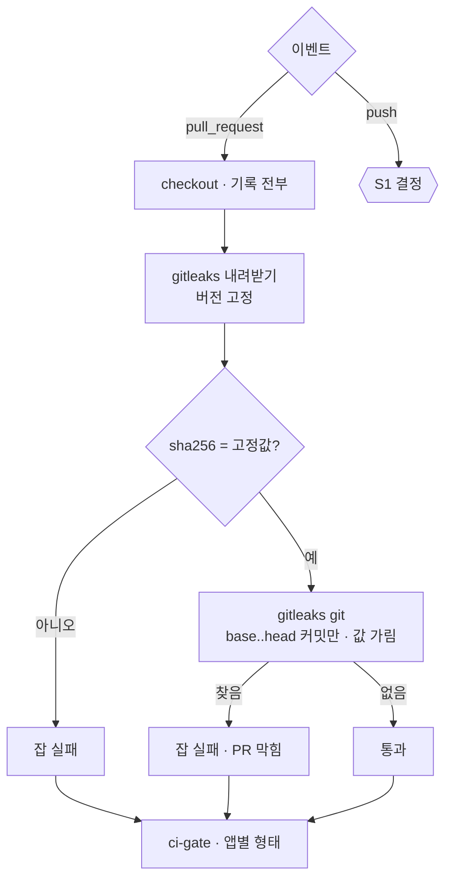

# ARCHITECTURE — secret-scan

> PRD: [PRD.md](PRD.md). ADR 없음(아래 「ADR 판정」). 줄 번호는 0cbc1d3 기준이다.

## 바뀌는 층

템플릿 두 파일과 업그레이드 모드 문서 한 곳, 그리고 그 테스트만 바뀐다. `fill_ci.py` · 이 레포 자신의 CI(`.github/workflows/ci.yml`)는 그대로다.

```mermaid
flowchart LR
  TPL[templates/.github/workflows/ci.yml<br/>단일 형태 + 앱별 주석 블록]:::changed
  GI[templates/.gitignore.append]:::changed
  HI[skills/harness-init/SKILL.md<br/>§4 처음 설치]
  UP[skills/harness-init/SKILL.md<br/>§0 업그레이드 모드]:::changed
  FC[fill_ci.py<br/>플레이스홀더 7개]
  REPO[템플릿으로 만든 레포<br/>.github/workflows/ci.yml · .gitignore]
  TPL --> HI --> FC --> REPO
  GI --> HI
  TPL -. 안내 한 줄만 .-> UP
  GI -. 빠진 줄 diff .-> UP
  UP -. CI 파일은 안 고침 · .gitignore는 diff 승인 뒤 .-> REPO
  classDef changed stroke-width:3px
```

| 자리 | 지금 | 바뀜 |
|---|---|---|
| 템플릿 CI 단일 형태(`templates/.github/workflows/ci.yml:22`) | 잡 `verify` 하나 | 잡 `secret-scan`을 `verify` 옆에 더한다. 두 잡은 서로 기다리지 않는다 |
| 템플릿 CI 앱별 주석 블록(`:50-99`) | `changes` · `api` · `web` · `ci-gate`, `ci-gate: needs: [changes, api, web]`(`:94`) | 같은 `secret-scan` 잡을 주석 블록에 더하고 `ci-gate`의 `needs`에 넣는다. `changes` paths 필터는 거치지 않는다(어느 앱이 바뀌어도 돈다) |
| 템플릿 `.gitignore.append` | 하네스 상태 · 리포트 · 디자인 레퍼런스 줄 | `.env` 줄을 더한다 |
| 업그레이드 모드 표(`skills/harness-init/SKILL.md:16-25`) | CI는 다시 하지 않는다(`:14`). `.gitignore`는 `.gitignore.append`의 빠진 줄을 넣는다(`:22`) | CI 행을 더한다: 고치지 않고, 레포 CI에 비밀값 검사가 없으면 안내 한 줄. `.gitignore` 행은 그대로라 `.env` 줄도 다른 빠진 줄처럼 diff 승인 뒤 들어간다(S2 = B) |
| 처음 설치(`skills/harness-init/SKILL.md` §4) | 템플릿을 복사하고 `fill_ci.py`로 채운다 | 그대로. 새 잡에는 플레이스홀더가 없어 복사만으로 들어간다 |

## 데이터 흐름 (PR 하나)



## 결정

구조 · 기술 결정. 열린 것 0(2026-11-28 지휘 결정 묶음 1회차 회신: S1 지휘 판정 · S2 사용자).

| # | 정할 것 | 선택지 | 추천 | 주체 |
|---|---|---|---|---|
| S1 | push 이벤트(기준 브랜치 push)에서 비밀값 검사 잡이 무엇을 하나. 설계서는 「PR이면 PR 커밋 범위」만 정했다. 그대로 두면 push에서 PR 기준 · 머리 값이 비어 범위가 깨진다 | A: PR에서만 돈다, push에서는 잡이 건너뛰어진다(skipped. 앱별 `ci-gate`는 skipped를 통과로 친다) / B: push에서도 `before..after` 범위를 검사한다 | A | 지휘 판정(사용자 반려 가능) — 설계서 「PR이면 그 PR의 커밋 범위만」 · 범위 밖 「레포 전체 기록 훑기」. 템플릿 한 파일이라 되돌리기 쉽다 |
| S2 | 업그레이드 모드에서 `.env` 줄. 지금 `.gitignore` 행은 `.gitignore.append`의 빠진 줄을 넣는다(`SKILL.md:22`) → 그대로 두면 `.env` 줄이 이미 깔린 레포 `.gitignore`에 들어간다. 설계서는 「안내 한 줄만 · 파일 자동 수정 없음」 | A: 설계서 그대로 — `.gitignore` 행에서 `.env` 줄은 빼고 안내 한 줄에 넣는다 / B: `.gitignore` 행 그대로(`.env`도 전체 diff 승인 뒤 들어간다), 안내는 CI 잡만 | A(세션) · B(지휘) | 사용자(AI 추천 수용 — 지휘 추천 B, 2026-11-28). 승인한 diff로만 들어가니 몰래 바꾸는 게 아니다. A를 버린 이유: 깔린 레포는 사람이 손으로 넣어야 해서 빠뜨리면 유출 위험이 남는다 · 업그레이드 규칙에 예외 한 줄 |

아래는 설계서가 검증 세션에 맡긴 기술 세부(gitleaks 버전 값 · 내려받는 방법 · PR 커밋 범위 지정법 · 테스트 방법)라 코드 사실로 정했다(주체: 검증 세션, 설계서 위임). 되돌리기 쉽다 — 템플릿 한 파일 · 테스트 한 파일만 고친다.

- 버전: gitleaks 8.30.1(2026-11-28 기준 최신 릴리스, 2026-03-21 공개). 템플릿 잡의 `env`에 `GITLEAKS_VERSION` · `GITLEAKS_SHA256` 두 값으로 둔다. 올릴 때는 두 줄만 바꾼다
- 체크섬: 상류 `gitleaks_8.30.1_checksums.txt`의 `linux_x64` 값 `551f6fc8…f2470eb`. 검증 세션이 내려받은 파일의 sha256과 대조해 같음을 확인했다. 잡은 `sha256sum -c`로 대조하고, 다르면 압축을 풀기 전에 실패한다
- 내려받기: GitHub 릴리스 주소에서 `curl -sSfL`로 `linux_x64` 압축 파일 하나를 받는다(`runs-on: ubuntu-latest` 한 종류). 풀어 둔 실행 파일은 `$RUNNER_TEMP`에 두어 작업 트리를 더럽히지 않는다. 버린 방법: 공식 action(ADR-021 질문 3에서 버림) · 패키지 관리자 설치(버전 · 체크섬을 고정하기 어렵다)
- 범위: `actions/checkout`에 `fetch-depth: 0`(기준 커밋이 있어야 범위가 된다). PR 기준 · 머리 커밋은 `github.event.pull_request.base.sha` · `head.sha`를 스텝 `env`로 넘기고, `gitleaks git --log-opts="${BASE}..${HEAD}"`로 그 범위 커밋만 본다. `run:` 안에 `${{ }}`를 직접 넣지 않는다(값이 셸 코드로 섞이지 않게)
- 출력: `--redact`로 찾은 값을 로그에서 가린다(공개 레포의 CI 로그도 공개다). `--no-banner`
- 잡 이름: `secret-scan`. 단일 형태 · 앱별 형태가 같은 이름이라 업그레이드 안내 · 테스트가 한 이름으로 찾는다
- 잡 머리 주석 한 줄: 걸리면 값은 이미 원격에 있으니 폐기가 먼저라는 것(이슈 본문). 템플릿을 받은 레포 사람이 실패를 처음 보는 자리가 그 파일이다
- 업그레이드 안내 조건: 레포 `.github/workflows/ci.yml`에 `gitleaks`가 없으면 한 줄. `.env` 줄은 안내하지 않는다 — `.gitignore` 행의 diff에 이미 보인다(S2 = B). 문구는 PRD AC-7 👤

## 지키는 것

- 템플릿 안에 이 레포 전용 경로 · 이름을 넣지 않는다(PRD 제약)
- 템플릿 플레이스홀더를 늘리지 않는다. 늘면 `fill_ci.py`와 그 테스트(`hooks/tests/fill-ci.sh` ①)가 같이 바뀌어야 한다
- 실제 키 꼴 값은 어디에도 커밋하지 않는다. 테스트와 실측은 가짜 키를 실행 중에 만든다(GitHub 비밀값 push 보호에 걸리지 않게)
- 업그레이드 모드는 레포 CI 파일을 고치지 않는다(PRD AC-7). `.gitignore`는 기존 행대로 승인 뒤에만 쓴다(PRD AC-11)

## 테스트 전략

- 새 케이스 묶음 `hooks/tests/secret-scan.sh`(러너가 테스트 파일로 알아보는 자리, `hooks/test.sh`가 source). 레포 파일은 건드리지 않고 `$TMP`에서만 돈다
- 꼴 검사: 템플릿을 YAML로 읽는다(시스템 `ruby -ryaml`. 이 레포 CI는 `macos-latest`라 있다). 단일 형태 · 주석을 벗긴 앱별 블록 둘 다 YAML로 읽혀야 하고, 잡 · `needs` · `fetch-depth` · `env` 두 값의 꼴을 본다
- 동작 검사(네트워크 없음): 템플릿에서 스텝의 `run:`을 꺼내 그대로 돌린다
  - 내려받기 스텝: 가짜 `curl`(PATH 앞)이 정해 둔 압축 파일을 낸다. sha256을 그 파일 값으로 넘기면 `$RUNNER_TEMP/gitleaks`가 생기고, 다른 값이면 실패하고 실행 파일이 없다
  - 검사 스텝: `$RUNNER_TEMP/gitleaks` 자리에 가짜 실행 파일을 두고 임시 git 레포에서 돌린다. 넘긴 범위가 `base..head`인지, 가짜가 낸 종료 코드가 잡 결과로 그대로 나오는지 본다
- 실제 실행(완료 조건): 진짜 gitleaks 8.30.1을 템플릿 스텝 그대로 내려받아, 임시 레포에서 가짜 키가 든 PR 범위 · 키를 뺀 PR 범위 두 경우를 돌린 출력과 걸린 시간을 PR에 싣는다. 훅 테스트에는 넣지 않는다 — 테스트가 네트워크에 기대면 오프라인 · 다른 OS에서 거짓 실패가 난다
- 업그레이드 모드(PRD AC-7)는 사람이 부르는 스킬 문서라 실행하지 않는다(유료 실행 0회). 테스트는 `SKILL.md` §0 표의 CI 행(고치지 않음 · 안내 한 줄) · `.gitignore` 행(빠진 줄 · 예외 없음) 글을 본다. 실제 업그레이드 화면의 안내 한 줄은 사람이 볼 것(👤)으로 PR에 싣는다

## ADR 판정

ADR 없음. 큰 결정(gitleaks CLI · PR 범위 · `.env`)은 이미 ADR-021(강의 대조로 나온 하네스 보강 결정 묶음) 질문 3에 있다. 이번 결정(S1 · S2 · 위 기술 세부)은 「되돌리기 비싸다」를 넘지 못한다: 바꿔도 템플릿 한 파일 · 업그레이드 표 한 행 · 테스트 한 파일만 고친다. 이미 깔린 레포는 업그레이드 모드가 안내만 하므로 템플릿을 바꿔도 남의 레포를 고칠 일이 없다. ADR-021 I5 행(`docs/lecture-gap-2026-11-26/ADR.md:121`)은 바뀌지 않아 「갱신」 줄도 없다.
