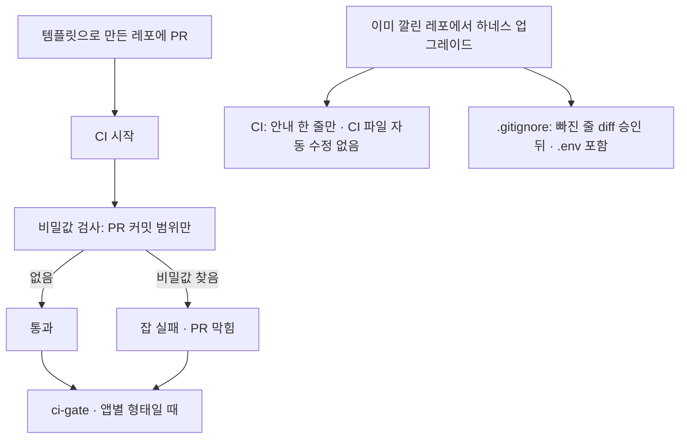

# PRD — secret-scan

> 원문: 지휘 자리 설계서 최종본(사용자 승인, 2026-11-28, 비공개 경로라 링크하지 않음) · 이슈 https://github.com/jtwjs/claude-harness/issues/71 본문과 결정 댓글 · 상위 결정 ADR-021(`docs/lecture-gap-2026-11-26/ADR.md` 「구현 이슈 분해」 I5 · 질문 3). 아래는 설계서 원문의 뜻을 바꾸지 않고 옮긴 것이다. 에이전트 칸(`AC-N` · 맡는 쪽 · `👤` · 키워드)만 더했다.

## 무엇을

하네스 템플릿으로 만든 레포의 CI가, PR에 들어온 커밋에서 비밀값(키 · 토큰)을 찾으면 실패한다. 템플릿 `.gitignore`에는 `.env`가 들어간다.

## 왜

- 진짜 문제: 템플릿 CI(`templates/.github/workflows/ci.yml`)는 잡 `verify` 하나이고 비밀값 검사가 없다. 템플릿으로 만든 레포에서 비밀값이 PR로 원격에 올라가도 CI가 막지 않는다(ADR-021 I5 · 이슈 #71)
- 템플릿 `.gitignore.append`에 `.env` 줄이 없다(하네스 상태 · 리포트 · 디자인 레퍼런스 줄만, ADR-021 질문 3)
- 걸려도 값은 이미 원격에 있으니 폐기가 먼저다(이슈 본문). 검사는 사고를 알리는 장치이고, 폐기는 사람이 한다
- 성공지표: 가짜 키가 든 PR에서 CI가 실패하는가. 비포: 실패하지 않는다(템플릿에 검사 잡 0개, 확인함 2026-11-28). 애프터: 가짜 키 있음/없음 두 경우의 gitleaks 실제 실행 출력으로 잰다

## 키워드

| 용어 | 이 기능에서의 뜻 |
|---|---|
| 템플릿 CI | `templates/.github/workflows/ci.yml`. `harness-init`이 레포의 `.github/workflows/ci.yml`로 복사하고 `fill_ci.py`가 채운다 |
| 단일 형태 · 앱별 형태 | 템플릿 CI의 두 꼴. 단일 = 위쪽 `jobs.verify`. 앱별 = 맨 아래 주석 블록(앱별 잡 · `changes` paths 필터 · `ci-gate`) |
| 비밀값 검사 잡 | 템플릿 CI에 새로 넣는 잡. gitleaks CLI로 PR 커밋 범위를 검사한다 |
| PR 커밋 범위 | PR 기준 커밋(base)에서 닿지 않고 PR 머리 커밋(head)에서 닿는 커밋들(`base..head`) |
| 버전 · 체크섬 고정 | 내려받는 gitleaks 실행 파일의 버전 번호와 sha256 값을 템플릿에 적어 두고, 값이 다르면 잡을 실패시킨다 |
| 업그레이드 모드 | `skills/harness-init/SKILL.md` §0. 이미 깔린 레포에서 템플릿이 주인인 사본만 맞춘다 |
| 가짜 키 | 실제 키 꼴(클라우드 접근 키 꼴)이되 실제로 쓸 수 없는 값. 테스트 · 검증이 실행 중에 만들고 커밋하지 않는다 |

## 사용자 흐름

## 범위

포함

- 템플릿 CI에 비밀값 검사 잡을 더한다. PR이면 그 PR의 커밋 범위만 본다
- gitleaks CLI는 버전과 체크섬을 고정해 내려받는다
- 템플릿 CI의 두 형태(단일 · 앱별)에 다 넣는다. 앱별 형태면 `ci-gate`의 `needs`에도 넣는다
- 템플릿 `.gitignore.append`에 `.env`를 넣는다
- 업그레이드 모드: 이미 깔린 레포의 CI에는 「비밀값 검사 잡이 새로 생겼다」는 안내 한 줄만 보이고, CI 파일을 자동으로 고치지 않는다
- 업그레이드 모드: 이미 깔린 레포의 `.env` 줄은 지금 업그레이드 방식 그대로 다른 빠진 줄처럼 diff로 보여 주고, 승인하면 `.gitignore`에 들어간다

하지 않을 것

- 이미 원격에 올라간 값을 폐기하거나 기록에서 지우기: 걸려도 값은 이미 원격에 있으니 폐기가 먼저다(이슈 본문). 사람이 할 일이다
- 레포 전체 기록 훑기: PR 범위만 본다
- 이 하네스 레포 자신의 CI: 템플릿만 바꾼다
- 계정 · 키 · 유료 플랜이 필요한 도구

## 비기능

- CI 시간이 눈에 띄게 늘지 않는다. 미측정: 검증 세션이 임시 레포에서 잡 시간을 잰다(방법 — 템플릿 잡의 내려받기 · 검사 명령을 임시 레포에서 그대로 돌려 걸린 시간 / 기한 — PR 전)

## 제약

- 템플릿은 다른 레포로 복사된다. 템플릿 안에 이 레포 전용 경로 · 이름을 넣지 않는다
- 공개 레포라 테스트용 가짜 키는 실제 키 꼴이되 실제로 쓸 수 없는 값만 쓴다

## 가정

- gitleaks 기본 규칙이 흔한 가짜 키 꼴(예: 클라우드 접근 키 꼴)을 잡는다. 확인함(2026-11-28, 검증 세션 스크래치): gitleaks 8.30.1 기본 규칙이 실행 중에 만든 클라우드 접근 키 꼴 값 1건을 잡았다(`leaks found: 1` · exit 1). 키 없는 커밋은 `no leaks found` · exit 0
- 템플릿 CI의 앱별 형태는 주석 블록이고 `ci-gate`가 `needs`로 잡을 모은다. 확인함(2026-11-28): `templates/.github/workflows/ci.yml` 주석 블록에 `ci-gate: needs: [changes, api, web]`

## 결정

설계서 「결정한 것」 그대로(제품 · 도메인 결정). 기술 결정은 [ARCHITECTURE.md](ARCHITECTURE.md) 「결정」 절.

| 주제 | 결정 | 주체 | 이유 · 버린 방법 |
|---|---|---|---|
| secret-scan-tool | 비밀값 검사는 gitleaks CLI를 버전 고정으로, PR 커밋 범위에만 돌린다 | 사용자(AI 추천 수용) · ADR-021 질문 3 A | 계정 · 키가 필요 없다. 버린 방법은 ADR-021 질문 3에 있다(공식 action: 조직 레포는 키 · 상용 라이선스 / 호스팅 검사: 조직 비공개 레포는 유료) |
| env-ignore | 템플릿 `.gitignore.append`에 `.env`를 넣는다 | 사용자(AI 추천 수용) · ADR-021 질문 3 A | 비밀값 파일이 처음부터 커밋되지 않게 |
| installed-repo-notice | 이미 깔린 레포의 CI에는 안내 한 줄만 보이고, CI 파일을 자동으로 고치지 않는다 | 사용자(AI 추천 수용) · 이슈 끝 조건 | 남의 레포 CI를 몰래 바꾸지 않는다 |
| installed-repo-env | 이미 깔린 레포의 `.env` 줄은 지금 업그레이드 방식 그대로: 다른 빠진 줄처럼 diff로 보여 주고 승인하면 `.gitignore`에 들어간다 | 사용자(AI 추천 수용, 2026-11-28, 결정 묶음 1회차 S2) | 승인한 diff로만 들어가니 몰래 바꾸는 게 아니다. 버린 방법: 안내 한 줄에만 넣기(깔린 레포는 사람이 손으로 넣어야 해서, 빠뜨리면 유출 위험이 남음 · 업그레이드 규칙에 예외 한 줄) |
| checksum-pin | 버전 고정에는 내려받은 실행 파일의 체크섬 확인을 포함한다 | 지휘 판정(사용자 반려 가능) | 버전 번호만 고정하면, 같은 번호로 다른 파일이 내려와도 모른다. 일반적인 공급망 관행이다 |
| track-order | #80 「릴리스 필요 알림」 머지 뒤 이 자리에 #71을 넣는다. #91 「러너 tdd:false 테스트 보호」와 병렬 | 사용자(AI 추천 수용, 2026-11-28) | 선행이 없고 바꾸는 파일(템플릿 CI · .gitignore)이 다른 트랙과 겹치지 않는다 |

## 수용 조건

맡는 쪽: 층이 하나(템플릿 · 하네스 문서)라 생략한다. 검증 세션이 테스트를 쓰고 구현 세션이 통과시킨다.

- [ ] AC-1 템플릿 CI 단일 형태에 비밀값 검사 잡이 있다. PR이면 그 PR의 커밋 범위(`base..head`)만 검사한다
- [ ] AC-2 gitleaks는 버전과 sha256을 템플릿에 고정해 내려받는다. 내려받은 파일의 sha256이 고정값과 다르면 잡이 실패한다
- [ ] AC-3 (설계서 수용 기준 1) Given 가짜 키를 넣은 커밋이 든 PR · When CI · Then 비밀값 검사 잡이 실패한다
- [ ] AC-4 (설계서 수용 기준 2) Given 그 키를 뺀 PR · When CI · Then 통과한다
- [ ] AC-5 (설계서 수용 기준 3) Given 앱별 형태 · When 템플릿을 펼침 · Then 비밀값 검사 잡이 있고 `ci-gate`의 `needs`에 그 잡이 있다
- [ ] AC-6 템플릿 `.gitignore.append`에 `.env` 줄이 있다
- [ ] AC-7 (설계서 수용 기준 4, S2 반영) Given 이미 깔린 레포 · When 하네스 업그레이드 · Then CI에는 안내 한 줄만 보이고 그 레포 CI 파일은 바뀌지 않는다 👤 안내 한 줄 문구
- [ ] AC-11 (S2) Given `.gitignore`에 `.env` 줄이 없는 깔린 레포 · When 하네스 업그레이드 · Then `.env` 줄은 다른 빠진 줄과 같이 diff로 보이고 승인 뒤에만 들어간다(업그레이드 모드 `.gitignore` 행 그대로)
- [ ] AC-8 템플릿 안에 이 레포 전용 경로 · 이름이 없다. 템플릿 플레이스홀더는 지금 7개 그대로라 `fill_ci.py`가 바뀌지 않는다
- [ ] AC-9 비밀값 검사 잡의 시간을 잰다(내려받기 · 검사 각각). 비포: 잡 없음
- [ ] AC-10 새 동작은 훅 테스트로 덮고 `bash hooks/test.sh`가 통과한다

## 남은 ⚠️

- 없음 (S1 · S2 모두 닫힘, ARCHITECTURE 「결정」)
