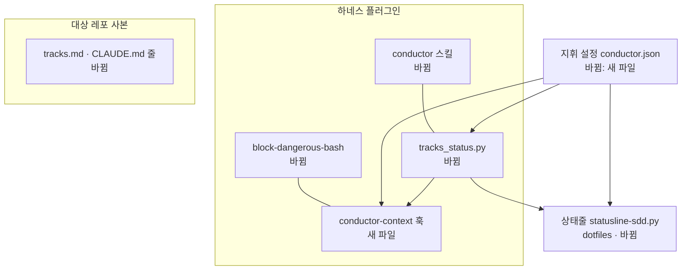
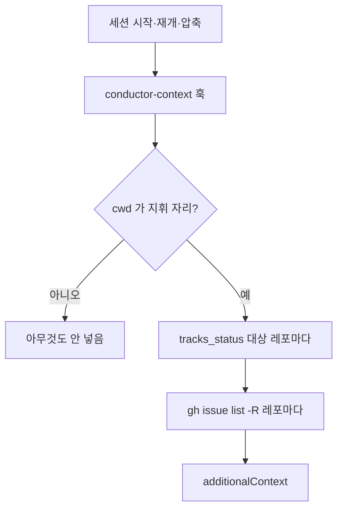

# ARCHITECTURE — 지휘 세션 하나

## 키워드

| 용어 | 이 문서에서의 뜻 |
|---|---|
| 지휘 자리 | 지휘 세션을 여는 폴더. 하네스가 깔리지 않은 폴더(사람의 vault)일 수 있다 |
| 대상 레포 | 지휘가 맡는 레포. 지휘 설정 파일에 경로로 적는다 |
| 지휘 설정 | `~/.claude/conductor.json` — 지휘 자리와 대상 레포 목록 (ADR-001) |
| 트랙 세션 | 대상 레포 안에서 연 세션. 상주 · 기능 묶음 · 1회용 |
| 옛 지휘 이름 | `<레포>-conductor`. 사본을 업그레이드하지 않은 레포가 계속 쓴다 |

## 개요

지휘는 레포 안에서 돌지 않는다. 지휘 자리에서 돌며 대상 레포를 경로·`-R`로 지정해 다룬다. 원장은 지금처럼 레포마다의 GitHub 이슈와 ADR이다. 하네스가 "지금 레포"를 cwd로 정하던 곳 중 지휘가 지나는 곳만, 지휘 설정이 있으면 대상 레포를 읽도록 바꾼다. 지휘 설정이 없으면 모든 동작이 지금과 같다.

## 계층 배치

| 층 | 책임 | 이번에 |
|---|---|---|
| 지휘 설정 | 지휘 자리 · 대상 레포 경로. 머신마다 다르다 | 새로 |
| `conductor` 스킬 | 지휘 절차. 모든 gh·git 명령에 대상 레포 지정 · 세션 종류 · 옛 이름 호환 · 재개 | 고침 |
| `tracks_status.py` | 트랙 현황. 지휘 설정이 있고 cwd가 지휘 자리면 대상 레포 전부, 아니면 cwd 레포 하나 | 고침 |
| `block-dangerous-bash.sh` | 계정 검사·운영 DB 절의 "대상 레포" 판정 | 고침 |
| `conductor-context.sh` (SessionStart) | 지휘 자리에서만 현황 + 열린 이슈를 additionalContext로 | 새로 |
| 검사 상한 `lib/verify-busy` | 지금 도는 검사 프로세스 수를 센다(ps). Stop 훅·러너·PreToolUse가 쓴다 | 새로 |
| 템플릿·`harness-init` ⑧ | 레포 사본의 지휘 이름 · 세션 종류 표 | 고침 |
| 상태줄 (dotfiles) | 지휘 자리 판정 · 손댈 것만 | 고침 |

## 데이터 흐름

- 지휘가 이슈를 쓸 때: `gh issue create -R <owner>/<repo>` → `block-dangerous-bash`가 `-R`의 owner로 계정을 고른다 → 이슈는 그 레포에 남는다.
- 트랙 세션이 결정을 알릴 때: `SendMessage conductor` (옛 사본은 `<레포>-conductor` — 그 이름의 세션이 없으면 사람이 옮긴다. §8 그대로).

## 경계·의존 방향

- 지휘 설정은 읽기만 한다. 플러그인 어디도 이 파일을 쓰지 않는다(사람이 쓴다).
- 지휘 설정이 없으면 새 코드 경로는 전부 건너뛴다 — 하네스를 쓰는 다른 사람·다른 머신은 지금과 같다.
- 지휘 자리가 vault여도 플러그인은 vault 파일을 읽지 않는다. vault 규칙(반출 금지 등)은 vault의 CLAUDE.md가 맡는다.
- 상태줄은 dotfiles 소유. 하네스 스크립트(`tracks_status.py`)를 부르기만 한다(지금과 같은 방향).

## 상태 관리 규약

- 상태는 GitHub 이슈와 각 worktree의 `phases/*/index.json`에만 있다. 지휘 세션의 대화는 상태가 아니다 — 압축 뒤 훅이 다시 넣는다.
- 지휘 설정의 대상 레포 경로는 기준 worktree(본 트리)다. worktree는 `git worktree list`로 찾는다(지금과 같음).

## 테스트 전략

- `hooks/test.sh`에 케이스 추가: `-R` 없는 gh 쓰기 차단(지휘 자리) · `-R` owner로 계정 판정 · `git -C` 대상 레포의 prodDb 판정 · conductor-context 훅의 지휘 자리 / 아님 / gh 실패.
- `tracks_status.py`: 임시 git 레포 2개 + worktree + phases로 `--compact` 결과(끝 없음 · 진행 중끼리 겹침 · 대상 레포 여럿)를 같은 test.sh에서 본다.
- 상태줄은 dotfiles 레포라 여기 테스트 밖. 수동 확인 1회(지휘 자리에서 조각이 뜨는지).
