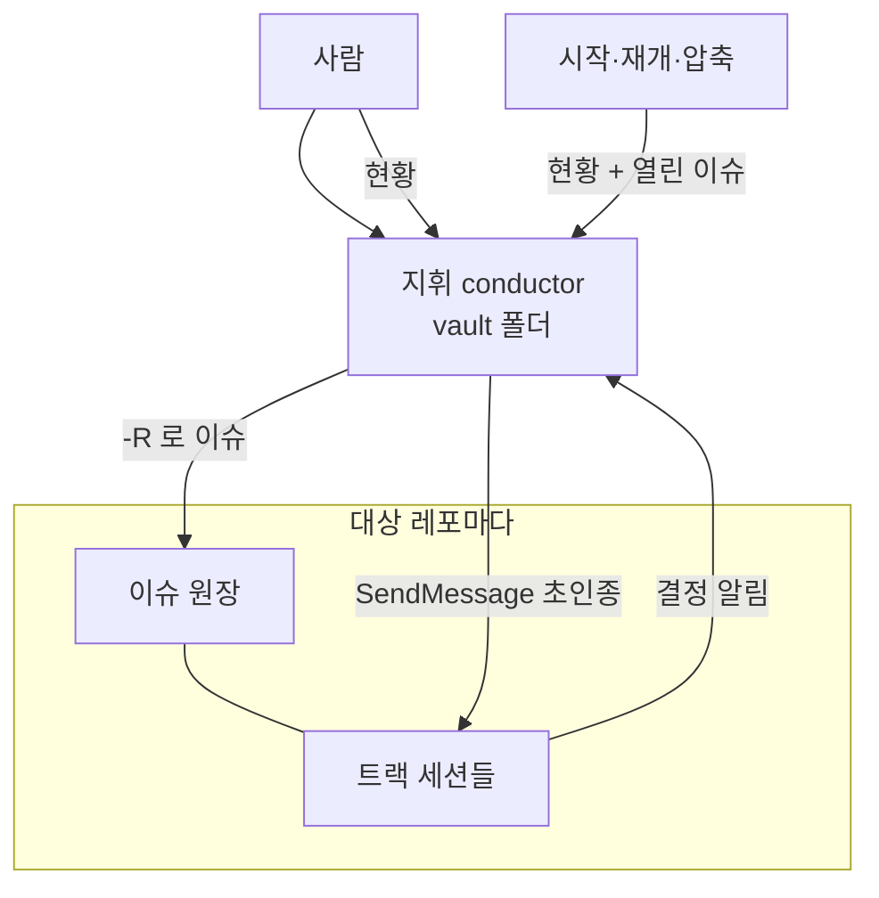

# PRD — 지휘 세션 하나 · 세션 종류 · 검사 동시 실행 상한

## 날것

> 프로젝트별로 지휘 세션을 각각 두는 현재 방식에서 지휘 세션 단 하나를 두게끔 개선한다. 각 프로젝트별로 1회용 세션(버그, 리뷰 등), 지속 운영할 세션(autocompact로 진행되어서 문제없음), 그리고 전체 지휘하는 지휘 세션. 오르카는 프로젝트별로 세션을 만들기 때문에 지휘 세션은 위키에 둔다. 계속 쓰는 세션은 레포마다 여러 개일 수 있다(fe·be, 큰 기능 묶음 단위 병렬). 세션 상태 표시는 "트랙 끝7"처럼 의미 없는 것이 뜰 때가 있다.

## 무엇을

`conductor`를 레포 하나 안의 지휘에서 **여러 레포를 한 세션이 지휘**하는 것으로 바꾸고, 세션 종류(지휘 · 상주 · 기능 묶음 · 1회용)와 이름 규칙을 정한다.

## 왜

- 진짜 문제: 지휘 세션이 레포마다 하나씩 떠 있어 사람이 지휘들 사이를 오가며 말을 옮긴다. 세션 성격이 정해져 있지 않아 이름 없는 세션이 쌓이고, 상태줄은 끝난 worktree를 세어 할 일이 아닌 숫자를 띄운다.
- 한 줄 정의: 우리는 (지휘가 레포마다 갈라져 사람이 중계자가 되는 문제) 때문에 (사람은 지휘 하나와만 대화하는 상태)를 위해 (지휘를 개인 vault 세션 하나로 모으고 세션 종류를 고정)한다.
- 참고: 외부 세미나 Q&A(2026-10-31) — 메인 오케스트레이터 하나와만 대화하고 그 세션이 나머지 세션과 대화한다. 세션 성격을 정한다(쓰고 버리는 세션 / 프로젝트별 롱러닝 메인). 자동 압축에 맡긴다.

### 성공지표

| 지표 | 비포 (2026-10-31 실측) | 목표 |
|---|---|---|
| 떠 있는 지휘 세션 수 | 3 (`ListAgents`, `*-conductor` 이름) | 1 |
| 대상 레포 상태줄 트랙 조각에서 할 일 없는 항목 | 한 레포 `트랙 끝17 겹침50` (`tracks_status.py --compact`) | 진행 중 트랙이 없으면 빈 출력. `끝N` 없음 |
| vault 폴더에서 `-R` 없는 `gh issue comment` | 통과 — owner를 cwd origin으로 판정(`block-dangerous-bash.sh` :102-103) | 막힘 |
| 동시에 도는 전체 검사(verify) 수 | 17 (2026-10-31 사람 관찰: 세션 17개가 각자 `pnpm verify` 전체를 동시에) | 상한(기본 2) 이하 |
| 사람이 세션 사이에 말을 옮긴 횟수 | 미측정: 세션 로그에서 "지휘에게 전해·옮겨" 류 사람 메시지 집계 / 2026-11-14 | 줄어듦 |

## 사용자 시나리오

1. 사람이 vault 세션(`conductor`)에 "bv-admin 채널 관리 기능 시작"이라고 한다 → 지휘가 대상 레포의 CLAUDE.md·`tracks.md`를 읽고, 기능 묶음 트랙 행을 제안하고, 지시문을 채워 트랙 세션에 보낸다.
2. 트랙 세션이 결정을 알린다 → 지휘가 주 레포에 `decision` 이슈를 `-R`로 연다. 다른 레포에 걸치면 그 레포에 `follow-up` 이슈만 열고 링크한다.
3. 1회용 세션(`<레포>-tmp-<할일>`)이 버그를 고치다 결정을 만난다 → 지휘에게 알리고 이슈로 남긴 뒤 닫힌다.
4. 사람이 "현황"이라고 한다 → 지휘가 대상 레포 전부의 트랙 현황을 한 장으로 본다.
5. 지휘 세션이 압축됐거나 새로 열렸다 → 대상 레포들의 열린 `conductor` 이슈를 다시 모아 이어 간다.

## 사용자 흐름

- 진입 경로: vault 폴더에서 연 세션을 `/rename conductor` / 트랙 세션의 `SendMessage` / 사람의 "현황"
- 동선: 지휘 자리 확인 → 대상 레포 지정(`-R`·`git -C`) → 이슈 원장 → 트랙에 초인종

## 범위

포함
- `conductor` 스킬: 지휘 자리·대상 레포 목록·`-R` 규칙·옛 이름 호환·세션 종류·재개(§7·압축 뒤)
- `tracks_status.py`: 대상 레포 여럿 · `--compact`에서 `끝N` 제거 · 겹침은 진행 중 worktree끼리만
- `block-dangerous-bash.sh`(계정 검사·운영 DB 절): 대상 레포(`-R` · `git -C` · `cd <경로> &&`) 기준 판정. vault 폴더(하네스 없음)에서 `-R` 없는 gh 쓰기 차단
- 템플릿 `tracks.md`·`track-brief.md`, `harness-init` ⑧ 지휘 이름 줄
- 상태줄(`statusline-sdd.py`, 레포 밖 dotfiles): 지휘 자리 판정을 지휘 설정 기준으로
- 검사 동시 실행 상한: Stop 훅 verify · 러너 판정 · 모델이 직접 친 verify 명령이 머신 전체 상한(기본 2)을 나눠 쓴다. 세션이 하나면 아무 일도 하지 않는다
- 지휘 자리 SessionStart 훅(시작·재개·압축 뒤): 대상 레포의 트랙 현황 + 열린 `conductor` 이슈 목록을 넣어 준다
- 대상 레포 2개의 사본 업그레이드

이 PRD 밖(사람 환경, 하네스 레포에 커밋하지 않음): vault CLAUDE.md 「지휘 자리」 절 · `~/.claude/conductor.json` · `~/.claude/gh-accounts.txt`에 회사 org 계정 한 줄

하지 않을 것
- 레포 밖을 고치는 트랙 — 다른 레포는 그 레포에서 연 세션이 트랙이다
- 1회용 세션을 트랙 표 행으로 올리기 — 이름 규칙만
- 그 밖의 회사 레포 사본 업그레이드 — 플러그인은 옛 이름을 계속 알아본다
- 지휘 세션의 SessionStart vault 알림 줄이기 — 실제로 거슬리면 그때
- 레포별 검사 줄이기(앱별 verify · lint·format 캐시 · "전체 verify는 PR 직전" 규칙) — 레포마다 다르고 세션 하나일 때 손해가 날 수 있어 레포 세션이 고친다
- 지휘 편의 설정(재개 별칭 · 에이전트 뷰 · ⛔ 폰 알림 · 읽기 명령 미리 허용) — 하네스 밖 개인 설정이라 출시 뒤 사람이 켠다
- 레포를 넘는 하나의 ADR 원장 · vault에 결정 원장

## 결정

### conductor-single-seat
- 목적·이유·배경: 지휘가 레포마다 있으면 사람이 중계자가 된다. 지휘는 코드를 고치지 않으므로 레포 설정이 로드되지 않아도 판정 전 읽기로 막을 수 있다. vault 세션은 레포 사본·과거 결정·메모리를 한 곳에서 읽는다.
- 결정: 지휘는 사람 vault 폴더 세션 하나. 이름 `conductor`.
- 결정 주체: 사람
- 버린 방법: 지휘 전용 빈 폴더 + vault `--add-dir` — 섞임은 없지만 vault 설정·메모리가 안 붙어 지휘 자리의 이점이 줄어든다

### session-kinds
- 목적·이유·배경: 세션 성격이 없으면 이름 없는 세션이 쌓이고 무엇을 닫을지 모른다.
- 결정: 지휘 `conductor` · 상주 `<레포>-<층|앱>`(닫지 않음, 자동 압축) · 기능 묶음 `<레포>-<층>-<기능>`(트랙 표 행, 병합되면 worktree와 닫음) · 1회용 `<레포>-tmp-<할일>`(표 밖). 기획·시안 단계는 새 종류가 아니라 코드 0인 기능 묶음 행으로 쓴다.
- 결정 주체: 사람(종류·앱 단위·기획 단계) / AI 추천 수용(1회용은 표 밖)
- 버린 방법: 레포마다 상주 하나 — fe·be·앱별 병렬이 막힌다 / 레포 밖 백엔드 트랙 — 그 레포를 따로 열어 트랙으로 둔다

### cross-repo-decision-ledger
- 목적·이유·배경: 레포 여럿에 걸친 결정을 어디 남기나. 같은 결정이 두 곳이면 한쪽이 낡는다. 인계받는 사람이 레포만 보고 찾아야 한다.
- 결정: 기능이 시작된 주 레포에 `decision` 이슈·ADR. 다른 레포는 `follow-up` 이슈 + 링크. ADR 번호는 레포마다.
- 결정 주체: AI 추천 수용
- 버린 방법: 레포마다 같은 결정 복제(낡음) / vault 원장(인계 불가)

### upgrade-scope
- 목적·이유·배경: 퇴사 뒤 계속 쓰는 레포만 사본을 맞춘다.
- 결정: 플러그인 릴리스 + 사본 업그레이드는 대상 레포 2개. 플러그인은 옛 `<레포>-conductor` 이름을 계속 받아들인다.
- 결정 주체: 사람

### status-line-actionable-only
- 목적·이유·배경: 상태줄이 끝난 worktree를 세어 할 일이 아닌 숫자를 띄웠다(사람: "트랙 끝7처럼 의미 없는 것").
- 결정: 상태줄은 ⛔ · 💤 · 진행 수 · 진행 중끼리 겹침만. 끝난 worktree는 지휘 §7 「지울 worktree」 목록으로.
- 결정 주체: 사람(문제) / AI 추천 수용(방법)

### verify-concurrency-cap
- 목적·이유·배경: 세션 여럿이 각자 전체 검사를 동시에 돌려 머신이 느려졌다. 세션 수는 앞으로 하나일 수도 여럿일 수도 있다.
- 결정: 공통 하네스에는 장치(슬롯 상한)만 넣는다. 경합이 없으면 작동하지 않는다. 레포별 검사 줄이기는 레포에 둔다.
- 결정 주체: 사람(합치기·레포 몫은 레포 세션) / AI 추천 수용(장치만 공통)
- 버린 방법: 공통 규칙 문구("전체 verify는 PR 직전") — 혼자 일하는 레포까지 검사가 늦어진다

## 수용 조건

- [ ] AC1 `tracks_status.py`를 대상 레포 목록 설정과 함께 vault 폴더(트랙 표 없는 폴더)에서 돌리면 레포마다 트랙 행이 나온다. 목록이 없으면 지금처럼 cwd 레포 하나. 목록의 경로가 없거나 git이 아니면 그 레포만 `(경로 없음)` 한 줄, 설정 파일이 깨졌으면 목록이 없는 것으로 본다
- [ ] AC2 `--compact` 출력에 `끝`이 없다. 모든 worktree의 SDD step이 끝났으면 빈 출력이다
- [ ] AC3 `--compact`의 겹침은 진행 중(…·⛔·💤) worktree끼리만 센다. 끝난 worktree 둘이 같은 파일을 바꿨으면 겹침 0
- [ ] AC4 `block-dangerous-bash.sh`: 하네스 없는 폴더에서 `-R` 없는 `gh issue|pr … create|comment|edit|close` → 차단(exit 2) + `-R <owner>/<repo>` 안내. `-R sellermill/x`면 계정 목록의 `sellermill` 계정으로 판정
- [ ] AC5 `block-dangerous-bash.sh` 운영 DB 절: `git -C <레포>` 또는 `cd <레포> &&`로 시작하는 명령은 cwd가 아니라 그 레포의 `harness.json` `guard.prodDb`로 판정한다
- [ ] AC6 `conductor` §0: 세션 이름 `conductor` 또는 `<레포>-conductor`면 진행. 둘 다 아니면 `/rename conductor` 안내 후 멈춤
- [ ] AC7 `conductor` 스킬의 gh·git 예시 명령이 전부 `-R`·`git -C`를 쓴다(grep으로 cwd 기준 `gh issue`·`gh label`·`gh pr` 0건)
- [ ] AC8 `templates/.claude/references/tracks.md`·`track-brief.md`·`harness-init` ⑧ 줄의 지휘 이름이 `conductor`이고 세션 종류 표가 있다
- [ ] AC9 `statusline-sdd.py`: 지휘 자리(설정의 자리 폴더)에서 대상 레포 트랙 요약이 뜬다. 진행 중이 없으면 조각 없음
- [ ] AC10 지휘 자리에서 SessionStart(시작·재개·압축)가 돌면 대상 레포마다 트랙 현황 한 줄 + 열린 `conductor` 이슈 번호·제목이 additionalContext로 들어간다. 지휘 자리가 아니면 아무것도 넣지 않는다. gh 실패는 그 레포만 `(조회 실패)` 한 줄
- [ ] AC11 검사 상한: 지금 도는 검사 프로세스가 `CLAUDE_VERIFY_MAX` 이상이면 Stop 훅 verify는 돌지 않고 `⏸ 다른 세션 검사 N개 중 — 건너뜀` 한 줄을 남긴다. 아래면 지금과 같다
- [ ] AC12 검사 상한: 모델이 직접 친 verify 명령(harness.json verify 값 · `pnpm verify`)은 상한 이상이면 PreToolUse가 차단하고 `30초 뒤 다시` 안내를 낸다. 아래면 그대로 돈다. 러너 판정은 상한 아래까지 기다린다(최대 10분)
- [ ] AC13 상한 기본값 2, `CLAUDE_VERIFY_MAX`로 바꾼다. 세션 하나에서 연속 실행은 막히지 않는다
- [ ] AC14 `bash hooks/test.sh` 전부 통과(새 케이스 AC4·AC5·AC10~AC13 포함)

## 남은 ⚠️

- 없음 (지휘 자리 판정 방식·대상 레포 목록 위치는 ADR)
