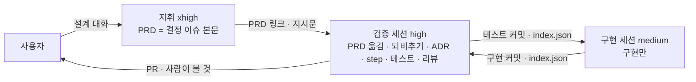

# ADR — 검증 흐름 보강 (verify-flow 트랙)

> 번호는 지휘(`conductor`)가 발급한다. 결정 원문은 jtwjs/claude-harness 이슈 #52(본문 + 댓글 3개). 이번 범위는 설계 · 계획까지이고 구현은 사용자 승인 뒤에 한다.

## ADR-019 만드는 세션과 검증하는 세션을 나누고, 사람은 설계와 검증 자리에서만 본다

- 상태: 수락 (2026-11-25) — 구현은 사용자 승인 뒤
- 맥락: 사람의 시간은 앞단(설계)과 뒷단(검증)에 쓴다(사용자 원칙). 0.41.0 실물과 대조하면 구멍이 셋이다. `sdd` §③은 「리뷰는 같은 세션의 서브에이전트」인데 `sdd-review`는 메인이 경로로 읽어 직접 돈다. `code-reviewer`는 「escalate 판정에 따라」 부르는데 기준이 없다. 테스트를 만드는 쪽이 쓰고(step 1회 호출), 테스트가 PRD 수용 조건을 다 덮는지는 아무도 대조하지 않는다(`sdd-review` 테스트 축은 짝 테스트 존재만). 요청서(step 파일 · 리뷰어 넘김 · 즉석 Agent 호출)에는 의도 · effort 칸이 없다. ADR-017(앞단 설계 도구는 DESIGN · PLAN 절차와 원칙 문서에 녹인다)의 D1c 확인 장치 · D2b 용어 겨루기 자리 이동 · 세션을 넘는 끝까지 확인, ADR-018(하네스를 덜어낼지는 있음/없음 점수 차이로)의 B-6(effort) · B-9(멈추고 묻는 칸)이 이 ADR로 넘어왔다.
- 결정 주체 칸: 「사용자」는 사용자가 고른 것, 「AI 추천 수용」은 추천을 사용자가 그대로 받은 것, 「따라 나옴」은 이미 내린 결정에서 지휘 · 이 트랙이 따라 정한 것(지휘 확인). 사용자 답은 지휘가 받아 전달했다(2026-11-25).

### 흐름 그림 (정해진 부분)

### A. 만드는 쪽 / 검증하는 쪽 분리

| # | 정할 것 | 선택지 (고르면 생기는 일) | 추천 | 주체 |
|---|---|---|---|---|
| A1 | `sdd-review`를 누가 도나 | 검증 세션이 돈다(코드를 쓰지 않은 쪽). 세션 하나 모드(작은 작업 · 지휘 없이 혼자 도는 작업)는 `sdd-review` 뒤 F2처럼 새 맥락 `code-reviewer` 1회 — 같은 세션 자기 리뷰를 막는다. `sdd` §③ 「같은 세션의 서브에이전트」 문장은 이 두 갈래로 바꾼다 | — | 따라 나옴(E1 · F2) |
| A2 | `code-reviewer`를 부르는 기준 | ① 늘 부른다 — 기준이 필요 없지만 문서 · 설정 변경에도 opus 호출 ② 조건 목록: `gate`(schema · api · error · delete · security)에 닿는 변경 · `pr-write` Risk 30 초과 · `sdd-review`에 「확인 필요」가 남음 중 하나 — 안 부르면 `code-reviewer 건너뜀: <이유>` 한 줄 ③ 검증 세션 판단 + 이유 기록 — 기준이 다시 흐려진다 | ② + 「gate에 닿음」은 세션 판단이 아니라 경로로 정한다(지휘 보탬): 계약(API 스키마) · 마이그레이션 · 권한 경로 glob 목록을 `harness.json`에서 읽는다(`tracks.md` 공유 구역은 병렬 트랙 레포에만 있어 정본으로 못 쓴다). 목록이 비면 세션 판단 + 이유 기록 | 사용자(AI 추천 수용) |
| A3 | 테스트 ↔ 수용 조건 대조 장치(ADR-017 D1c) | ① `sdd-review` 테스트 축에 「수용 조건별 테스트 위치」 표를 의무로 — 사람 눈 대조, 형식 없음 ② PRD 수용 조건에 번호(`AC-1`…)를 달고, step 「의도」 칸(C1)이 채우는 번호를 적고, `sdd-review`가 번호별 테스트 위치 표를 낸다(빈 번호 = 🟡) — 번호가 세 곳을 잇는다 ③ ② + `phases_status.py --check`가 PRD 번호 ↔ step 의도 칸을 기계 대조 | ② (기계 대조 ③은 PRD 형식이 굳은 뒤). 번호는 PRD를 쓰는 지휘가 달고, 번호마다 맡는 쪽(BE 몫 · FE 몫 · 끝까지 확인 몫)을 붙인다 — `conductor` 결정 이슈 틀에 한 줄(지휘 보탬) | 사용자(AI 추천 수용) |
| A4 | 두 세션이 나눠 만든 커밋을 judge가 어떻게 판정하나 | ① 지금처럼 끝에 한 번 — 규칙 2~4는 git 기록만 봐서 그대로 쓰이지만, RED가 틀렸다는 걸 구현이 끝난 뒤에야 안다 ② 두 번: 검증 세션이 테스트 커밋 뒤 `judge --red`(규칙 2 · 3)를 돌리고 통과하면 step에 `red: <sha>`를 적는다 → 구현 세션은 `red`가 있는 step만 집는다 → 구현 뒤 `judge`(규칙 4~6, `red` 기준) ③ step을 테스트 step / 구현 step 둘로 쪼갠다(`kind` 추가) — step 수가 두 배, 규칙 2~4가 step 경계를 넘어 다시 짜야 한다 | ② | 사용자(AI 추천 수용) |
| A5 | 검증자 · 러너 step은 fork하지 않는다(ADR-018 B-14) | Agent를 띄우는 자리 두 곳에 한 구절씩: `sdd-run` §2 2번(러너 step 서브에이전트) · `sdd-review` 「위임」(`code-reviewer`). 「만든 쪽 맥락을 물려받으면 A절 분리가 무너진다 — fork하지 않는다. 탐색 같은 보조 작업은 해도 된다」. 원칙 문서가 아니라 호출 자리에 두는 이유: 원칙 문서는 판단할 때만 읽혀서 호출 직전에 안 보인다. 검증 · 구현 세션 둘(E1)은 대화형 세션이라 fork와 무관하고, 남는 위험은 세션 하나 모드의 러너 서브에이전트와 리뷰어 호출이다 | — | 따라 나옴(점검 트랙에서 범위 이동, 지휘) |

### B. 도메인 검증 칸

| # | 정할 것 | 결정 | 주체 |
|---|---|---|---|
| B1 | 표시 시점 · 자리 | 설계에서 미리 표시한다. PRD를 지휘가 쓰게 됐으므로(E4) 지휘의 설계 대화에서 수용 조건 줄 끝에 `👤 <기준 한 구절>`을 단다. 기준은 지휘 지시문 「도메인 지식 링크」 칸의 문서에서 고르고, 하네스는 경로를 박지 않는다 | 사용자(이슈 B) · 자리는 따라 나옴(E4) |
| B2 | REVIEW 출력 | 검증 세션의 최종 판정에서 `👤` 항목만 사람 체크리스트로 낸다. 표시가 없는 변경(리팩터 · 문서)은 칸을 건너뛴다 | 사용자 |
| B3 | 막는 방식 | 건너뛰기 허용, `도메인 검증 건너뜀: <항목> — <이유(선택)>`만 남긴다(REFLECT 출구 조건과 같은 꼴). ADR-016 D-gate가 걷은 이해 관문은 사람의 이해를 시험해 막는 장치였고, 이 칸은 사람이 업무 규칙을 확인하는 검증 자리이며 막지 않는다 | 사용자 |
| B4 | 세 줄 요약 「직접 확인할 것」과의 관계 | 셋째 줄을 `위험: … · 사람이 볼 것 N개`로 하고 항목은 B5 절이 정본. 지휘가 머지를 묻는 한 줄 꼴 `Risk n · 심각도 · 사람이 볼 것 n개 · 규칙 diff 있음/없음`(아래 「B4 선택지」 ②) | 사용자(AI 추천 수용) |
| B5 | PR 본문 | 「모델이 검증한 것」(돌린 명령 · 결과)과 「사람이 볼 것: 항목별 ✅ / 건너뜀」을 두 절로 나눈다 | 사용자(이슈 B) |

B4 선택지: ① 셋째 줄을 「위험」만 남기고 사람 확인은 PR 본문 「사람이 볼 것」 절로만 — 터미널에서는 사람이 볼 것이 안 보인다 ② 셋째 줄을 `위험: … · 사람이 볼 것 N개`로 — 세 줄은 그대로(ADR-016 D-요약 · ADR-018 B-13 유지), 항목은 B5 절이 정본 ③ 지금처럼 섞어 둔다 — 위험과 사람 확인이 계속 갈리지 않는다. 추천 ②. → 사용자 선택 ②(AI 추천 수용). 같은 자리에서 지휘가 사용자에게 머지를 묻는 한 줄 꼴도 정한다(지휘 보탬, E7 보탬과 같은 자리): `Risk n · 심각도 · 사람이 볼 것 n개 · 규칙 diff 있음/없음`, 규칙 diff가 있으면 그 diff를 줄 아래에 붙인다.

### C. 에이전트 요청서 세 칸 — 의도 · effort · 검증

| # | 정할 것 | 선택지 (고르면 생기는 일) | 추천 | 주체 |
|---|---|---|---|---|
| C1 | step 「의도」 칸 | step 템플릿에 `## 의도`(채우는 수용 조건 번호 · 이유 한 줄)를 더한다. 절이 있는데 비면 `sdd_runner.py prompt`가 지시문을 내지 않는다. 절이 없는 옛 phase는 경고 한 줄만(지금 대기 중인 phase를 깨지 않게) | — | 사용자(이슈 C-1) · 옛 phase 처리는 따라 나옴 |
| C2 | effort를 어디서 정하나(ADR-018 B-6) | ① step마다 effort 칸 — 「어렵겠다는 느낌」으로 채워진다(`sdd-plan` `model` 칸과 같은 함정) ② 칸 없이 세션 역할이 정한다: 검증 high · 구현 medium. 러너가 부르는 서브에이전트 · 헤드리스 `claude -p`는 부르는 쪽 역할 값을 `--effort` / Agent effort로 넘긴다 ③ ② + step에 선택 칸(`model`처럼 `retries` 근거로만 올림) | ② — 올려야 풀리는 step은 분해가 덜 된 step이고, 그 탈출구는 이미 `model` 칸이 있다. 역할 표에 「세션을 띄울 때 `--effort`를 넘긴다(지휘 · 러너 둘 다)」를 둔다(지휘 보탬): 2026-11-25 지휘가 `claude --bg`로 플래그 없이 띄운 트랙 세션 하나가 낮은 effort로 돌았고(그 트랙 보고), 레포 `.claude/settings.json` `effortLevel`은 폴더 전체에 걸려 역할별로 못 쓴다(지휘 자리 실측) | 사용자(AI 추천 수용) |
| C3 | step 「이럴 때만 멈추고 묻는다」 칸(ADR-018 B-9) | ① step마다 칸 — step별 멈춤 조건이 보이지만 대부분 같은 말이 반복된다 ② 칸 없이 러너 지시문(`preamble.md`) 공용 규칙 한 곳: 「테스트가 수용 조건과 다르다 · 설계 문서에 없는 결정이 필요하다 · 사람만 할 수 있는 일」이면 `blocked` — 구현 세션의 blocked는 E3 순서(검증 재판정 → 사용자)로 간다 ③ ② + step에 그 step만의 조건이 있을 때만 「금지사항」 아래 한 줄 | ③ | 사용자(AI 추천 수용) |
| C4 | 「맡길 때 세 칸」 원칙 문서 자리 | ① 새 원칙 문서 한 장 — INDEX 행 · 읽는 비용이 하나 는다 ② ADR-017 D4가 만드는 `write-for-agents.md`(에이전트용 글 원칙)에 절로 붙인다(#55 뒤) — 같은 독자 · 같은 자리 ③ 문서 없이 track-brief · `code-reviewer` 넘김 형식에 칸으로만 — 즉석 Agent 호출에는 기준이 없다 | ② | 사용자(AI 추천 수용) |
| C7a | 세션 하나 작업(작은 작업)에서 옵션 없는 1회 모드의 effort | 구현 역할 값(medium). 추천 ③(검증 역할 값)과 다르다. 머지 전 새 맥락 `code-reviewer` 1회(F2)가 받친다 | 검증 역할 값(high) | 사용자(이유: 「작은 작업은 medium으로 충분, 머지 전 code-reviewer 한 번이 받침」) |
| C7b | 헤드리스 `run` 1회 모드(사람 없이 phase 전체를 돌릴 때도 쓴다)의 effort | 검증 역할 값(high). 검증 세션도 사람도 없는 자리라 테스트 품질을 받칠 것이 사후 리뷰뿐이다 | 검증 역할 값(high) | 사용자(AI 추천 수용 — 지휘 반박을 들은 뒤) |
| C5 | Agent 호출 경고 훅 | 보류 — 오탐이 많을 것으로 봄. C1 · C4 먼저 | — | 사용자(이슈 C-3) |
| C6 | track-brief 칸 · 두 세션 띄우는 법 | 지시문에 「의도」 · 「effort」 · 「세션 역할(검증 / 구현)」 칸. 지휘가 `claude --bg --permission-mode auto --effort <high\|medium> -n <레포>-<트랙>-<verify\|impl>`로 연다(E8: FE · BE 기능이면 층마다 둘, 세션 4개). `--effort`는 적용되고 사용자 전역 `effortLevel`은 적용되지 않는다(#47 B-6 실측, CLI 2.1.332) | — | 따라 나옴(E1 · E8) · 세션 이름 꼬리표는 AI 추천 |

### D. 가설 원장

| # | 정할 것 | 결정 | 주체 |
|---|---|---|---|
| D1 | 프롬프트마다 세 칸 | 판정 줄에 `intent=` · `effort=` · `verify=`를 선택 칸으로 더한다. 세 칸 모두 값은 `true \| false`(effort도 수준이 아니라 「말했나」). 이 칸이 없는 옛 줄은 null로 읽고 고치지 않는다(D2와 같은 이유). 숫자는 참고, 판정은 사용자 | 기록은 사용자 · 칸 이름과 옛 줄 처리는 AI 추천 |
| D2 | `by` enum의 사용자 별칭 값 | 그대로 둔다 — 쌓인 줄과 맞춰 쓰는 데이터 계약 | 사용자 |
| D3 | #17(판정 모호 5건 · 비사람 입력 줄) | 원장 지시가 하네스 레포 · 지휘 자리에서만 붙게 바뀌는 것(ADR-018 B-3, 점검 step 5)을 전제로 본다. 비사람 입력(세션 간 메시지만 있는 턴) 줄은 D1 형식 변경과 같은 step에서 훅이 거르게 한다. 판정 문구 5건은 #17 「다음 수」대로 데이터를 본 뒤 | 따라 나옴 |

### E. 세션 역할 — 검증 세션 ↔ 구현 세션

| # | 정할 것 | 결정 | 주체 |
|---|---|---|---|
| E1 | 구성 · effort | 지휘 xhigh / 검증 high(테스트 작성 · 검증 · 리뷰) / 구현 medium(구현만). 검증 · 구현은 대화형 세션 둘(서브에이전트 아님) | 사용자 |
| E2 | 흐름 | 검증이 테스트를 쓴다 → 구현이 맞춘다 → 검증이 다시 확인 · 리뷰한다. 러너의 「step 1회 = 테스트 + 구현」을 둘로 나눈다(판정은 A4) | 사용자 |
| E3 | 부딪힐 때 | 구현은 테스트 파일을 못 고친다 → 막히면 이유를 남기고 멈춘다 → 검증이 한 번 다시 판정 → 그래도 갈리면 사용자 | 사용자 |
| E4 | 설계 문서 담당 | PRD는 지휘가 결정 이슈 본문에 쓴다. 검증 세션이 `docs/{feature}/PRD.md`에 원문 그대로 옮기고 이슈 링크를 단다(고치지 않는다). 지휘는 다른 레포 워크스페이스에 직접 쓰지 않는다. 공개 레포면 PRD에도 이름 · 개인 문서 문구를 넣지 않는다 | 사용자 |
| E5 | PRD를 받았을 때 갈래 | 지금 `sdd` ① 표는 PRD · ARCHITECTURE · ADR 세 장이 다 있을 때만 DESIGN을 건너뛴다. 「PRD를 받았을 때」 갈래를 더한다: 원문 옮김(+ 이슈 링크) → 의도 되비추기 한 줄(지휘 확인) → ARCHITECTURE · ADR만 → Readiness → PLAN. 인터뷰 · 용어 겨루기(ADR-017 D2b)는 지휘 설계 대화로 옮겨 가 검증 세션은 돌지 않는다 | 따라 나옴(E4, 지휘 보정) |
| E6 | `sdd` 단계 나눔 | 검증 세션: ① 계획(E5 갈래) · ③ REVIEW · ④ REFLECT · ⑤ 마무리(PR). 구현 세션: ② IMPLEMENT만. `sdd` 「트랙 하나 = 세션 하나」 전제 문장을 바꾼다 | 사용자(이슈 E) · ⑤를 검증 쪽에 두는 것은 따라 나옴 |
| E7 | 사람 체크포인트 배치 | 자리를 옮긴다(아래 「E7 선택지」 ②): Readiness ❌ · step 분해는 지휘 확인(사람 아님, PRD를 고쳐야 하면 지휘가 사용자와) · REFLECT 묶음은 PR 리뷰 한 자리로 · harness-gaps 승격만 지휘 결정 이슈로. 보탬: 규칙 파일(`CLAUDE.md` · `.claude/rules/**`)이 바뀐 PR은 지휘가 사용자에게 머지를 물을 때 그 diff를 같이 싣는다 — 머지는 「조건 맞으면 머지」 한 줄로 승인되므로, PR에 실린 것만으로는 사람이 규칙 diff를 실제로 보지 않는다(이게 없으면 ②가 사실상 ①) | 사용자(AI 추천 수용) · 보탬은 지휘 의견 수용 |
| E8 | 검증 세션 구성(FE · BE) · 세션을 넘는 끝까지 확인 | 층마다 검증 + 구현(아래 「E8 선택지」 ②). FE · BE 기능 하나에 세션 4개. 끝까지 확인은 E9대로 검증 FE가 머지 전에 한다(계약을 먼저 굳혀 BE가 앞서 들어오므로 「나중에 PR을 내는 쪽」이 늘 FE다) | 사용자(이유: 「층마다 검증할 게 다르기 때문, ①은 검증이 병목으로 다가올 것 같다」). 지휘 반박 「수용 조건이 두 검증 세션에 반씩 갈려 둘 다 초록인데 붙이면 깨지는 틈 · high 세션 둘」을 들은 뒤에도 유지. 그 반박은 E9와 한 세트로 닫혔다 |
| E12 | 검증 · 구현 두 세션이 쓰는 작업 트리 · 브랜치 | ① 같은 worktree · 같은 브랜치에서 차례로 — 차례는 index.json으로 정한다(`tdd: true` · `red` 없음 = 검증 차례 · `red` 있고 pending = 구현 차례 · 구현 judge 끝 = 검증 리뷰 차례). 따라 나옴(지휘 확인): `kind: measure` = 검증 차례(먼저 본다, `--role test`가 집는다) · 그 밖의 `tdd: false` pending = 구현 차례(쓸 테스트가 없다) · blocked = 검증 재판정 차례(E3). 남의 차례에는 git을 만지지 않는다. `judge --red`의 `checkout --detach` · `reset --hard`가 구현 중인 트리를 치지 않게 하는 장치가 차례뿐이다 ② 각자 worktree — 같은 브랜치를 두 worktree에 못 걸어 검증 브랜치 ↔ 구현 브랜치를 차례마다 `merge --ff-only`로 주고받는다. 동시에 다른 step을 할 수 있지만 통로(`red` 칸)가 ff 전엔 안 보인다 | ① — E2 흐름이 원래 한 step씩 번갈아 가서 동시 작업 이득이 작고, ②는 F1 통로(index.json)를 ff 단계 뒤로 미룬다 | 사용자(AI 추천 수용) |
| E9 | 층 사이 계약(OpenAPI 스펙 등)을 누가 어떻게 주고받나 | 계약 먼저 + 변경은 지휘 경유. 지휘 PRD에 API 계약 초안(엔드포인트 · 필드 · 에러) → 검증 BE 첫 step = 계약 PR(스펙 파일) 먼저 머지(`tracks.md` §5) → 검증 FE 첫 step = 스펙으로 MSW 핸들러 · 타입 → 구현은 양쪽 동시. 변경은 누구든 지휘에 → `contract-change` 이슈(`conductor` decisions.md §2) → 검증 BE 스펙 PR 먼저 → FE가 따라간다. 끝까지 확인 = 검증 FE가 MSW를 끄고 실제 BE로 한 번(머지 전). 트랙끼리 직접 메시지는 하지 않는다. BE 쪽 「응답이 스펙과 맞나」 테스트 도구는 스택 팩에서 정한다(미정) | 사용자(AI 추천 수용 — 사용자 전제 「스펙이 정해지면 FE는 MSW 목 서버, BE는 그대로 구현」과 같음) |
| E10 | 용어 · 계약이 두 세션에 같은 원문으로 가는 자리 | 지휘가 쓰는 PRD에 기능 키워드 표 · 계약 요약을 둔다. 두 세션이 같은 원문을 옮긴다(ADR-017 D2a) | 사용자(댓글 3) |
| E11 | 층별 트랙 모델 | 층별 분리는 유지하고, 세로 조각(ADR-017 D1a)은 각 세션이 맡은 층 안에서 돈다. 나눔은 설계 단계에서 한다. `tracks.md` 세션 종류 표에 검증 · 구현 행을 더한다 | 사용자(ADR-017 D1a · D1d, 댓글 3) |

E7 선택지 — 검증 세션 안에 남은 사람 체크포인트 셋(Readiness 착수 · PLAN step 승인 · REFLECT 승인 묶음 4개). 사용자 원칙 「사람은 설계 · 검증에서만」 밖에 있는 것들이다:
- ① 전부 없앤다 — Readiness · step은 검증 세션이 정하고, REFLECT는 모델 값으로 기록(`hit … model`). 사람이 아무것도 안 본다
- ② 자리를 옮긴다: Readiness ❌ · step 분해는 지휘 확인으로(사람 아님, PRD를 고쳐야 하면 지휘가 사용자와), REFLECT 묶음은 PR 리뷰 한 자리로 모은다(회고 · 규칙 한 줄 diff · 적중 판정 값이 PR에 실리고 사람은 PR 검증 때 본다), harness-gaps 승격만 지휘 결정 이슈로 — 사람이 보는 자리는 설계 대화 · PR 리뷰 · E3 2차 판정 셋
- ③ 그대로 남긴다 — 검증 세션이 단계마다 사용자를 기다린다
- 추천 ② → 사용자 선택 ②(AI 추천 수용).

E8 선택지 — FE · BE가 별도 작업 세션일 때(사용자 전제):
- ① PRD 하나에 검증 세션 하나, 구현 세션은 층마다 — 검증 세션이 두 층 테스트를 다 쓰고, 두 구현이 다 들어온 뒤 끝까지 확인(REVIEW 「실제 동작」 축 · 화면이면 `design-reconcile`)도 같은 세션이 한다. 세션 3개
- ② 층마다 검증 + 구현 — 끝까지 확인은 나중에 PR을 내는 쪽 검증 세션이 상대 층이 기준 브랜치에 들어온 상태에서 한다. 세션 4개, 확인 맥락이 한쪽 층뿐
- ③ 층마다 검증 + 구현, 지휘가 두 PR 머지를 보고 끝까지 확인용 세션을 따로 띄운다 — 확인이 머지 뒤라 깨지면 되돌림 PR이 필요하다
- 추천 ① → 사용자 선택 ②(이유는 E8 행).

### F. 통로 · 작은 작업

| # | 정할 것 | 결정 | 주체 |
|---|---|---|---|
| F1 | 통로 | 상태는 `phases/{task}/index.json`(정본), 알림은 세션 간 메시지(`conductor` §8 초인종과 같은 꼴). 이슈 댓글(공개 레포 잡음) · 메시지만(기록이 안 남음)은 버림 | 사용자(AI 추천 수용) |
| F2 | 작은 작업(diff 한 문장) | worktree 세션 하나, 검증 세션 없이 `pr-write` 자동 머지 조건(Risk 0~30 · 지적 🟢만)으로 판단. 자동 머지 전에 새 맥락 `code-reviewer` 한 번을 조건으로 둔다 — 같은 세션 자기 리뷰를 막는다 | 사용자(AI 추천 수용) |

### G. 같이 묶는 이슈 · 보고 형식

| # | 대상 | 처리 | 주체 |
|---|---|---|---|
| G1 | #12(verify 실패 출력 끝 몇 줄을 `last_error`에) · #13(부하 중 전체 test를 세션 끝으로 미루는 옵션) | 결정이 아니라 러너 작은 개선 step 후보. A4와 같은 파일(`sdd_runner.py`)이라 같은 phase에 둔다 | 따라 나옴(지휘) |
| G2 | #17 | D3 | 따라 나옴 |
| G3 | #47 B-6 · B-9 | 이 ADR C2 · C3이 정본. ADR-018 B 판정표는 이 ADR을 가리킨다 | 사용자(이슈 G) |
| G4 | 트랙 보고 4칸(댓글 1) | track-brief 「끝나면 지휘에 보고」에 「지휘 자리의 지식 저장소로 올릴 것」 칸(도메인 사실 · 반대 근거 · 남은 문제 · 저장소 쪽 할 일 후보, 없으면 「없음」, 레포에 쓰지 않음). `conductor` §8 「step·PR을 끝냈다」 줄에 지휘가 이 칸을 자리 쪽으로 넘긴다는 한 줄 | 사용자(AI 추천 수용) |
| G5 | 점검 트랙(ADR-018 B-1 · B-12)에서 넘어온 덜기 · 평문 후보 | track-brief 「금지」의 `판정함에 설계 질문을…` 줄(「진행 방식」과 같은 말) · `## 새 worktree 준비` 절(지휘가 `conductor` §5로 만든다) → step 8. 점검 PR #57 step 9 목록: `sdd-plan` 「시그니처 수준」의 「반드시 명시」 · `docs` 필드 「반드시 채운다」(평문 + 러너 기계 검사 후보) → step 11 / `sdd_runner.py` 재시도 · 재개 머리글 「반드시」 두 곳 → step 5 / `sdd-review` CRITICAL 축 `--no-verify` 대조 → deny 규칙을 가리키게(#57이 deny 템플릿에 넣음) → step 9 | 따라 나옴(범위 이동, 지휘) |
| G6 | 엣지 5축 칸(강의 대조 #64 Q5 A — 엣지를 주 경로에) | 별도 이슈로 이 ADR 뒤에 하지 않고 이 phase에 합친다. step 수용 조건에 「엣지 5축(빈 값·경계 / 비정상 입력 / 실패 경로 / 상태 전이 / 동시성): 축마다 테스트 이름 또는 해당 없음」 칸(템플릿 → step 11). 칸이 비면 러너가 그 step을 돌리지 않고(재시도 없이 멈춤 — 계획 칸이라 에이전트가 못 고친다), 칸의 이름이 테스트 커밋에 없으면 RED 위반으로 본다(→ step 5). 옛 꼴 step(의도 절 없음)은 경고만. 판정 4(테스트 무수정)는 그대로, 커버리지 숫자 게이트는 두지 않는다. `agents/test-writer.md`와 `testing.md` §2 축 질문 표는 이 phase에서 고치지 않는다(표 옮기기는 강의 대조 I7, test-writer 역할은 이 phase 머지 뒤 지휘 판정) | 합침 · 칸 · 빈 칸이면 실패: 사용자(2026-11-26, 지휘 경유). 이름 대조: 사용자(AI 추천 수용, 이유: 「엣지 케이스는 에이전트가 사용자의 의도와 목적을 얼마나 이해했는지 보여 준다. FE 테스트는 사용자 관점으로 더 깊게 파고들어야 좋은 테스트가 된다」). 판정 자리(step 5) · 표 자리(I7): 지휘 |

- 대안(버린 방법): 검증 · 구현을 서브에이전트로(사용자가 대화형 세션 둘을 고름, E1) / 이슈 댓글 통로(F1) / 도메인 검증을 막는 관문으로(ADR-016 D-gate가 걷은 것과 같은 꼴, B3) / PRD 하나에 검증 세션 하나(E8 ①, 검증 병목) / 층 사이 계약을 트랙끼리 직접 메시지로(E9, 다른 트랙 · 다음 세션이 모른다 — `conductor` §8) / step을 테스트 step · 구현 step으로 쪼개기(A4 ③, 판정 규칙이 step 경계를 넘음)
- 대가:
  - FE · BE 기능 하나에 세션이 4개(검증 high 둘 · 구현 medium 둘)다(E8). 수용 조건이 두 검증 세션에 갈려 각자 초록인데 붙이면 깨지는 틈이 남는다 — AC 번호의 「끝까지 확인 몫」(A3)과 검증 FE의 실제 BE 확인(E9)이 그 틈을 맡는다. BE 쪽 「응답이 스펙과 맞나」 테스트 도구는 스택 팩에서 정할 때까지 비어 있다
  - 러너에 모드가 둘이 된다(1회 모드 · 나눔 모드, A4). 헤드리스 `run`과 세션 하나 작업은 1회 모드 그대로라 두 모드의 판정 규칙이 갈라지지 않게 `check` 하나를 같이 쓴다
  - 사람 체크포인트를 PR 리뷰로 모으면(E7) 사람이 PR을 「조건 맞으면 머지」로 넘길 때 같이 넘어간다. 머지 질문 한 줄(B4)과 규칙 diff 싣기(E7 보탬)가 그 자리를 막는다
  - step 템플릿이 6절이 된다(C1). 이미 쓴 phase(이 phase 포함)는 옛 5절 꼴이라 러너가 의도 절 없음을 경고만 한다
  - `harness.json`에 `review.gatePaths`가 생긴다(A2). 비어 있는 레포는 세션 판단으로 떨어진다
  - 원칙 「맡길 때 세 칸」(C4) · `sdd-plan` 템플릿(C1 · C3) · `design.md`(E5 · A3)는 #55가 같은 파일을 고친 뒤에 반영한다 — #55가 늦어지면 이 phase 뒤쪽 step이 기다린다

### #55 뒤로 묶이는 step (지휘가 순서를 걸 때 쓴다)

| step | 이유(#55가 고치는 파일) |
|---|---|
| 6 `sdd-two-sessions` | `skills/sdd/references/design.md` |
| 9 `review-gates` | `skills/sdd/references/design.md` |
| 11 `step-template-cells` | `skills/sdd-plan/SKILL.md` |
| 12 `delegate-three-cells` | `docs/principles/write-for-agents.md`(#55가 만든다) |

점검 phase(`harness-checkup`)와는 phase 단위로 묶지 않는다(`after: []`). 같은 훅을 고친 점검 step 3 · 5는 #56으로 이미 들어왔고, 점검 step 10(fork 줄)은 이 ADR A5로 넘어와 그 phase가 끝나기를 기다리면 이 phase가 막힌다. 남는 겹침은 점검 평문 step(같은 스킬 · 템플릿 문장)뿐이라 step 6~10을 그 머지 뒤에 돌린다(각 step 「작업」 머리에 적음).
- 결과: phase `verify-flow` 13 step을 헤드리스 1회 모드(C7b, effort high)로 모두 완료했다 — 재시도 0 · 범위 밖 파일 0 · 환산 비용 합 $16.31(`total_cost_usd`, step별 `usage`) · `bash hooks/test.sh` 통과 642 · 실패 0. 새 맥락 리뷰의 지적 중 4건은 같은 PR에서 고쳤고, 재판정(E3) 뒤 「테스트 고침」의 진입점은 #77로 넘겼다. 남은 부딪힘: 지휘 「디스패치 관문」 문장 ↔ E4 · E5(#76). 나눔 모드는 아직 실제 트랙에서 두 세션으로 돌린 적이 없다(step 13 스크래치 걷기만)
